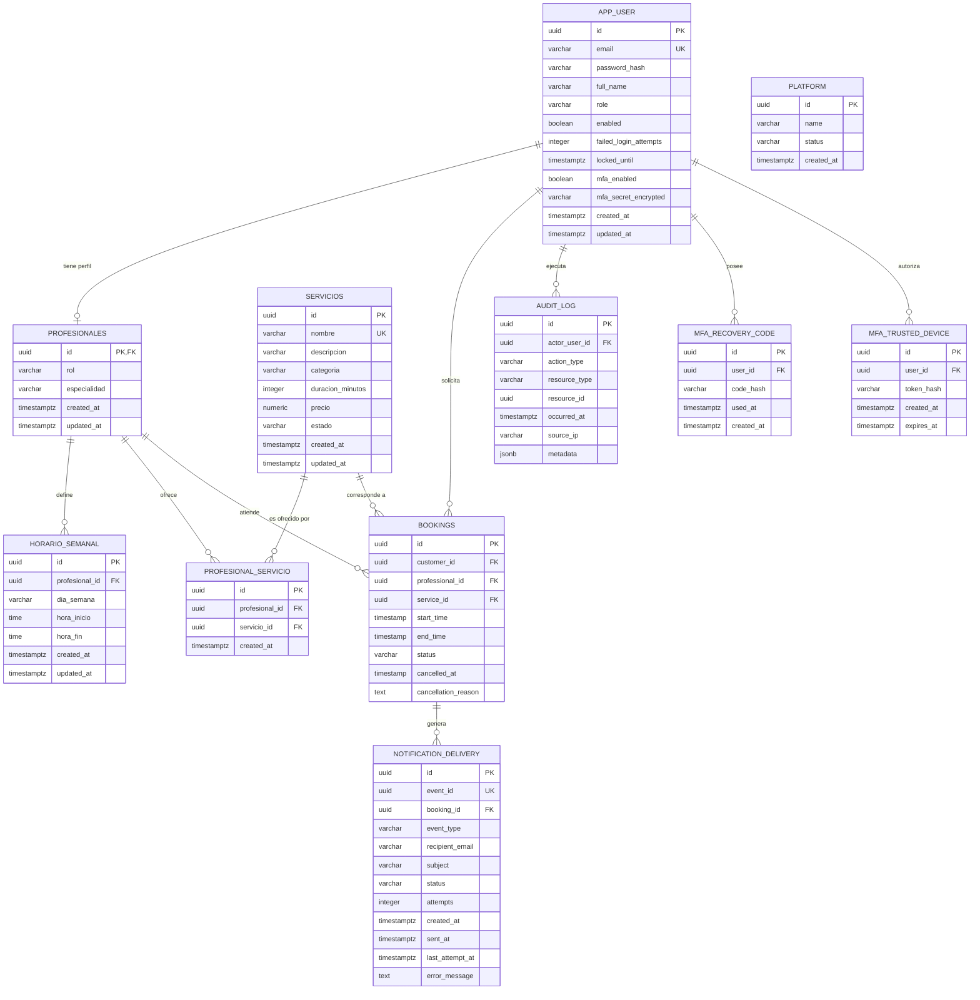

# Entregable de Bases de Datos - Sprint 2

## Caso 14: Plataforma de Reservas de Servicios

**EAV-10 CodeFactory** · Facultad de Ingeniería · Universidad de Antioquia
**Docente:** Angel Rey
**Repositorio principal:** [Code-Factory-Bookly/backendcf](https://github.com/Code-Factory-Bookly/backendcf)
**Proyecto Azure DevOps:** [CodeFactory EAV10](https://dev.azure.com/CodeFactoryEAV10/CodeFactory%20EAV10/)

**Integrantes:** Sofía Espinal Vasquez, Elena Vargas Grisales, Miguel Angel Marín Otalvaro.

## Propósito y alcance

Este repositorio contiene exclusivamente el entregable de Base de Datos del caso 14 Plataforma de Reservas de Servicios. El diseño se construyó a partir de las historias de usuario implementadas en los Sprints 1 y 2.

El Sprint 1 cubrió las cuentas, la plataforma, el catálogo de servicios y los perfiles profesionales. El Sprint 2 amplía el modelo con horarios, relación entre profesionales y servicios, reservas, auditoría, MFA y registro técnico de notificaciones.

La fuente técnica de referencia es el código SQL de Flyway ubicado en `src/main/resources/db/migration` del repositorio principal. Este repositorio conserva esas migraciones en `migrations/` y presenta además una versión académica autocontenida del modelo, separada del código Java de la aplicación.

## Cambios frente al Sprint 1

- Se agregó `horario_semanal` para las franjas de atención de los profesionales (HU-04).
- Se agregó `profesional_servicio` para relacionar profesionales con servicios (HU-07 y HU-08).
- Se agregó `bookings` para las reservas, sus estados y restricciones de horario (HU-08 y HU-09).
- Se agregó `audit_log` como bitácora inmutable de acciones críticas (HU-19).
- Se agregaron `mfa_recovery_code` y `mfa_trusted_device` para el segundo factor de administradores (HU-18).
- Se agregó `notification_delivery` para controlar la entrega idempotente de correos de reservas (HU-10).
- Se ampliaron las consultas de negocio para incluir reservas, notificaciones y auditoría.

## Diagrama ER refinado



`platform` mantiene una sola fila mediante un índice único sobre una expresión constante. `profesionales` comparte su identificador con `app_user` y utiliza una FK compuesta para aceptar únicamente cuentas con rol `PROFESSIONAL`. La unicidad parcial de `bookings` solo aplica a reservas `CONFIRMADA`, de modo que una franja cancelada pueda reutilizarse.

## Modelo lógico y restricciones principales

| Tabla | Clave primaria | Relaciones y reglas principales |
|---|---|---|
| `app_user` | `id` | Correo único; roles `CUSTOMER`, `PROFESSIONAL` y `ADMIN`; control de bloqueo y MFA. |
| `platform` | `id` | Una sola fila; estado `ACTIVE` o `SUSPENDED`. |
| `servicios` | `id` | Nombre único sin distinguir mayúsculas; duración de 1 a 480 minutos; precio positivo. |
| `profesionales` | `id` | FK compuesta a `app_user(id, role)`; solo rol `PROFESSIONAL`; especialidad obligatoria. |
| `horario_semanal` | `id` | FK a `profesionales`; día válido; `hora_fin > hora_inicio`; inicio único por profesional y día. |
| `profesional_servicio` | `id` | FKs a `profesionales` y `servicios`; combinación profesional-servicio única. |
| `bookings` | `id` | FKs a cliente, profesional y servicio; `start_time < end_time`; estados controlados; índice parcial contra dobles reservas confirmadas. |
| `audit_log` | `id` | FK al actor; acciones y recursos controlados; índices por fecha y actor; inmutable mediante triggers. |
| `mfa_recovery_code` | `id` | FK a `app_user`; almacena hashes de códigos de recuperación. |
| `mfa_trusted_device` | `id` | FK a `app_user`; token almacenado como hash y fecha de expiración. |
| `notification_delivery` | `id` | Evento único; FK a reserva; estados `PENDING`, `SENT` y `FAILED`; consistencia entre estado, fecha y error. |

El modelo conserva la separación de responsabilidades del Sprint 1 y evita duplicar información de usuarios, profesionales, servicios y reservas. Las relaciones se implementan mediante claves foráneas y las reglas críticas se sostienen en PostgreSQL mediante restricciones, índices y triggers.

## Normalización hasta tercera forma normal (3FN)

El modelo se diseñó para reducir la repetición de datos y evitar anomalías de inserción, actualización y eliminación, siguiendo el criterio de normalización indicado en la guía académica.

### Primera forma normal (1FN)

- Cada atributo contiene un valor individual y no existen grupos repetitivos de columnas.
- Las relaciones de muchos a muchos se separan en `profesional_servicio`.
- Los horarios se almacenan como filas independientes en `horario_semanal`.
- Los datos de una reserva, un servicio, un usuario y una notificación se almacenan en sus respectivas tablas.

### Segunda forma normal (2FN)

- Todas las tablas tienen una clave primaria definida.
- Las tablas operativas utilizan identificadores `UUID` simples, por lo que sus atributos dependen de la totalidad de la clave.
- En `profesional_servicio`, la combinación `profesional_id, servicio_id` es única y `created_at` describe la asociación completa, no solo una de sus partes.

### Tercera forma normal (3FN)

- Los datos comunes de una cuenta se mantienen únicamente en `app_user`; la información específica del profesional se mantiene en `profesionales`.
- Los datos descriptivos de los servicios se mantienen en `servicios` y no se repiten dentro de `bookings`.
- Los horarios, auditoría, MFA y notificaciones tienen responsabilidades independientes y se relacionan mediante claves foráneas.
- No se almacenan atributos que dependan de otro atributo no clave dentro de la misma entidad; las relaciones se reconstruyen mediante `JOIN`.

Existen algunas decisiones intencionales que pueden parecer redundantes, pero no rompen la integridad del modelo:

- `profesionales.rol` se mantiene junto con `id` para implementar la FK compuesta hacia `app_user(id, role)` y garantizar que el perfil corresponda a una cuenta con rol `PROFESSIONAL`.
- `notification_delivery.recipient_email` conserva el destinatario utilizado en el momento del envío. Funciona como una fotografía histórica de la notificación y no como una segunda fuente para los datos de la cuenta.
- `audit_log.metadata` utiliza `JSONB` porque una bitácora puede registrar información variable según el tipo de evento. No contiene atributos operativos principales del sistema.

Por estas razones, el modelo se considera normalizado hasta 3FN para el alcance del Sprint 2, manteniendo separadas las entidades y evitando duplicaciones que produzcan inconsistencias.

## Modelo físico detallado

La siguiente especificación complementa el diagrama lógico y permite verificar directamente el DDL de [`schema.sql`](schema.sql). `NOT NULL` identifica atributos obligatorios; cuando no se indica un valor por defecto, la aplicación debe proporcionarlo.

### `app_user`

| Atributo | Tipo | Null | Clave, valor predeterminado o regla |
|---|---|---|---|
| `id` | `UUID` | No | PK |
| `email` | `VARCHAR(320)` | No | Único |
| `password_hash` | `VARCHAR(255)` | No | Hash de contraseña |
| `full_name` | `VARCHAR(150)` | No | Nombre completo |
| `role` | `VARCHAR(30)` | No | `CUSTOMER`, `PROFESSIONAL` o `ADMIN` |
| `enabled` | `BOOLEAN` | No | Estado de acceso |
| `failed_login_attempts` | `INTEGER` | No | Default `0`; debe ser `>= 0` |
| `locked_until` | `TIMESTAMPTZ` | Sí | Fecha opcional de desbloqueo |
| `mfa_enabled` | `BOOLEAN` | No | Default `FALSE` |
| `mfa_secret_encrypted` | `VARCHAR(512)` | Sí | Secreto MFA cifrado |
| `created_at`, `updated_at` | `TIMESTAMPTZ` | No | Fechas de auditoría |

Restricciones adicionales: `UNIQUE(email)` y `UNIQUE(id, role)` para soportar la FK compuesta del perfil profesional.

### `platform`

| Atributo | Tipo | Null | Clave, valor predeterminado o regla |
|---|---|---|---|
| `id` | `UUID` | No | PK |
| `name` | `VARCHAR(200)` | No | Nombre de la plataforma |
| `status` | `VARCHAR(20)` | No | `ACTIVE` o `SUSPENDED` |
| `created_at` | `TIMESTAMPTZ` | No | Fecha de creación |

La tabla es singleton mediante el índice único `uk_platform_singleton` sobre una expresión constante.

### `servicios`

| Atributo | Tipo | Null | Clave, valor predeterminado o regla |
|---|---|---|---|
| `id` | `UUID` | No | PK |
| `nombre` | `VARCHAR(150)` | No | Único sin distinguir mayúsculas |
| `descripcion` | `VARCHAR(500)` | Sí | Descripción opcional |
| `categoria` | `VARCHAR(100)` | No | Categoría del servicio |
| `duracion_minutos` | `INTEGER` | No | Mayor que `0` y menor o igual a `480` |
| `precio` | `NUMERIC(12,2)` | No | Mayor que `0` |
| `estado` | `VARCHAR(20)` | No | Default `ACTIVO`; `ACTIVO` o `INACTIVO` |
| `created_at`, `updated_at` | `TIMESTAMPTZ` | No | Fechas de auditoría |

### `profesionales`

| Atributo | Tipo | Null | Clave, valor predeterminado o regla |
|---|---|---|---|
| `id` | `UUID` | No | PK y FK a `app_user(id, role)` |
| `rol` | `VARCHAR(30)` | No | Default `PROFESSIONAL`; solo permite ese valor |
| `especialidad` | `VARCHAR(100)` | No | No puede estar vacía |
| `created_at`, `updated_at` | `TIMESTAMPTZ` | No | Fechas de auditoría |

### `horario_semanal`

| Atributo | Tipo | Null | Clave, valor predeterminado o regla |
|---|---|---|---|
| `id` | `UUID` | No | PK |
| `profesional_id` | `UUID` | No | FK a `profesionales(id)` |
| `dia_semana` | `VARCHAR(10)` | No | Día válido de lunes a domingo |
| `hora_inicio`, `hora_fin` | `TIME` | No | `hora_fin > hora_inicio` |
| `created_at`, `updated_at` | `TIMESTAMPTZ` | No | Fechas de auditoría |

Restricción adicional: combinación única `profesional_id, dia_semana, hora_inicio`.

### `profesional_servicio`

| Atributo | Tipo | Null | Clave, valor predeterminado o regla |
|---|---|---|---|
| `id` | `UUID` | No | PK |
| `profesional_id` | `UUID` | No | FK a `profesionales(id)` |
| `servicio_id` | `UUID` | No | FK a `servicios(id)` |
| `created_at` | `TIMESTAMPTZ` | No | Fecha de asociación |

La combinación `profesional_id, servicio_id` es única.

### `bookings`

| Atributo | Tipo | Null | Clave, valor predeterminado o regla |
|---|---|---|---|
| `id` | `UUID` | No | PK; default `gen_random_uuid()` |
| `customer_id` | `UUID` | No | FK a `app_user(id)` |
| `professional_id` | `UUID` | No | FK a `profesionales(id)` |
| `service_id` | `UUID` | No | FK a `servicios(id)` |
| `start_time`, `end_time` | `TIMESTAMP` | No | `start_time < end_time` |
| `status` | `VARCHAR(50)` | No | Default `CONFIRMADA`; estados controlados |
| `created_at`, `updated_at` | `TIMESTAMP` | No | Default `CURRENT_TIMESTAMP` |
| `cancelled_at` | `TIMESTAMP` | Sí | Fecha opcional de cancelación |
| `cancellation_reason` | `TEXT` | Sí | Motivo opcional |

El índice único parcial `unique_booking_per_professional_time` impide duplicar una franja confirmada exactamente igual y la restricción `booking_no_overlapping_confirmed` impide que dos reservas confirmadas del mismo profesional se solapen.

### `audit_log`

| Atributo | Tipo | Null | Clave, valor predeterminado o regla |
|---|---|---|---|
| `id` | `UUID` | No | PK |
| `actor_user_id` | `UUID` | No | FK a `app_user(id)` |
| `action_type` | `VARCHAR(40)` | No | `BOOKING_CREATED`, `BOOKING_CANCELLED` o `ROLE_CHANGED` |
| `resource_type` | `VARCHAR(30)` | No | `BOOKING` o `USER` |
| `resource_id` | `UUID` | Sí | Recurso afectado |
| `occurred_at` | `TIMESTAMPTZ` | No | Fecha del evento |
| `source_ip` | `VARCHAR(45)` | Sí | IP opcional |
| `metadata` | `JSONB` | No | Default `'{}'::jsonb` |

Los triggers `trg_audit_log_immutable` y `trg_audit_log_no_truncate` rechazan `UPDATE`, `DELETE` y `TRUNCATE`.

### `mfa_recovery_code`

| Atributo | Tipo | Null | Clave, valor predeterminado o regla |
|---|---|---|---|
| `id` | `UUID` | No | PK |
| `user_id` | `UUID` | No | FK a `app_user(id)` |
| `code_hash` | `VARCHAR(255)` | No | Hash del código |
| `used_at` | `TIMESTAMPTZ` | Sí | Fecha opcional de uso |
| `created_at` | `TIMESTAMPTZ` | No | Fecha de creación |

### `mfa_trusted_device`

| Atributo | Tipo | Null | Clave, valor predeterminado o regla |
|---|---|---|---|
| `id` | `UUID` | No | PK |
| `user_id` | `UUID` | No | FK a `app_user(id)` |
| `token_hash` | `VARCHAR(255)` | No | Hash del token |
| `created_at` | `TIMESTAMPTZ` | No | Fecha de creación |
| `expires_at` | `TIMESTAMPTZ` | No | Fecha de expiración |

### `notification_delivery`

| Atributo | Tipo | Null | Clave, valor predeterminado o regla |
|---|---|---|---|
| `id` | `UUID` | No | PK; default `gen_random_uuid()` |
| `event_id` | `UUID` | No | Único para garantizar idempotencia |
| `booking_id` | `UUID` | No | FK a `bookings(id)` con `ON DELETE CASCADE` |
| `event_type` | `VARCHAR(40)` | No | Evento de creación, reprogramación o cancelación |
| `recipient_email` | `VARCHAR(320)` | No | Destinatario |
| `subject` | `VARCHAR(200)` | No | Asunto |
| `status` | `VARCHAR(20)` | No | Default `PENDING`; `PENDING`, `SENT` o `FAILED` |
| `attempts` | `INTEGER` | No | Default `0`; debe ser `>= 0` |
| `created_at` | `TIMESTAMPTZ` | No | Default `CURRENT_TIMESTAMP` |
| `sent_at`, `last_attempt_at` | `TIMESTAMPTZ` | Sí | Fechas del proceso de envío |
| `error_message` | `TEXT` | Sí | Obligatorio si `status = FAILED` |

Además, si el estado es `SENT`, `sent_at` debe existir; para otros estados debe ser `NULL`.

## Preguntas de negocio

Las cinco preguntas del Sprint 1 se mantienen y se amplían con preguntas del Sprint 2:

1. ¿Cuáles son los servicios activos con duración superior a 60 minutos?
2. ¿Qué profesionales tienen una especialidad determinada?
3. ¿Cuántas cuentas existen por rol?
4. ¿Qué cuentas tienen perfil profesional y cuál es su especialidad?
5. ¿Cuál es el precio promedio de los servicios activos por categoría?
6. ¿Qué reservas confirmadas tiene un profesional en un rango de fechas?
7. ¿Qué franjas de horario están ocupadas o pueden reutilizarse después de una cancelación?
8. ¿Qué notificaciones están pendientes o fallaron y deben reintentarse?
9. ¿Qué acciones críticas realizó un usuario en un período determinado?
10. ¿Qué profesionales ofrecen un servicio específico?

### Consultas del Sprint 1

#### 1. Servicios activos con duración superior a 60 minutos

```sql
SELECT id, nombre, categoria, duracion_minutos, precio
FROM servicios
WHERE estado = 'ACTIVO'
  AND duracion_minutos > 60
ORDER BY duracion_minutos DESC, nombre;
```

#### 2. Profesionales con una especialidad determinada

```sql
SELECT p.id, u.full_name, u.email, p.especialidad
FROM profesionales p
JOIN app_user u ON u.id = p.id
WHERE lower(p.especialidad) = lower('Ortodoncia')
ORDER BY u.full_name;
```

#### 3. Cantidad de cuentas por rol

```sql
SELECT role, COUNT(*) AS total_cuentas
FROM app_user
GROUP BY role
ORDER BY role;
```

#### 4. Cuentas con perfil profesional y especialidad

```sql
SELECT u.id, u.full_name, u.email, p.especialidad
FROM app_user u
JOIN profesionales p ON p.id = u.id
ORDER BY p.especialidad, u.full_name;
```

#### 5. Precio promedio de servicios activos por categoría

```sql
SELECT categoria,
       COUNT(*) AS total_servicios,
       ROUND(AVG(precio), 2) AS precio_promedio
FROM servicios
WHERE estado = 'ACTIVO'
GROUP BY categoria
ORDER BY categoria;
```

### Consultas del Sprint 2

#### 6. Reservas confirmadas de un profesional en un rango de fechas

```sql
WITH parametros AS (
    SELECT
        '00000000-0000-0000-0000-000000000000'::uuid AS profesional_id,
        CURRENT_TIMESTAMP::timestamp AS desde,
        (CURRENT_TIMESTAMP + INTERVAL '30 days')::timestamp AS hasta
)
SELECT b.id, b.start_time, b.end_time, b.status,
       u.full_name AS cliente, s.nombre AS servicio
FROM bookings b
JOIN app_user u ON u.id = b.customer_id
JOIN servicios s ON s.id = b.service_id
JOIN parametros p ON p.profesional_id = b.professional_id
WHERE b.status = 'CONFIRMADA'
  AND b.start_time >= p.desde
  AND b.start_time < p.hasta
ORDER BY b.start_time;
```

#### 7. Franjas de horario ocupadas o disponibles para reservar

```sql
WITH parametros AS (
    SELECT
        '00000000-0000-0000-0000-000000000000'::uuid AS profesional_id,
        CURRENT_DATE AS fecha
)
SELECT h.id, h.dia_semana, h.hora_inicio, h.hora_fin,
       (b.id IS NULL) AS franja_disponible,
       b.id AS reserva_id
FROM horario_semanal h
JOIN parametros p ON p.profesional_id = h.profesional_id
LEFT JOIN bookings b
       ON b.professional_id = h.profesional_id
      AND b.status = 'CONFIRMADA'
      AND b.start_time::date = p.fecha
      AND b.start_time::time < h.hora_fin
      AND b.end_time::time > h.hora_inicio
ORDER BY h.hora_inicio;
```

#### 8. Notificaciones pendientes o fallidas que pueden reintentarse

```sql
SELECT id, event_id, booking_id, recipient_email, attempts,
       status, last_attempt_at
FROM notification_delivery
WHERE status IN ('PENDING', 'FAILED')
ORDER BY last_attempt_at NULLS FIRST, created_at
LIMIT 100;
```

#### 9. Acciones críticas realizadas por un usuario en un período

```sql
WITH parametros AS (
    SELECT
        '00000000-0000-0000-0000-000000000000'::uuid AS actor_id,
        CURRENT_TIMESTAMP - INTERVAL '30 days' AS desde,
        CURRENT_TIMESTAMP AS hasta
)
SELECT a.id, a.action_type, a.resource_type, a.resource_id,
       a.occurred_at, a.metadata
FROM audit_log a
JOIN parametros p ON p.actor_id = a.actor_user_id
WHERE a.occurred_at >= p.desde
  AND a.occurred_at < p.hasta
ORDER BY a.occurred_at DESC, a.id DESC;
```

#### 10. Profesionales que ofrecen un servicio específico

```sql
SELECT p.id AS profesional_id, u.full_name, u.email,
       s.id AS servicio_id, s.nombre AS servicio
FROM profesional_servicio ps
JOIN profesionales p ON p.id = ps.profesional_id
JOIN app_user u ON u.id = p.id
JOIN servicios s ON s.id = ps.servicio_id
WHERE lower(s.nombre) = lower('Consulta general')
ORDER BY u.full_name;
```

Las consultas 2, 4, 6, 7, 9 y 10 incluyen reuniones (`JOIN` o `LEFT JOIN`); las consultas 3 y 5 incluyen agregaciones. Los valores UUID y nombres utilizados como ejemplo pueden reemplazarse por datos existentes sin cambiar la estructura de las consultas.

## Estimación de volumen y crecimiento

Las siguientes cifras son supuestos académicos para dimensionar el sistema; no representan datos reales de producción. Se considera una primera etapa con una sede de servicios, crecimiento constante durante el primer año y retención de los registros históricos para auditoría y trazabilidad.

| Tabla | Registros iniciales estimados | Crecimiento esperado | Supuesto de cálculo |
|---|---:|---:|---|
| `app_user` | 1.000 | 300 por mes | Clientes, profesionales y administradores registrados; se conservan las cuentas deshabilitadas. |
| `platform` | 1 | 0 | La configuración es singleton y se actualiza, no se crean nuevas filas. |
| `servicios` | 50 | 5 por mes | Catálogo inicial de servicios; el crecimiento depende de nuevos servicios ofrecidos. |
| `profesionales` | 100 | 10 por mes | Aproximadamente uno de cada diez usuarios iniciales es profesional. |
| `horario_semanal` | 700 | 70 por mes | Siete franjas promedio por profesional; cada profesional puede reemplazar su horario. |
| `profesional_servicio` | 250 | 25 por mes | Cada profesional ofrece entre dos y tres servicios en promedio. |
| `bookings` | 5.000 | 500 por mes | Reservas confirmadas, canceladas y completadas; se conserva el historial. |
| `audit_log` | 10.000 | 2.000 por mes | Aproximadamente cuatro acciones críticas registradas por reserva, además de cambios de rol. |
| `mfa_recovery_code` | 500 | 150 por mes | Cinco códigos por cada cuenta administrativa con MFA; se generan nuevos códigos cuando se regeneran. |
| `mfa_trusted_device` | 200 | 60 por mes | Dos dispositivos confiables promedio por administrador; se conservan hasta su expiración o limpieza. |
| `notification_delivery` | 7.500 | 750 por mes | En promedio 1,5 notificaciones técnicas por reserva, incluyendo creación y cancelación. |

### Supuestos generales

- El sistema inicia con 1.000 cuentas, 100 profesionales y 50 servicios.
- El crecimiento mensual se estima para los primeros doce meses y debe revisarse con métricas reales.
- Las reservas y la auditoría son datos históricos: cancelar una reserva no elimina su registro.
- `notification_delivery` conserva los intentos de entrega para permitir reintentos y trazabilidad.
- Los códigos de recuperación y dispositivos confiables pueden crecer por regeneraciones y nuevos dispositivos; una política de limpieza puede reducir el volumen real.
- No se considera particionamiento en esta etapa porque los volúmenes iniciales son pequeños; se reevaluará cuando `bookings` o `audit_log` superen varios millones de filas.

## Roles y esquema de seguridad

Los roles funcionales de la aplicación (`CUSTOMER`, `PROFESSIONAL` y `ADMIN`) representan permisos de negocio almacenados en `app_user.role`. Son diferentes de los roles técnicos de PostgreSQL, que controlan el acceso directo al esquema.

La propuesta aplica mínimo privilegio:

| Rol PostgreSQL | Permisos principales | Uso |
|---|---|---|
| `bookly_admin` | Todos los privilegios sobre tablas y funciones | Administración, migraciones y mantenimiento controlado. |
| `bookly_app` | Lectura y escritura limitada en tablas operativas; sin `DELETE` sobre datos de negocio | Usuario de conexión de la aplicación. |
| `bookly_readonly` | Solo `SELECT` | Reportes, consultas académicas y monitoreo. |

Reglas de seguridad documentadas:

- Se revoca `CREATE` sobre el esquema `public` para `PUBLIC`.
- `bookly_app` no puede crear tablas ni modificar la bitácora `audit_log`.
- `bookly_readonly` no puede insertar, actualizar, eliminar ni truncar datos.
- La auditoría se conserva mediante el trigger de inmutabilidad definido en `schema.sql`.
- Las credenciales reales no se almacenan en este repositorio; los roles se crean sin login y se asignan a usuarios de conexión según el entorno.

El script ejecutable de creación de roles y privilegios está en [`docs/roles-seguridad.sql`](docs/roles-seguridad.sql). Debe ejecutarse con un usuario administrador después de crear el esquema.

## Archivos del entregable

- `schema.sql`: script DDL autocontenido y ejecutable sobre PostgreSQL vacío, con las tablas y restricciones del Sprint 2.
- `migrations/`: migraciones Flyway locales, desde `V1` hasta `V46`, que representan la evolución incremental del esquema.
- `docs/roles-seguridad.sql`: roles PostgreSQL, permisos y revocaciones según mínimo privilegio.
- [`docs/analisis-almacenamiento.md`](docs/analisis-almacenamiento.md): documento completo con el análisis de almacenamiento, índices, costo de una consulta y optimización algebraica exigido en los criterios 7, 8 y 9.
- `evidence/`: evidencias de ejecución del esquema y de las restricciones principales.

## Evidencias del Sprint 2

### Esquema y estructura

- [Ejecución exitosa de `schema.sql`](evidence/01-schema-sprint2-ejecutado.png)
- [Tablas creadas](evidence/02-tablas-sprint2.png)
- [Estructura de `bookings`](evidence/03a-bookings-estructura.png)
- [Estructura de `profesionales`](evidence/03b-profesionales-estructura.png)
- [Estructura de `notification_delivery`](evidence/03c-notificaciones-estructura.png)

### Integridad, seguridad y consultas

- [Auditoría inmutable](evidence/04-auditoria-inmutable.png)
- [Roles y privilegios](evidence/05-roles-privilegios.png)
- [Consultas de reservas y notificaciones](evidence/06a-consultas-reservas-notificaciones.png)
- [Consultas de auditoría, servicios y horarios](evidence/06b-consultas-auditoria-servicio-horario.png)
- [Plan de ejecución de consulta con `JOIN`](evidence/07-explain-consulta.png)

### Validación final en Supabase

- [Tablas creadas por el `schema.sql` final](evidence/08-supabase-tablas.png)
- [Restricción contra solapamiento de reservas confirmadas](evidence/09-supabase-restriccion-bookings.png)
- [Índices de `bookings`](evidence/10-supabase-indices-bookings.png)

### Documento de análisis

En este documento [`docs/analisis-almacenamiento.md`](docs/analisis-almacenamiento.md) se contienen los supuestos, fórmulas, cálculos paso a paso, comparación de costos y transformaciones algebraicas.

## Ejecución y validación

Para revisar el estado consolidado, crear una base PostgreSQL vacía y ejecutar `schema.sql`. Este script ya incluye las extensiones, tablas, restricciones, índices y triggers del Sprint 2.

Para reproducir la evolución mediante Flyway, ejecutar en orden los archivos de `migrations/` (`V1` a `V46`) sobre una base compatible con la configuración de Flyway del proyecto principal. No se deben ejecutar `schema.sql` y las migraciones Flyway sobre la misma base, porque representan dos formas alternativas de construir el esquema.

Después de cualquiera de las dos opciones:

1. Verificar las tablas, restricciones, índices y triggers con `\\dt`, `\\d nombre_tabla` y consultas a `pg_indexes`.
2. Ejecutar las consultas de negocio documentadas.
3. Validar que `audit_log` rechace `UPDATE`, `DELETE` y `TRUNCATE`.
4. Validar que dos reservas confirmadas solapadas no sean aceptadas para el mismo profesional.
5. Registrar en `evidence/` capturas o salidas de las validaciones.

## Fuente de trazabilidad

Las decisiones del modelo se contrastaron con la rama `main` del repositorio principal, especialmente con:

- `src/main/resources/db/migration/V10__create_weekly_schedule.sql`
- `src/main/resources/db/migration/V30__create_bookings.sql`
- `src/main/resources/db/migration/V31__allow_rebooking_cancelled_slots.sql`
- `src/main/resources/db/migration/V40__create_audit_log.sql`
- `src/main/resources/db/migration/V41__mfa_totp.sql`
- `src/main/resources/db/migration/V42__mfa_trusted_devices.sql`
- `src/main/resources/db/migration/V43__create_notification_delivery.sql`
- `src/main/resources/db/migration/V44__cascade_notification_delivery_booking.sql`
- `src/main/resources/db/migration/V45__create_professional_service.sql`
- `src/main/resources/db/migration/V46__prevent_overlapping_confirmed_bookings.sql`

La matriz de roles PostgreSQL, la estimación de volumen y el análisis de costos quedan documentados en este README y en [`docs/analisis-almacenamiento.md`](docs/analisis-almacenamiento.md), conforme a los requerimientos de entrega del Sprint 2.
