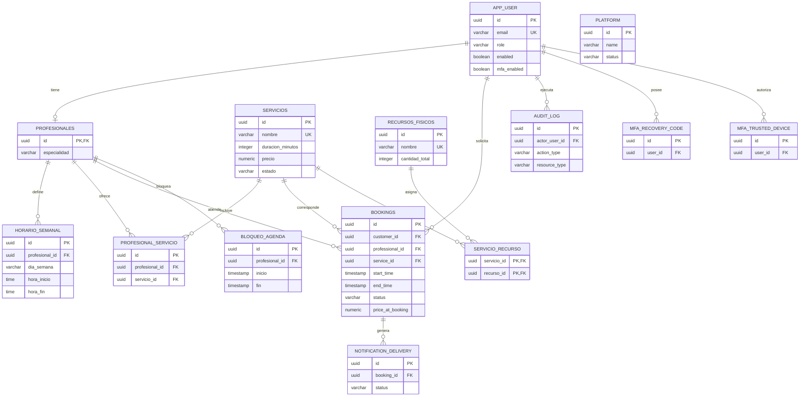

# Entregable de Bases de Datos - Sprint 3

## Caso 14: Plataforma de Reservas de Servicios

**EAV-10 CodeFactory** · Facultad de Ingeniería · Universidad de Antioquia
**Docente:** Angel Rey
**Repositorio principal:** [Code-Factory-Bookly/backendcf](https://github.com/Code-Factory-Bookly/backendcf)
**Proyecto Azure DevOps:** [CodeFactory EAV10](https://dev.azure.com/CodeFactoryEAV10/CodeFactory%20EAV10/)

**Integrantes:** Sofía Espinal Vasquez, Elena Vargas Grisales, Miguel Angel Marín Otalvaro, Ana María Garzón Giraldo, Adelaida Rodriguez García

## Propósito y alcance

Este repositorio contiene exclusivamente el entregable de Base de Datos del caso 14 Plataforma de Reservas de Servicios. El diseño se construyó a partir de las historias de usuario implementadas en los Sprints 1 y 2.

El Sprint 1 cubrió las cuentas, la plataforma, el catálogo de servicios y los perfiles profesionales. El Sprint 2 amplió el modelo con horarios, relación entre profesionales y servicios, reservas, auditoría, MFA y registro técnico de notificaciones. El Sprint 3 incorpora bloqueos, recursos físicos, precio histórico, consultas de reportes y auditoría adicional.

La fuente técnica de referencia es el código SQL de Flyway ubicado en `src/main/resources/db/migration` del repositorio principal. Este repositorio conserva esas migraciones en `migrations/` y presenta además una versión académica autocontenida del modelo, separada del código Java de la aplicación.

## Cambios frente al Sprint 1

- Se agregó `horario_semanal` para las franjas de atención de los profesionales (HU-04).
- Se agregó `profesional_servicio` para relacionar profesionales con servicios (HU-07 y HU-08).
- Se agregó `bookings` para las reservas, sus estados y restricciones de horario (HU-08 y HU-09).
- Se agregó `audit_log` como bitácora inmutable de acciones críticas (HU-19).
- Se agregaron `mfa_recovery_code` y `mfa_trusted_device` para el segundo factor de administradores (HU-18).
- Se agregó `notification_delivery` para controlar la entrega idempotente de correos de reservas (HU-10).
- Se ampliaron las consultas de negocio para incluir reservas, notificaciones y auditoría.

## Cambios respecto al Sprint 2

- Se modificó la regla de solapamiento para que las reservas `CONFIRMADA`, `RESCHEDULED` y `COMPLETED` ocupen agenda.
- Se agregó `bloqueo_agenda` para registrar bloqueos temporales sin rangos invertidos ni solapamientos del mismo profesional (HU-05).
- Se agregaron `recursos_fisicos` y `servicio_recurso` para controlar recursos y su relación con los servicios (HU-11 y HU-12).
- Se agregó `bookings.price_at_booking` para conservar el precio histórico usado en cada reserva (HU-16).
- Se agregaron índices para consultas de reportes y se ampliaron los dominios de auditoría con `REPORT_VIEWED` y `CUSTOMER_HISTORY_VIEWED` (HU-13 y HU-16).
- Se agregó la función `get_customer_booking_history` para consultar el historial de un cliente con filtros opcionales de fecha (HU-13).
- Se actualizaron los roles técnicos para cubrir las tablas nuevas y el permiso `EXECUTE` de la función.

## Diagrama ER refinado



<details>
<summary>Fuente editable del diagrama draw.io</summary>

```xml
<mxfile>
  <diagram id="Apu7d7yXoVykscMsgzfk" name="Page-1">
    <mxGraphModel dx="2628" dy="2450" grid="1" gridSize="10" guides="1" tooltips="0" connect="1" arrows="1" fold="1" page="1" pageScale="1" pageWidth="827" pageHeight="1169" math="0" shadow="0">
      <root>
        <mxCell id="0" />
        <mxCell id="1" parent="0" />
        <UserObject label="" mermaidData="{&#xa;  &quot;data&quot;: &quot;erDiagram\n    APP_USER ||--o| PROFESIONALES : \&quot;tiene perfil\&quot;\n    PROFESIONALES ||--o{ HORARIO_SEMANAL : \&quot;define\&quot;\n    PROFESIONALES ||--o{ PROFESIONAL_SERVICIO : \&quot;ofrece\&quot;\n    SERVICIOS ||--o{ PROFESIONAL_SERVICIO : \&quot;es ofrecido por\&quot;\n    APP_USER ||--o{ BOOKINGS : \&quot;solicita\&quot;\n    PROFESIONALES ||--o{ BOOKINGS : \&quot;atiende\&quot;\n    SERVICIOS ||--o{ BOOKINGS : \&quot;corresponde a\&quot;\n    BOOKINGS ||--o{ NOTIFICATION_DELIVERY : \&quot;genera\&quot;\n    PROFESIONALES ||--o{ BLOQUEO_AGENDA : \&quot;bloquea\&quot;\n    SERVICIOS ||--o{ SERVICIO_RECURSO : \&quot;requiere\&quot;\n    RECURSOS_FISICOS ||--o{ SERVICIO_RECURSO : \&quot;se asigna\&quot;\n    APP_USER ||--o{ AUDIT_LOG : \&quot;ejecuta\&quot;\n    APP_USER ||--o{ MFA_RECOVERY_CODE : \&quot;posee\&quot;\n    APP_USER ||--o{ MFA_TRUSTED_DEVICE : \&quot;autoriza\&quot;\n\n    APP_USER {\n        uuid id PK\n        varchar email UK\n        varchar password_hash\n        varchar full_name\n        varchar role\n        boolean enabled\n        integer failed_login_attempts\n        timestamptz locked_until\n        boolean mfa_enabled\n        varchar mfa_secret_encrypted\n        timestamptz created_at\n        timestamptz updated_at\n    }\n    PLATFORM {\n        uuid id PK\n        varchar name\n        varchar status\n        timestamptz created_at\n    }\n    SERVICIOS {\n        uuid id PK\n        varchar nombre UK\n        varchar descripcion\n        varchar categoria\n        integer duracion_minutos\n        numeric precio\n        varchar estado\n        timestamptz created_at\n        timestamptz updated_at\n    }\n    PROFESIONALES {\n        uuid id PK, FK\n        varchar rol\n        varchar especialidad\n        timestamptz created_at\n        timestamptz updated_at\n    }\n    HORARIO_SEMANAL {\n        uuid id PK\n        uuid profesional_id FK\n        varchar dia_semana\n        time hora_inicio\n        time hora_fin\n        timestamptz created_at\n        timestamptz updated_at\n    }\n    PROFESIONAL_SERVICIO {\n        uuid id PK\n        uuid profesional_id FK\n        uuid servicio_id FK\n        timestamptz created_at\n    }\n    BOOKINGS {\n        uuid id PK\n        uuid customer_id FK\n        uuid professional_id FK\n        uuid service_id FK\n        timestamp start_time\n        timestamp end_time\n        varchar status\n        numeric price_at_booking\n        timestamp cancelled_at\n        text cancellation_reason\n    }\n    AUDIT_LOG {\n        uuid id PK\n        uuid actor_user_id FK\n        varchar action_type\n        varchar resource_type\n        uuid resource_id\n        timestamptz occurred_at\n        varchar source_ip\n        jsonb metadata\n    }\n    MFA_RECOVERY_CODE {\n        uuid id PK\n        uuid user_id FK\n        varchar code_hash\n        timestamptz used_at\n        timestamptz created_at\n    }\n    MFA_TRUSTED_DEVICE {\n        uuid id PK\n        uuid user_id FK\n        varchar token_hash\n        timestamptz created_at\n        timestamptz expires_at\n    }\n    NOTIFICATION_DELIVERY {\n        uuid id PK\n        uuid event_id UK\n        uuid booking_id FK\n        varchar event_type\n        varchar recipient_email\n        varchar subject\n        varchar status\n        integer attempts\n        timestamptz created_at\n        timestamptz sent_at\n        timestamptz last_attempt_at\n        text error_message\n    }\n    BLOQUEO_AGENDA {\n        uuid id PK\n        uuid profesional_id FK\n        timestamp inicio\n        timestamp fin\n        varchar motivo\n        timestamptz created_at\n    }\n    RECURSOS_FISICOS {\n        uuid id PK\n        varchar nombre UK\n        integer cantidad_total\n        timestamptz created_at\n        timestamptz updated_at\n    }\n    SERVICIO_RECURSO {\n        uuid servicio_id PK, FK\n        uuid recurso_id PK, FK\n    }&quot;,&#xa;  &quot;config&quot;: null&#xa;}" id="406">
          <mxCell connectable="0" parent="1" style="group;transparentBounds=1;editIcon=1;lockedGroup=0;groupPadding=10;" vertex="1">
            <mxGeometry as="geometry" />
          </mxCell>
        </UserObject>
        <UserObject label="APP_USER" mermaidId="n:APP_USER" mermaidBaseStyle="shape=table;startSize=43;container=1;collapsible=0;childLayout=tableLayout;fixedRows=1;rowLines=1;fontSize=16;fontFamily=Trebuchet MS,Verdana,Arial,sans-serif;strokeWidth=1;align=center;resizeLast=1;html=1;fillColor=light-dark(#ECECFF,#1f2020);strokeColor=light-dark(#9370DB,#cccccc);fontColor=light-dark(#333333,#cccccc);" mermaidBaseValue="APP_USER" id="2">
          <mxCell parent="406" style="shape=table;startSize=43;container=1;collapsible=0;childLayout=tableLayout;fixedRows=1;rowLines=1;fontSize=16;fontFamily=Trebuchet MS,Verdana,Arial,sans-serif;strokeWidth=1;align=center;resizeLast=1;html=1;fillColor=light-dark(#ECECFF,#1f2020);strokeColor=light-dark(#9370DB,#cccccc);fontColor=light-dark(#333333,#cccccc);" vertex="1">
            <mxGeometry height="559" width="346" x="1476" y="10" as="geometry" />
          </mxCell>
        </UserObject>
        <mxCell id="3" parent="2" style="shape=tableRow;horizontal=0;startSize=0;swimlaneHead=0;swimlaneBody=1;fillColor=light-dark(#ffffff,#1f2020);strokeColor=inherit;strokeWidth=1;collapsible=0;dropTarget=0;points=[[0,0.5],[1,0.5]];portConstraint=eastwest;top=0;left=0;right=0;bottom=0;" vertex="1">
          <mxGeometry height="43" width="346" y="43" as="geometry" />
        </mxCell>
        <mxCell id="4" parent="3" style="shape=partialRectangle;connectable=0;fillColor=none;strokeColor=light-dark(#9370DB,#cccccc);strokeWidth=1;fontColor=light-dark(#333333,#cccccc);fontFamily=Trebuchet MS,Verdana,Arial,sans-serif;top=1;left=1;bottom=1;right=1;align=left;spacingLeft=8;overflow=hidden;fontSize=16;" value="uuid" vertex="1">
          <mxGeometry height="43" width="115" as="geometry" />
        </mxCell>
        <mxCell id="5" parent="3" style="shape=partialRectangle;connectable=0;fillColor=none;strokeColor=light-dark(#9370DB,#cccccc);strokeWidth=1;fontColor=light-dark(#333333,#cccccc);fontFamily=Trebuchet MS,Verdana,Arial,sans-serif;top=1;left=1;bottom=1;right=1;align=left;spacingLeft=8;overflow=hidden;fontSize=16;" value="id" vertex="1">
          <mxGeometry height="43" width="186" x="115" as="geometry" />
        </mxCell>
        <mxCell id="6" parent="3" style="shape=partialRectangle;connectable=0;fillColor=none;strokeColor=light-dark(#9370DB,#cccccc);strokeWidth=1;fontColor=light-dark(#333333,#cccccc);fontFamily=Trebuchet MS,Verdana,Arial,sans-serif;top=1;left=1;bottom=1;right=1;align=left;spacingLeft=8;overflow=hidden;fontSize=16;" value="PK" vertex="1">
          <mxGeometry height="43" width="45" x="301" as="geometry" />
        </mxCell>
        <mxCell id="7" parent="2" style="shape=tableRow;horizontal=0;startSize=0;swimlaneHead=0;swimlaneBody=1;fillColor=light-dark(#F1F1FF,#1f2020);strokeColor=inherit;strokeWidth=1;collapsible=0;dropTarget=0;points=[[0,0.5],[1,0.5]];portConstraint=eastwest;top=0;left=0;right=0;bottom=0;" vertex="1">
          <mxGeometry height="43" width="346" y="86" as="geometry" />
        </mxCell>
        <mxCell id="8" parent="7" style="shape=partialRectangle;connectable=0;fillColor=none;strokeColor=light-dark(#9370DB,#cccccc);strokeWidth=1;fontColor=light-dark(#333333,#cccccc);fontFamily=Trebuchet MS,Verdana,Arial,sans-serif;top=1;left=1;bottom=1;right=1;align=left;spacingLeft=8;overflow=hidden;fontSize=16;" value="varchar" vertex="1">
          <mxGeometry height="43" width="115" as="geometry" />
        </mxCell>
        <mxCell id="9" parent="7" style="shape=partialRectangle;connectable=0;fillColor=none;strokeColor=light-dark(#9370DB,#cccccc);strokeWidth=1;fontColor=light-dark(#333333,#cccccc);fontFamily=Trebuchet MS,Verdana,Arial,sans-serif;top=1;left=1;bottom=1;right=1;align=left;spacingLeft=8;overflow=hidden;fontSize=16;" value="email" vertex="1">
          <mxGeometry height="43" width="186" x="115" as="geometry" />
        </mxCell>
        <mxCell id="10" parent="7" style="shape=partialRectangle;connectable=0;fillColor=none;strokeColor=light-dark(#9370DB,#cccccc);strokeWidth=1;fontColor=light-dark(#333333,#cccccc);fontFamily=Trebuchet MS,Verdana,Arial,sans-serif;top=1;left=1;bottom=1;right=1;align=left;spacingLeft=8;overflow=hidden;fontSize=16;" value="UK" vertex="1">
          <mxGeometry height="43" width="45" x="301" as="geometry" />
        </mxCell>
        <mxCell id="11" parent="2" style="shape=tableRow;horizontal=0;startSize=0;swimlaneHead=0;swimlaneBody=1;fillColor=light-dark(#ffffff,#1f2020);strokeColor=inherit;strokeWidth=1;collapsible=0;dropTarget=0;points=[[0,0.5],[1,0.5]];portConstraint=eastwest;top=0;left=0;right=0;bottom=0;" vertex="1">
          <mxGeometry height="43" width="346" y="129" as="geometry" />
        </mxCell>
        <mxCell id="12" parent="11" style="shape=partialRectangle;connectable=0;fillColor=none;strokeColor=light-dark(#9370DB,#cccccc);strokeWidth=1;fontColor=light-dark(#333333,#cccccc);fontFamily=Trebuchet MS,Verdana,Arial,sans-serif;top=1;left=1;bottom=1;right=1;align=left;spacingLeft=8;overflow=hidden;fontSize=16;" value="varchar" vertex="1">
          <mxGeometry height="43" width="115" as="geometry" />
        </mxCell>
        <mxCell id="13" parent="11" style="shape=partialRectangle;connectable=0;fillColor=none;strokeColor=light-dark(#9370DB,#cccccc);strokeWidth=1;fontColor=light-dark(#333333,#cccccc);fontFamily=Trebuchet MS,Verdana,Arial,sans-serif;top=1;left=1;bottom=1;right=1;align=left;spacingLeft=8;overflow=hidden;fontSize=16;" value="password_hash" vertex="1">
          <mxGeometry height="43" width="186" x="115" as="geometry" />
        </mxCell>
        <mxCell id="14" parent="11" style="shape=partialRectangle;connectable=0;fillColor=none;strokeColor=light-dark(#9370DB,#cccccc);strokeWidth=1;fontColor=light-dark(#333333,#cccccc);fontFamily=Trebuchet MS,Verdana,Arial,sans-serif;top=1;left=1;bottom=1;right=1;align=left;spacingLeft=8;overflow=hidden;fontSize=16;" value="" vertex="1">
          <mxGeometry height="43" width="45" x="301" as="geometry" />
        </mxCell>
        <mxCell id="15" parent="2" style="shape=tableRow;horizontal=0;startSize=0;swimlaneHead=0;swimlaneBody=1;fillColor=light-dark(#F1F1FF,#1f2020);strokeColor=inherit;strokeWidth=1;collapsible=0;dropTarget=0;points=[[0,0.5],[1,0.5]];portConstraint=eastwest;top=0;left=0;right=0;bottom=0;" vertex="1">
          <mxGeometry height="43" width="346" y="172" as="geometry" />
        </mxCell>
        <mxCell id="16" parent="15" style="shape=partialRectangle;connectable=0;fillColor=none;strokeColor=light-dark(#9370DB,#cccccc);strokeWidth=1;fontColor=light-dark(#333333,#cccccc);fontFamily=Trebuchet MS,Verdana,Arial,sans-serif;top=1;left=1;bottom=1;right=1;align=left;spacingLeft=8;overflow=hidden;fontSize=16;" value="varchar" vertex="1">
          <mxGeometry height="43" width="115" as="geometry" />
        </mxCell>
        <mxCell id="17" parent="15" style="shape=partialRectangle;connectable=0;fillColor=none;strokeColor=light-dark(#9370DB,#cccccc);strokeWidth=1;fontColor=light-dark(#333333,#cccccc);fontFamily=Trebuchet MS,Verdana,Arial,sans-serif;top=1;left=1;bottom=1;right=1;align=left;spacingLeft=8;overflow=hidden;fontSize=16;" value="full_name" vertex="1">
          <mxGeometry height="43" width="186" x="115" as="geometry" />
        </mxCell>
        <mxCell id="18" parent="15" style="shape=partialRectangle;connectable=0;fillColor=none;strokeColor=light-dark(#9370DB,#cccccc);strokeWidth=1;fontColor=light-dark(#333333,#cccccc);fontFamily=Trebuchet MS,Verdana,Arial,sans-serif;top=1;left=1;bottom=1;right=1;align=left;spacingLeft=8;overflow=hidden;fontSize=16;" value="" vertex="1">
          <mxGeometry height="43" width="45" x="301" as="geometry" />
        </mxCell>
        <mxCell id="19" parent="2" style="shape=tableRow;horizontal=0;startSize=0;swimlaneHead=0;swimlaneBody=1;fillColor=light-dark(#ffffff,#1f2020);strokeColor=inherit;strokeWidth=1;collapsible=0;dropTarget=0;points=[[0,0.5],[1,0.5]];portConstraint=eastwest;top=0;left=0;right=0;bottom=0;" vertex="1">
          <mxGeometry height="43" width="346" y="215" as="geometry" />
        </mxCell>
        <mxCell id="20" parent="19" style="shape=partialRectangle;connectable=0;fillColor=none;strokeColor=light-dark(#9370DB,#cccccc);strokeWidth=1;fontColor=light-dark(#333333,#cccccc);fontFamily=Trebuchet MS,Verdana,Arial,sans-serif;top=1;left=1;bottom=1;right=1;align=left;spacingLeft=8;overflow=hidden;fontSize=16;" value="varchar" vertex="1">
          <mxGeometry height="43" width="115" as="geometry" />
        </mxCell>
        <mxCell id="21" parent="19" style="shape=partialRectangle;connectable=0;fillColor=none;strokeColor=light-dark(#9370DB,#cccccc);strokeWidth=1;fontColor=light-dark(#333333,#cccccc);fontFamily=Trebuchet MS,Verdana,Arial,sans-serif;top=1;left=1;bottom=1;right=1;align=left;spacingLeft=8;overflow=hidden;fontSize=16;" value="role" vertex="1">
          <mxGeometry height="43" width="186" x="115" as="geometry" />
        </mxCell>
        <mxCell id="22" parent="19" style="shape=partialRectangle;connectable=0;fillColor=none;strokeColor=light-dark(#9370DB,#cccccc);strokeWidth=1;fontColor=light-dark(#333333,#cccccc);fontFamily=Trebuchet MS,Verdana,Arial,sans-serif;top=1;left=1;bottom=1;right=1;align=left;spacingLeft=8;overflow=hidden;fontSize=16;" value="" vertex="1">
          <mxGeometry height="43" width="45" x="301" as="geometry" />
        </mxCell>
        <mxCell id="23" parent="2" style="shape=tableRow;horizontal=0;startSize=0;swimlaneHead=0;swimlaneBody=1;fillColor=light-dark(#F1F1FF,#1f2020);strokeColor=inherit;strokeWidth=1;collapsible=0;dropTarget=0;points=[[0,0.5],[1,0.5]];portConstraint=eastwest;top=0;left=0;right=0;bottom=0;" vertex="1">
          <mxGeometry height="43" width="346" y="258" as="geometry" />
        </mxCell>
        <mxCell id="24" parent="23" style="shape=partialRectangle;connectable=0;fillColor=none;strokeColor=light-dark(#9370DB,#cccccc);strokeWidth=1;fontColor=light-dark(#333333,#cccccc);fontFamily=Trebuchet MS,Verdana,Arial,sans-serif;top=1;left=1;bottom=1;right=1;align=left;spacingLeft=8;overflow=hidden;fontSize=16;" value="boolean" vertex="1">
          <mxGeometry height="43" width="115" as="geometry" />
        </mxCell>
        <mxCell id="25" parent="23" style="shape=partialRectangle;connectable=0;fillColor=none;strokeColor=light-dark(#9370DB,#cccccc);strokeWidth=1;fontColor=light-dark(#333333,#cccccc);fontFamily=Trebuchet MS,Verdana,Arial,sans-serif;top=1;left=1;bottom=1;right=1;align=left;spacingLeft=8;overflow=hidden;fontSize=16;" value="enabled" vertex="1">
          <mxGeometry height="43" width="186" x="115" as="geometry" />
        </mxCell>
        <mxCell id="26" parent="23" style="shape=partialRectangle;connectable=0;fillColor=none;strokeColor=light-dark(#9370DB,#cccccc);strokeWidth=1;fontColor=light-dark(#333333,#cccccc);fontFamily=Trebuchet MS,Verdana,Arial,sans-serif;top=1;left=1;bottom=1;right=1;align=left;spacingLeft=8;overflow=hidden;fontSize=16;" value="" vertex="1">
          <mxGeometry height="43" width="45" x="301" as="geometry" />
        </mxCell>
        <mxCell id="27" parent="2" style="shape=tableRow;horizontal=0;startSize=0;swimlaneHead=0;swimlaneBody=1;fillColor=light-dark(#ffffff,#1f2020);strokeColor=inherit;strokeWidth=1;collapsible=0;dropTarget=0;points=[[0,0.5],[1,0.5]];portConstraint=eastwest;top=0;left=0;right=0;bottom=0;" vertex="1">
          <mxGeometry height="43" width="346" y="301" as="geometry" />
        </mxCell>
        <mxCell id="28" parent="27" style="shape=partialRectangle;connectable=0;fillColor=none;strokeColor=light-dark(#9370DB,#cccccc);strokeWidth=1;fontColor=light-dark(#333333,#cccccc);fontFamily=Trebuchet MS,Verdana,Arial,sans-serif;top=1;left=1;bottom=1;right=1;align=left;spacingLeft=8;overflow=hidden;fontSize=16;" value="integer" vertex="1">
          <mxGeometry height="43" width="115" as="geometry" />
        </mxCell>
        <mxCell id="29" parent="27" style="shape=partialRectangle;connectable=0;fillColor=none;strokeColor=light-dark(#9370DB,#cccccc);strokeWidth=1;fontColor=light-dark(#333333,#cccccc);fontFamily=Trebuchet MS,Verdana,Arial,sans-serif;top=1;left=1;bottom=1;right=1;align=left;spacingLeft=8;overflow=hidden;fontSize=16;" value="failed_login_attempts" vertex="1">
          <mxGeometry height="43" width="186" x="115" as="geometry" />
        </mxCell>
        <mxCell id="30" parent="27" style="shape=partialRectangle;connectable=0;fillColor=none;strokeColor=light-dark(#9370DB,#cccccc);strokeWidth=1;fontColor=light-dark(#333333,#cccccc);fontFamily=Trebuchet MS,Verdana,Arial,sans-serif;top=1;left=1;bottom=1;right=1;align=left;spacingLeft=8;overflow=hidden;fontSize=16;" value="" vertex="1">
          <mxGeometry height="43" width="45" x="301" as="geometry" />
        </mxCell>
        <mxCell id="31" parent="2" style="shape=tableRow;horizontal=0;startSize=0;swimlaneHead=0;swimlaneBody=1;fillColor=light-dark(#F1F1FF,#1f2020);strokeColor=inherit;strokeWidth=1;collapsible=0;dropTarget=0;points=[[0,0.5],[1,0.5]];portConstraint=eastwest;top=0;left=0;right=0;bottom=0;" vertex="1">
          <mxGeometry height="43" width="346" y="344" as="geometry" />
        </mxCell>
        <mxCell id="32" parent="31" style="shape=partialRectangle;connectable=0;fillColor=none;strokeColor=light-dark(#9370DB,#cccccc);strokeWidth=1;fontColor=light-dark(#333333,#cccccc);fontFamily=Trebuchet MS,Verdana,Arial,sans-serif;top=1;left=1;bottom=1;right=1;align=left;spacingLeft=8;overflow=hidden;fontSize=16;" value="timestamptz" vertex="1">
          <mxGeometry height="43" width="115" as="geometry" />
        </mxCell>
        <mxCell id="33" parent="31" style="shape=partialRectangle;connectable=0;fillColor=none;strokeColor=light-dark(#9370DB,#cccccc);strokeWidth=1;fontColor=light-dark(#333333,#cccccc);fontFamily=Trebuchet MS,Verdana,Arial,sans-serif;top=1;left=1;bottom=1;right=1;align=left;spacingLeft=8;overflow=hidden;fontSize=16;" value="locked_until" vertex="1">
          <mxGeometry height="43" width="186" x="115" as="geometry" />
        </mxCell>
        <mxCell id="34" parent="31" style="shape=partialRectangle;connectable=0;fillColor=none;strokeColor=light-dark(#9370DB,#cccccc);strokeWidth=1;fontColor=light-dark(#333333,#cccccc);fontFamily=Trebuchet MS,Verdana,Arial,sans-serif;top=1;left=1;bottom=1;right=1;align=left;spacingLeft=8;overflow=hidden;fontSize=16;" value="" vertex="1">
          <mxGeometry height="43" width="45" x="301" as="geometry" />
        </mxCell>
        <mxCell id="35" parent="2" style="shape=tableRow;horizontal=0;startSize=0;swimlaneHead=0;swimlaneBody=1;fillColor=light-dark(#ffffff,#1f2020);strokeColor=inherit;strokeWidth=1;collapsible=0;dropTarget=0;points=[[0,0.5],[1,0.5]];portConstraint=eastwest;top=0;left=0;right=0;bottom=0;" vertex="1">
          <mxGeometry height="43" width="346" y="387" as="geometry" />
        </mxCell>
        <mxCell id="36" parent="35" style="shape=partialRectangle;connectable=0;fillColor=none;strokeColor=light-dark(#9370DB,#cccccc);strokeWidth=1;fontColor=light-dark(#333333,#cccccc);fontFamily=Trebuchet MS,Verdana,Arial,sans-serif;top=1;left=1;bottom=1;right=1;align=left;spacingLeft=8;overflow=hidden;fontSize=16;" value="boolean" vertex="1">
          <mxGeometry height="43" width="115" as="geometry" />
        </mxCell>
        <mxCell id="37" parent="35" style="shape=partialRectangle;connectable=0;fillColor=none;strokeColor=light-dark(#9370DB,#cccccc);strokeWidth=1;fontColor=light-dark(#333333,#cccccc);fontFamily=Trebuchet MS,Verdana,Arial,sans-serif;top=1;left=1;bottom=1;right=1;align=left;spacingLeft=8;overflow=hidden;fontSize=16;" value="mfa_enabled" vertex="1">
          <mxGeometry height="43" width="186" x="115" as="geometry" />
        </mxCell>
        <mxCell id="38" parent="35" style="shape=partialRectangle;connectable=0;fillColor=none;strokeColor=light-dark(#9370DB,#cccccc);strokeWidth=1;fontColor=light-dark(#333333,#cccccc);fontFamily=Trebuchet MS,Verdana,Arial,sans-serif;top=1;left=1;bottom=1;right=1;align=left;spacingLeft=8;overflow=hidden;fontSize=16;" value="" vertex="1">
          <mxGeometry height="43" width="45" x="301" as="geometry" />
        </mxCell>
        <mxCell id="39" parent="2" style="shape=tableRow;horizontal=0;startSize=0;swimlaneHead=0;swimlaneBody=1;fillColor=light-dark(#F1F1FF,#1f2020);strokeColor=inherit;strokeWidth=1;collapsible=0;dropTarget=0;points=[[0,0.5],[1,0.5]];portConstraint=eastwest;top=0;left=0;right=0;bottom=0;" vertex="1">
          <mxGeometry height="43" width="346" y="430" as="geometry" />
        </mxCell>
        <mxCell id="40" parent="39" style="shape=partialRectangle;connectable=0;fillColor=none;strokeColor=light-dark(#9370DB,#cccccc);strokeWidth=1;fontColor=light-dark(#333333,#cccccc);fontFamily=Trebuchet MS,Verdana,Arial,sans-serif;top=1;left=1;bottom=1;right=1;align=left;spacingLeft=8;overflow=hidden;fontSize=16;" value="varchar" vertex="1">
          <mxGeometry height="43" width="115" as="geometry" />
        </mxCell>
        <mxCell id="41" parent="39" style="shape=partialRectangle;connectable=0;fillColor=none;strokeColor=light-dark(#9370DB,#cccccc);strokeWidth=1;fontColor=light-dark(#333333,#cccccc);fontFamily=Trebuchet MS,Verdana,Arial,sans-serif;top=1;left=1;bottom=1;right=1;align=left;spacingLeft=8;overflow=hidden;fontSize=16;" value="mfa_secret_encrypted" vertex="1">
          <mxGeometry height="43" width="186" x="115" as="geometry" />
        </mxCell>
        <mxCell id="42" parent="39" style="shape=partialRectangle;connectable=0;fillColor=none;strokeColor=light-dark(#9370DB,#cccccc);strokeWidth=1;fontColor=light-dark(#333333,#cccccc);fontFamily=Trebuchet MS,Verdana,Arial,sans-serif;top=1;left=1;bottom=1;right=1;align=left;spacingLeft=8;overflow=hidden;fontSize=16;" value="" vertex="1">
          <mxGeometry height="43" width="45" x="301" as="geometry" />
        </mxCell>
        <mxCell id="43" parent="2" style="shape=tableRow;horizontal=0;startSize=0;swimlaneHead=0;swimlaneBody=1;fillColor=light-dark(#ffffff,#1f2020);strokeColor=inherit;strokeWidth=1;collapsible=0;dropTarget=0;points=[[0,0.5],[1,0.5]];portConstraint=eastwest;top=0;left=0;right=0;bottom=0;" vertex="1">
          <mxGeometry height="43" width="346" y="473" as="geometry" />
        </mxCell>
        <mxCell id="44" parent="43" style="shape=partialRectangle;connectable=0;fillColor=none;strokeColor=light-dark(#9370DB,#cccccc);strokeWidth=1;fontColor=light-dark(#333333,#cccccc);fontFamily=Trebuchet MS,Verdana,Arial,sans-serif;top=1;left=1;bottom=1;right=1;align=left;spacingLeft=8;overflow=hidden;fontSize=16;" value="timestamptz" vertex="1">
          <mxGeometry height="43" width="115" as="geometry" />
        </mxCell>
        <mxCell id="45" parent="43" style="shape=partialRectangle;connectable=0;fillColor=none;strokeColor=light-dark(#9370DB,#cccccc);strokeWidth=1;fontColor=light-dark(#333333,#cccccc);fontFamily=Trebuchet MS,Verdana,Arial,sans-serif;top=1;left=1;bottom=1;right=1;align=left;spacingLeft=8;overflow=hidden;fontSize=16;" value="created_at" vertex="1">
          <mxGeometry height="43" width="186" x="115" as="geometry" />
        </mxCell>
        <mxCell id="46" parent="43" style="shape=partialRectangle;connectable=0;fillColor=none;strokeColor=light-dark(#9370DB,#cccccc);strokeWidth=1;fontColor=light-dark(#333333,#cccccc);fontFamily=Trebuchet MS,Verdana,Arial,sans-serif;top=1;left=1;bottom=1;right=1;align=left;spacingLeft=8;overflow=hidden;fontSize=16;" value="" vertex="1">
          <mxGeometry height="43" width="45" x="301" as="geometry" />
        </mxCell>
        <mxCell id="47" parent="2" style="shape=tableRow;horizontal=0;startSize=0;swimlaneHead=0;swimlaneBody=1;fillColor=light-dark(#F1F1FF,#1f2020);strokeColor=inherit;strokeWidth=1;collapsible=0;dropTarget=0;points=[[0,0.5],[1,0.5]];portConstraint=eastwest;top=0;left=0;right=0;bottom=0;" vertex="1">
          <mxGeometry height="43" width="346" y="516" as="geometry" />
        </mxCell>
        <mxCell id="48" parent="47" style="shape=partialRectangle;connectable=0;fillColor=none;strokeColor=light-dark(#9370DB,#cccccc);strokeWidth=1;fontColor=light-dark(#333333,#cccccc);fontFamily=Trebuchet MS,Verdana,Arial,sans-serif;top=1;left=1;bottom=1;right=1;align=left;spacingLeft=8;overflow=hidden;fontSize=16;" value="timestamptz" vertex="1">
          <mxGeometry height="43" width="115" as="geometry" />
        </mxCell>
        <mxCell id="49" parent="47" style="shape=partialRectangle;connectable=0;fillColor=none;strokeColor=light-dark(#9370DB,#cccccc);strokeWidth=1;fontColor=light-dark(#333333,#cccccc);fontFamily=Trebuchet MS,Verdana,Arial,sans-serif;top=1;left=1;bottom=1;right=1;align=left;spacingLeft=8;overflow=hidden;fontSize=16;" value="updated_at" vertex="1">
          <mxGeometry height="43" width="186" x="115" as="geometry" />
        </mxCell>
        <mxCell id="50" parent="47" style="shape=partialRectangle;connectable=0;fillColor=none;strokeColor=light-dark(#9370DB,#cccccc);strokeWidth=1;fontColor=light-dark(#333333,#cccccc);fontFamily=Trebuchet MS,Verdana,Arial,sans-serif;top=1;left=1;bottom=1;right=1;align=left;spacingLeft=8;overflow=hidden;fontSize=16;" value="" vertex="1">
          <mxGeometry height="43" width="45" x="301" as="geometry" />
        </mxCell>
        <UserObject label="PROFESIONALES" mermaidId="n:PROFESIONALES" mermaidBaseStyle="shape=table;startSize=43;container=1;collapsible=0;childLayout=tableLayout;fixedRows=1;rowLines=1;fontSize=16;fontFamily=Trebuchet MS,Verdana,Arial,sans-serif;strokeWidth=1;align=center;resizeLast=1;html=1;fillColor=light-dark(#ECECFF,#1f2020);strokeColor=light-dark(#9370DB,#cccccc);fontColor=light-dark(#333333,#cccccc);" mermaidBaseValue="PROFESIONALES" id="51">
          <mxCell parent="406" style="shape=table;startSize=43;container=1;collapsible=0;childLayout=tableLayout;fixedRows=1;rowLines=1;fontSize=16;fontFamily=Trebuchet MS,Verdana,Arial,sans-serif;strokeWidth=1;align=center;resizeLast=1;html=1;fillColor=light-dark(#ECECFF,#1f2020);strokeColor=light-dark(#9370DB,#cccccc);fontColor=light-dark(#333333,#cccccc);" vertex="1">
            <mxGeometry height="258" width="296" x="73" y="774" as="geometry" />
          </mxCell>
        </UserObject>
        <mxCell id="52" parent="51" style="shape=tableRow;horizontal=0;startSize=0;swimlaneHead=0;swimlaneBody=1;fillColor=light-dark(#ffffff,#1f2020);strokeColor=inherit;strokeWidth=1;collapsible=0;dropTarget=0;points=[[0,0.5],[1,0.5]];portConstraint=eastwest;top=0;left=0;right=0;bottom=0;" vertex="1">
          <mxGeometry height="43" width="296" y="43" as="geometry" />
        </mxCell>
        <mxCell id="53" parent="52" style="shape=partialRectangle;connectable=0;fillColor=none;strokeColor=light-dark(#9370DB,#cccccc);strokeWidth=1;fontColor=light-dark(#333333,#cccccc);fontFamily=Trebuchet MS,Verdana,Arial,sans-serif;top=1;left=1;bottom=1;right=1;align=left;spacingLeft=8;overflow=hidden;fontSize=16;" value="uuid" vertex="1">
          <mxGeometry height="43" width="115" as="geometry" />
        </mxCell>
        <mxCell id="54" parent="52" style="shape=partialRectangle;connectable=0;fillColor=none;strokeColor=light-dark(#9370DB,#cccccc);strokeWidth=1;fontColor=light-dark(#333333,#cccccc);fontFamily=Trebuchet MS,Verdana,Arial,sans-serif;top=1;left=1;bottom=1;right=1;align=left;spacingLeft=8;overflow=hidden;fontSize=16;" value="id" vertex="1">
          <mxGeometry height="43" width="114" x="115" as="geometry" />
        </mxCell>
        <mxCell id="55" parent="52" style="shape=partialRectangle;connectable=0;fillColor=none;strokeColor=light-dark(#9370DB,#cccccc);strokeWidth=1;fontColor=light-dark(#333333,#cccccc);fontFamily=Trebuchet MS,Verdana,Arial,sans-serif;top=1;left=1;bottom=1;right=1;align=left;spacingLeft=8;overflow=hidden;fontSize=16;" value="PK,FK" vertex="1">
          <mxGeometry height="43" width="67" x="229" as="geometry" />
        </mxCell>
        <mxCell id="56" parent="51" style="shape=tableRow;horizontal=0;startSize=0;swimlaneHead=0;swimlaneBody=1;fillColor=light-dark(#F1F1FF,#1f2020);strokeColor=inherit;strokeWidth=1;collapsible=0;dropTarget=0;points=[[0,0.5],[1,0.5]];portConstraint=eastwest;top=0;left=0;right=0;bottom=0;" vertex="1">
          <mxGeometry height="43" width="296" y="86" as="geometry" />
        </mxCell>
        <mxCell id="57" parent="56" style="shape=partialRectangle;connectable=0;fillColor=none;strokeColor=light-dark(#9370DB,#cccccc);strokeWidth=1;fontColor=light-dark(#333333,#cccccc);fontFamily=Trebuchet MS,Verdana,Arial,sans-serif;top=1;left=1;bottom=1;right=1;align=left;spacingLeft=8;overflow=hidden;fontSize=16;" value="varchar" vertex="1">
          <mxGeometry height="43" width="115" as="geometry" />
        </mxCell>
        <mxCell id="58" parent="56" style="shape=partialRectangle;connectable=0;fillColor=none;strokeColor=light-dark(#9370DB,#cccccc);strokeWidth=1;fontColor=light-dark(#333333,#cccccc);fontFamily=Trebuchet MS,Verdana,Arial,sans-serif;top=1;left=1;bottom=1;right=1;align=left;spacingLeft=8;overflow=hidden;fontSize=16;" value="rol" vertex="1">
          <mxGeometry height="43" width="114" x="115" as="geometry" />
        </mxCell>
        <mxCell id="59" parent="56" style="shape=partialRectangle;connectable=0;fillColor=none;strokeColor=light-dark(#9370DB,#cccccc);strokeWidth=1;fontColor=light-dark(#333333,#cccccc);fontFamily=Trebuchet MS,Verdana,Arial,sans-serif;top=1;left=1;bottom=1;right=1;align=left;spacingLeft=8;overflow=hidden;fontSize=16;" value="" vertex="1">
          <mxGeometry height="43" width="67" x="229" as="geometry" />
        </mxCell>
        <mxCell id="60" parent="51" style="shape=tableRow;horizontal=0;startSize=0;swimlaneHead=0;swimlaneBody=1;fillColor=light-dark(#ffffff,#1f2020);strokeColor=inherit;strokeWidth=1;collapsible=0;dropTarget=0;points=[[0,0.5],[1,0.5]];portConstraint=eastwest;top=0;left=0;right=0;bottom=0;" vertex="1">
          <mxGeometry height="43" width="296" y="129" as="geometry" />
        </mxCell>
        <mxCell id="61" parent="60" style="shape=partialRectangle;connectable=0;fillColor=none;strokeColor=light-dark(#9370DB,#cccccc);strokeWidth=1;fontColor=light-dark(#333333,#cccccc);fontFamily=Trebuchet MS,Verdana,Arial,sans-serif;top=1;left=1;bottom=1;right=1;align=left;spacingLeft=8;overflow=hidden;fontSize=16;" value="varchar" vertex="1">
          <mxGeometry height="43" width="115" as="geometry" />
        </mxCell>
        <mxCell id="62" parent="60" style="shape=partialRectangle;connectable=0;fillColor=none;strokeColor=light-dark(#9370DB,#cccccc);strokeWidth=1;fontColor=light-dark(#333333,#cccccc);fontFamily=Trebuchet MS,Verdana,Arial,sans-serif;top=1;left=1;bottom=1;right=1;align=left;spacingLeft=8;overflow=hidden;fontSize=16;" value="especialidad" vertex="1">
          <mxGeometry height="43" width="114" x="115" as="geometry" />
        </mxCell>
        <mxCell id="63" parent="60" style="shape=partialRectangle;connectable=0;fillColor=none;strokeColor=light-dark(#9370DB,#cccccc);strokeWidth=1;fontColor=light-dark(#333333,#cccccc);fontFamily=Trebuchet MS,Verdana,Arial,sans-serif;top=1;left=1;bottom=1;right=1;align=left;spacingLeft=8;overflow=hidden;fontSize=16;" value="" vertex="1">
          <mxGeometry height="43" width="67" x="229" as="geometry" />
        </mxCell>
        <mxCell id="64" parent="51" style="shape=tableRow;horizontal=0;startSize=0;swimlaneHead=0;swimlaneBody=1;fillColor=light-dark(#F1F1FF,#1f2020);strokeColor=inherit;strokeWidth=1;collapsible=0;dropTarget=0;points=[[0,0.5],[1,0.5]];portConstraint=eastwest;top=0;left=0;right=0;bottom=0;" vertex="1">
          <mxGeometry height="43" width="296" y="172" as="geometry" />
        </mxCell>
        <mxCell id="65" parent="64" style="shape=partialRectangle;connectable=0;fillColor=none;strokeColor=light-dark(#9370DB,#cccccc);strokeWidth=1;fontColor=light-dark(#333333,#cccccc);fontFamily=Trebuchet MS,Verdana,Arial,sans-serif;top=1;left=1;bottom=1;right=1;align=left;spacingLeft=8;overflow=hidden;fontSize=16;" value="timestamptz" vertex="1">
          <mxGeometry height="43" width="115" as="geometry" />
        </mxCell>
        <mxCell id="66" parent="64" style="shape=partialRectangle;connectable=0;fillColor=none;strokeColor=light-dark(#9370DB,#cccccc);strokeWidth=1;fontColor=light-dark(#333333,#cccccc);fontFamily=Trebuchet MS,Verdana,Arial,sans-serif;top=1;left=1;bottom=1;right=1;align=left;spacingLeft=8;overflow=hidden;fontSize=16;" value="created_at" vertex="1">
          <mxGeometry height="43" width="114" x="115" as="geometry" />
        </mxCell>
        <mxCell id="67" parent="64" style="shape=partialRectangle;connectable=0;fillColor=none;strokeColor=light-dark(#9370DB,#cccccc);strokeWidth=1;fontColor=light-dark(#333333,#cccccc);fontFamily=Trebuchet MS,Verdana,Arial,sans-serif;top=1;left=1;bottom=1;right=1;align=left;spacingLeft=8;overflow=hidden;fontSize=16;" value="" vertex="1">
          <mxGeometry height="43" width="67" x="229" as="geometry" />
        </mxCell>
        <mxCell id="68" parent="51" style="shape=tableRow;horizontal=0;startSize=0;swimlaneHead=0;swimlaneBody=1;fillColor=light-dark(#ffffff,#1f2020);strokeColor=inherit;strokeWidth=1;collapsible=0;dropTarget=0;points=[[0,0.5],[1,0.5]];portConstraint=eastwest;top=0;left=0;right=0;bottom=0;" vertex="1">
          <mxGeometry height="43" width="296" y="215" as="geometry" />
        </mxCell>
        <mxCell id="69" parent="68" style="shape=partialRectangle;connectable=0;fillColor=none;strokeColor=light-dark(#9370DB,#cccccc);strokeWidth=1;fontColor=light-dark(#333333,#cccccc);fontFamily=Trebuchet MS,Verdana,Arial,sans-serif;top=1;left=1;bottom=1;right=1;align=left;spacingLeft=8;overflow=hidden;fontSize=16;" value="timestamptz" vertex="1">
          <mxGeometry height="43" width="115" as="geometry" />
        </mxCell>
        <mxCell id="70" parent="68" style="shape=partialRectangle;connectable=0;fillColor=none;strokeColor=light-dark(#9370DB,#cccccc);strokeWidth=1;fontColor=light-dark(#333333,#cccccc);fontFamily=Trebuchet MS,Verdana,Arial,sans-serif;top=1;left=1;bottom=1;right=1;align=left;spacingLeft=8;overflow=hidden;fontSize=16;" value="updated_at" vertex="1">
          <mxGeometry height="43" width="114" x="115" as="geometry" />
        </mxCell>
        <mxCell id="71" parent="68" style="shape=partialRectangle;connectable=0;fillColor=none;strokeColor=light-dark(#9370DB,#cccccc);strokeWidth=1;fontColor=light-dark(#333333,#cccccc);fontFamily=Trebuchet MS,Verdana,Arial,sans-serif;top=1;left=1;bottom=1;right=1;align=left;spacingLeft=8;overflow=hidden;fontSize=16;" value="" vertex="1">
          <mxGeometry height="43" width="67" x="229" as="geometry" />
        </mxCell>
        <UserObject label="HORARIO_SEMANAL" mermaidId="n:HORARIO_SEMANAL" mermaidBaseStyle="shape=table;startSize=43;container=1;collapsible=0;childLayout=tableLayout;fixedRows=1;rowLines=1;fontSize=16;fontFamily=Trebuchet MS,Verdana,Arial,sans-serif;strokeWidth=1;align=center;resizeLast=1;html=1;fillColor=light-dark(#ECECFF,#1f2020);strokeColor=light-dark(#9370DB,#cccccc);fontColor=light-dark(#333333,#cccccc);" mermaidBaseValue="HORARIO_SEMANAL" id="72">
          <mxCell parent="406" style="shape=table;startSize=43;container=1;collapsible=0;childLayout=tableLayout;fixedRows=1;rowLines=1;fontSize=16;fontFamily=Trebuchet MS,Verdana,Arial,sans-serif;strokeWidth=1;align=center;resizeLast=1;html=1;fillColor=light-dark(#ECECFF,#1f2020);strokeColor=light-dark(#9370DB,#cccccc);fontColor=light-dark(#333333,#cccccc);" vertex="1">
            <mxGeometry height="344" width="285" x="10" y="1302" as="geometry" />
          </mxCell>
        </UserObject>
        <mxCell id="73" parent="72" style="shape=tableRow;horizontal=0;startSize=0;swimlaneHead=0;swimlaneBody=1;fillColor=light-dark(#ffffff,#1f2020);strokeColor=inherit;strokeWidth=1;collapsible=0;dropTarget=0;points=[[0,0.5],[1,0.5]];portConstraint=eastwest;top=0;left=0;right=0;bottom=0;" vertex="1">
          <mxGeometry height="43" width="285" y="43" as="geometry" />
        </mxCell>
        <mxCell id="74" parent="73" style="shape=partialRectangle;connectable=0;fillColor=none;strokeColor=light-dark(#9370DB,#cccccc);strokeWidth=1;fontColor=light-dark(#333333,#cccccc);fontFamily=Trebuchet MS,Verdana,Arial,sans-serif;top=1;left=1;bottom=1;right=1;align=left;spacingLeft=8;overflow=hidden;fontSize=16;" value="uuid" vertex="1">
          <mxGeometry height="43" width="115" as="geometry" />
        </mxCell>
        <mxCell id="75" parent="73" style="shape=partialRectangle;connectable=0;fillColor=none;strokeColor=light-dark(#9370DB,#cccccc);strokeWidth=1;fontColor=light-dark(#333333,#cccccc);fontFamily=Trebuchet MS,Verdana,Arial,sans-serif;top=1;left=1;bottom=1;right=1;align=left;spacingLeft=8;overflow=hidden;fontSize=16;" value="id" vertex="1">
          <mxGeometry height="43" width="127" x="115" as="geometry" />
        </mxCell>
        <mxCell id="76" parent="73" style="shape=partialRectangle;connectable=0;fillColor=none;strokeColor=light-dark(#9370DB,#cccccc);strokeWidth=1;fontColor=light-dark(#333333,#cccccc);fontFamily=Trebuchet MS,Verdana,Arial,sans-serif;top=1;left=1;bottom=1;right=1;align=left;spacingLeft=8;overflow=hidden;fontSize=16;" value="PK" vertex="1">
          <mxGeometry height="43" width="43" x="242" as="geometry" />
        </mxCell>
        <mxCell id="77" parent="72" style="shape=tableRow;horizontal=0;startSize=0;swimlaneHead=0;swimlaneBody=1;fillColor=light-dark(#F1F1FF,#1f2020);strokeColor=inherit;strokeWidth=1;collapsible=0;dropTarget=0;points=[[0,0.5],[1,0.5]];portConstraint=eastwest;top=0;left=0;right=0;bottom=0;" vertex="1">
          <mxGeometry height="43" width="285" y="86" as="geometry" />
        </mxCell>
        <mxCell id="78" parent="77" style="shape=partialRectangle;connectable=0;fillColor=none;strokeColor=light-dark(#9370DB,#cccccc);strokeWidth=1;fontColor=light-dark(#333333,#cccccc);fontFamily=Trebuchet MS,Verdana,Arial,sans-serif;top=1;left=1;bottom=1;right=1;align=left;spacingLeft=8;overflow=hidden;fontSize=16;" value="uuid" vertex="1">
          <mxGeometry height="43" width="115" as="geometry" />
        </mxCell>
        <mxCell id="79" parent="77" style="shape=partialRectangle;connectable=0;fillColor=none;strokeColor=light-dark(#9370DB,#cccccc);strokeWidth=1;fontColor=light-dark(#333333,#cccccc);fontFamily=Trebuchet MS,Verdana,Arial,sans-serif;top=1;left=1;bottom=1;right=1;align=left;spacingLeft=8;overflow=hidden;fontSize=16;" value="profesional_id" vertex="1">
          <mxGeometry height="43" width="127" x="115" as="geometry" />
        </mxCell>
        <mxCell id="80" parent="77" style="shape=partialRectangle;connectable=0;fillColor=none;strokeColor=light-dark(#9370DB,#cccccc);strokeWidth=1;fontColor=light-dark(#333333,#cccccc);fontFamily=Trebuchet MS,Verdana,Arial,sans-serif;top=1;left=1;bottom=1;right=1;align=left;spacingLeft=8;overflow=hidden;fontSize=16;" value="FK" vertex="1">
          <mxGeometry height="43" width="43" x="242" as="geometry" />
        </mxCell>
        <mxCell id="81" parent="72" style="shape=tableRow;horizontal=0;startSize=0;swimlaneHead=0;swimlaneBody=1;fillColor=light-dark(#ffffff,#1f2020);strokeColor=inherit;strokeWidth=1;collapsible=0;dropTarget=0;points=[[0,0.5],[1,0.5]];portConstraint=eastwest;top=0;left=0;right=0;bottom=0;" vertex="1">
          <mxGeometry height="43" width="285" y="129" as="geometry" />
        </mxCell>
        <mxCell id="82" parent="81" style="shape=partialRectangle;connectable=0;fillColor=none;strokeColor=light-dark(#9370DB,#cccccc);strokeWidth=1;fontColor=light-dark(#333333,#cccccc);fontFamily=Trebuchet MS,Verdana,Arial,sans-serif;top=1;left=1;bottom=1;right=1;align=left;spacingLeft=8;overflow=hidden;fontSize=16;" value="varchar" vertex="1">
          <mxGeometry height="43" width="115" as="geometry" />
        </mxCell>
        <mxCell id="83" parent="81" style="shape=partialRectangle;connectable=0;fillColor=none;strokeColor=light-dark(#9370DB,#cccccc);strokeWidth=1;fontColor=light-dark(#333333,#cccccc);fontFamily=Trebuchet MS,Verdana,Arial,sans-serif;top=1;left=1;bottom=1;right=1;align=left;spacingLeft=8;overflow=hidden;fontSize=16;" value="dia_semana" vertex="1">
          <mxGeometry height="43" width="127" x="115" as="geometry" />
        </mxCell>
        <mxCell id="84" parent="81" style="shape=partialRectangle;connectable=0;fillColor=none;strokeColor=light-dark(#9370DB,#cccccc);strokeWidth=1;fontColor=light-dark(#333333,#cccccc);fontFamily=Trebuchet MS,Verdana,Arial,sans-serif;top=1;left=1;bottom=1;right=1;align=left;spacingLeft=8;overflow=hidden;fontSize=16;" value="" vertex="1">
          <mxGeometry height="43" width="43" x="242" as="geometry" />
        </mxCell>
        <mxCell id="85" parent="72" style="shape=tableRow;horizontal=0;startSize=0;swimlaneHead=0;swimlaneBody=1;fillColor=light-dark(#F1F1FF,#1f2020);strokeColor=inherit;strokeWidth=1;collapsible=0;dropTarget=0;points=[[0,0.5],[1,0.5]];portConstraint=eastwest;top=0;left=0;right=0;bottom=0;" vertex="1">
          <mxGeometry height="43" width="285" y="172" as="geometry" />
        </mxCell>
        <mxCell id="86" parent="85" style="shape=partialRectangle;connectable=0;fillColor=none;strokeColor=light-dark(#9370DB,#cccccc);strokeWidth=1;fontColor=light-dark(#333333,#cccccc);fontFamily=Trebuchet MS,Verdana,Arial,sans-serif;top=1;left=1;bottom=1;right=1;align=left;spacingLeft=8;overflow=hidden;fontSize=16;" value="time" vertex="1">
          <mxGeometry height="43" width="115" as="geometry" />
        </mxCell>
        <mxCell id="87" parent="85" style="shape=partialRectangle;connectable=0;fillColor=none;strokeColor=light-dark(#9370DB,#cccccc);strokeWidth=1;fontColor=light-dark(#333333,#cccccc);fontFamily=Trebuchet MS,Verdana,Arial,sans-serif;top=1;left=1;bottom=1;right=1;align=left;spacingLeft=8;overflow=hidden;fontSize=16;" value="hora_inicio" vertex="1">
          <mxGeometry height="43" width="127" x="115" as="geometry" />
        </mxCell>
        <mxCell id="88" parent="85" style="shape=partialRectangle;connectable=0;fillColor=none;strokeColor=light-dark(#9370DB,#cccccc);strokeWidth=1;fontColor=light-dark(#333333,#cccccc);fontFamily=Trebuchet MS,Verdana,Arial,sans-serif;top=1;left=1;bottom=1;right=1;align=left;spacingLeft=8;overflow=hidden;fontSize=16;" value="" vertex="1">
          <mxGeometry height="43" width="43" x="242" as="geometry" />
        </mxCell>
        <mxCell id="89" parent="72" style="shape=tableRow;horizontal=0;startSize=0;swimlaneHead=0;swimlaneBody=1;fillColor=light-dark(#ffffff,#1f2020);strokeColor=inherit;strokeWidth=1;collapsible=0;dropTarget=0;points=[[0,0.5],[1,0.5]];portConstraint=eastwest;top=0;left=0;right=0;bottom=0;" vertex="1">
          <mxGeometry height="43" width="285" y="215" as="geometry" />
        </mxCell>
        <mxCell id="90" parent="89" style="shape=partialRectangle;connectable=0;fillColor=none;strokeColor=light-dark(#9370DB,#cccccc);strokeWidth=1;fontColor=light-dark(#333333,#cccccc);fontFamily=Trebuchet MS,Verdana,Arial,sans-serif;top=1;left=1;bottom=1;right=1;align=left;spacingLeft=8;overflow=hidden;fontSize=16;" value="time" vertex="1">
          <mxGeometry height="43" width="115" as="geometry" />
        </mxCell>
        <mxCell id="91" parent="89" style="shape=partialRectangle;connectable=0;fillColor=none;strokeColor=light-dark(#9370DB,#cccccc);strokeWidth=1;fontColor=light-dark(#333333,#cccccc);fontFamily=Trebuchet MS,Verdana,Arial,sans-serif;top=1;left=1;bottom=1;right=1;align=left;spacingLeft=8;overflow=hidden;fontSize=16;" value="hora_fin" vertex="1">
          <mxGeometry height="43" width="127" x="115" as="geometry" />
        </mxCell>
        <mxCell id="92" parent="89" style="shape=partialRectangle;connectable=0;fillColor=none;strokeColor=light-dark(#9370DB,#cccccc);strokeWidth=1;fontColor=light-dark(#333333,#cccccc);fontFamily=Trebuchet MS,Verdana,Arial,sans-serif;top=1;left=1;bottom=1;right=1;align=left;spacingLeft=8;overflow=hidden;fontSize=16;" value="" vertex="1">
          <mxGeometry height="43" width="43" x="242" as="geometry" />
        </mxCell>
        <mxCell id="93" parent="72" style="shape=tableRow;horizontal=0;startSize=0;swimlaneHead=0;swimlaneBody=1;fillColor=light-dark(#F1F1FF,#1f2020);strokeColor=inherit;strokeWidth=1;collapsible=0;dropTarget=0;points=[[0,0.5],[1,0.5]];portConstraint=eastwest;top=0;left=0;right=0;bottom=0;" vertex="1">
          <mxGeometry height="43" width="285" y="258" as="geometry" />
        </mxCell>
        <mxCell id="94" parent="93" style="shape=partialRectangle;connectable=0;fillColor=none;strokeColor=light-dark(#9370DB,#cccccc);strokeWidth=1;fontColor=light-dark(#333333,#cccccc);fontFamily=Trebuchet MS,Verdana,Arial,sans-serif;top=1;left=1;bottom=1;right=1;align=left;spacingLeft=8;overflow=hidden;fontSize=16;" value="timestamptz" vertex="1">
          <mxGeometry height="43" width="115" as="geometry" />
        </mxCell>
        <mxCell id="95" parent="93" style="shape=partialRectangle;connectable=0;fillColor=none;strokeColor=light-dark(#9370DB,#cccccc);strokeWidth=1;fontColor=light-dark(#333333,#cccccc);fontFamily=Trebuchet MS,Verdana,Arial,sans-serif;top=1;left=1;bottom=1;right=1;align=left;spacingLeft=8;overflow=hidden;fontSize=16;" value="created_at" vertex="1">
          <mxGeometry height="43" width="127" x="115" as="geometry" />
        </mxCell>
        <mxCell id="96" parent="93" style="shape=partialRectangle;connectable=0;fillColor=none;strokeColor=light-dark(#9370DB,#cccccc);strokeWidth=1;fontColor=light-dark(#333333,#cccccc);fontFamily=Trebuchet MS,Verdana,Arial,sans-serif;top=1;left=1;bottom=1;right=1;align=left;spacingLeft=8;overflow=hidden;fontSize=16;" value="" vertex="1">
          <mxGeometry height="43" width="43" x="242" as="geometry" />
        </mxCell>
        <mxCell id="97" parent="72" style="shape=tableRow;horizontal=0;startSize=0;swimlaneHead=0;swimlaneBody=1;fillColor=light-dark(#ffffff,#1f2020);strokeColor=inherit;strokeWidth=1;collapsible=0;dropTarget=0;points=[[0,0.5],[1,0.5]];portConstraint=eastwest;top=0;left=0;right=0;bottom=0;" vertex="1">
          <mxGeometry height="43" width="285" y="301" as="geometry" />
        </mxCell>
        <mxCell id="98" parent="97" style="shape=partialRectangle;connectable=0;fillColor=none;strokeColor=light-dark(#9370DB,#cccccc);strokeWidth=1;fontColor=light-dark(#333333,#cccccc);fontFamily=Trebuchet MS,Verdana,Arial,sans-serif;top=1;left=1;bottom=1;right=1;align=left;spacingLeft=8;overflow=hidden;fontSize=16;" value="timestamptz" vertex="1">
          <mxGeometry height="43" width="115" as="geometry" />
        </mxCell>
        <mxCell id="99" parent="97" style="shape=partialRectangle;connectable=0;fillColor=none;strokeColor=light-dark(#9370DB,#cccccc);strokeWidth=1;fontColor=light-dark(#333333,#cccccc);fontFamily=Trebuchet MS,Verdana,Arial,sans-serif;top=1;left=1;bottom=1;right=1;align=left;spacingLeft=8;overflow=hidden;fontSize=16;" value="updated_at" vertex="1">
          <mxGeometry height="43" width="127" x="115" as="geometry" />
        </mxCell>
        <mxCell id="100" parent="97" style="shape=partialRectangle;connectable=0;fillColor=none;strokeColor=light-dark(#9370DB,#cccccc);strokeWidth=1;fontColor=light-dark(#333333,#cccccc);fontFamily=Trebuchet MS,Verdana,Arial,sans-serif;top=1;left=1;bottom=1;right=1;align=left;spacingLeft=8;overflow=hidden;fontSize=16;" value="" vertex="1">
          <mxGeometry height="43" width="43" x="242" as="geometry" />
        </mxCell>
        <UserObject label="PROFESIONAL_SERVICIO" mermaidId="n:PROFESIONAL_SERVICIO" mermaidBaseStyle="shape=table;startSize=43;container=1;collapsible=0;childLayout=tableLayout;fixedRows=1;rowLines=1;fontSize=16;fontFamily=Trebuchet MS,Verdana,Arial,sans-serif;strokeWidth=1;align=center;resizeLast=1;html=1;fillColor=light-dark(#ECECFF,#1f2020);strokeColor=light-dark(#9370DB,#cccccc);fontColor=light-dark(#333333,#cccccc);" mermaidBaseValue="PROFESIONAL_SERVICIO" id="101">
          <mxCell parent="406" style="shape=table;startSize=43;container=1;collapsible=0;childLayout=tableLayout;fixedRows=1;rowLines=1;fontSize=16;fontFamily=Trebuchet MS,Verdana,Arial,sans-serif;strokeWidth=1;align=center;resizeLast=1;html=1;fillColor=light-dark(#ECECFF,#1f2020);strokeColor=light-dark(#9370DB,#cccccc);fontColor=light-dark(#333333,#cccccc);" vertex="1">
            <mxGeometry height="215" width="285" x="375" y="1366" as="geometry" />
          </mxCell>
        </UserObject>
        <mxCell id="102" parent="101" style="shape=tableRow;horizontal=0;startSize=0;swimlaneHead=0;swimlaneBody=1;fillColor=light-dark(#ffffff,#1f2020);strokeColor=inherit;strokeWidth=1;collapsible=0;dropTarget=0;points=[[0,0.5],[1,0.5]];portConstraint=eastwest;top=0;left=0;right=0;bottom=0;" vertex="1">
          <mxGeometry height="43" width="285" y="43" as="geometry" />
        </mxCell>
        <mxCell id="103" parent="102" style="shape=partialRectangle;connectable=0;fillColor=none;strokeColor=light-dark(#9370DB,#cccccc);strokeWidth=1;fontColor=light-dark(#333333,#cccccc);fontFamily=Trebuchet MS,Verdana,Arial,sans-serif;top=1;left=1;bottom=1;right=1;align=left;spacingLeft=8;overflow=hidden;fontSize=16;" value="uuid" vertex="1">
          <mxGeometry height="43" width="115" as="geometry" />
        </mxCell>
        <mxCell id="104" parent="102" style="shape=partialRectangle;connectable=0;fillColor=none;strokeColor=light-dark(#9370DB,#cccccc);strokeWidth=1;fontColor=light-dark(#333333,#cccccc);fontFamily=Trebuchet MS,Verdana,Arial,sans-serif;top=1;left=1;bottom=1;right=1;align=left;spacingLeft=8;overflow=hidden;fontSize=16;" value="id" vertex="1">
          <mxGeometry height="43" width="127" x="115" as="geometry" />
        </mxCell>
        <mxCell id="105" parent="102" style="shape=partialRectangle;connectable=0;fillColor=none;strokeColor=light-dark(#9370DB,#cccccc);strokeWidth=1;fontColor=light-dark(#333333,#cccccc);fontFamily=Trebuchet MS,Verdana,Arial,sans-serif;top=1;left=1;bottom=1;right=1;align=left;spacingLeft=8;overflow=hidden;fontSize=16;" value="PK" vertex="1">
          <mxGeometry height="43" width="43" x="242" as="geometry" />
        </mxCell>
        <mxCell id="106" parent="101" style="shape=tableRow;horizontal=0;startSize=0;swimlaneHead=0;swimlaneBody=1;fillColor=light-dark(#F1F1FF,#1f2020);strokeColor=inherit;strokeWidth=1;collapsible=0;dropTarget=0;points=[[0,0.5],[1,0.5]];portConstraint=eastwest;top=0;left=0;right=0;bottom=0;" vertex="1">
          <mxGeometry height="43" width="285" y="86" as="geometry" />
        </mxCell>
        <mxCell id="107" parent="106" style="shape=partialRectangle;connectable=0;fillColor=none;strokeColor=light-dark(#9370DB,#cccccc);strokeWidth=1;fontColor=light-dark(#333333,#cccccc);fontFamily=Trebuchet MS,Verdana,Arial,sans-serif;top=1;left=1;bottom=1;right=1;align=left;spacingLeft=8;overflow=hidden;fontSize=16;" value="uuid" vertex="1">
          <mxGeometry height="43" width="115" as="geometry" />
        </mxCell>
        <mxCell id="108" parent="106" style="shape=partialRectangle;connectable=0;fillColor=none;strokeColor=light-dark(#9370DB,#cccccc);strokeWidth=1;fontColor=light-dark(#333333,#cccccc);fontFamily=Trebuchet MS,Verdana,Arial,sans-serif;top=1;left=1;bottom=1;right=1;align=left;spacingLeft=8;overflow=hidden;fontSize=16;" value="profesional_id" vertex="1">
          <mxGeometry height="43" width="127" x="115" as="geometry" />
        </mxCell>
        <mxCell id="109" parent="106" style="shape=partialRectangle;connectable=0;fillColor=none;strokeColor=light-dark(#9370DB,#cccccc);strokeWidth=1;fontColor=light-dark(#333333,#cccccc);fontFamily=Trebuchet MS,Verdana,Arial,sans-serif;top=1;left=1;bottom=1;right=1;align=left;spacingLeft=8;overflow=hidden;fontSize=16;" value="FK" vertex="1">
          <mxGeometry height="43" width="43" x="242" as="geometry" />
        </mxCell>
        <mxCell id="110" parent="101" style="shape=tableRow;horizontal=0;startSize=0;swimlaneHead=0;swimlaneBody=1;fillColor=light-dark(#ffffff,#1f2020);strokeColor=inherit;strokeWidth=1;collapsible=0;dropTarget=0;points=[[0,0.5],[1,0.5]];portConstraint=eastwest;top=0;left=0;right=0;bottom=0;" vertex="1">
          <mxGeometry height="43" width="285" y="129" as="geometry" />
        </mxCell>
        <mxCell id="111" parent="110" style="shape=partialRectangle;connectable=0;fillColor=none;strokeColor=light-dark(#9370DB,#cccccc);strokeWidth=1;fontColor=light-dark(#333333,#cccccc);fontFamily=Trebuchet MS,Verdana,Arial,sans-serif;top=1;left=1;bottom=1;right=1;align=left;spacingLeft=8;overflow=hidden;fontSize=16;" value="uuid" vertex="1">
          <mxGeometry height="43" width="115" as="geometry" />
        </mxCell>
        <mxCell id="112" parent="110" style="shape=partialRectangle;connectable=0;fillColor=none;strokeColor=light-dark(#9370DB,#cccccc);strokeWidth=1;fontColor=light-dark(#333333,#cccccc);fontFamily=Trebuchet MS,Verdana,Arial,sans-serif;top=1;left=1;bottom=1;right=1;align=left;spacingLeft=8;overflow=hidden;fontSize=16;" value="servicio_id" vertex="1">
          <mxGeometry height="43" width="127" x="115" as="geometry" />
        </mxCell>
        <mxCell id="113" parent="110" style="shape=partialRectangle;connectable=0;fillColor=none;strokeColor=light-dark(#9370DB,#cccccc);strokeWidth=1;fontColor=light-dark(#333333,#cccccc);fontFamily=Trebuchet MS,Verdana,Arial,sans-serif;top=1;left=1;bottom=1;right=1;align=left;spacingLeft=8;overflow=hidden;fontSize=16;" value="FK" vertex="1">
          <mxGeometry height="43" width="43" x="242" as="geometry" />
        </mxCell>
        <mxCell id="114" parent="101" style="shape=tableRow;horizontal=0;startSize=0;swimlaneHead=0;swimlaneBody=1;fillColor=light-dark(#F1F1FF,#1f2020);strokeColor=inherit;strokeWidth=1;collapsible=0;dropTarget=0;points=[[0,0.5],[1,0.5]];portConstraint=eastwest;top=0;left=0;right=0;bottom=0;" vertex="1">
          <mxGeometry height="43" width="285" y="172" as="geometry" />
        </mxCell>
        <mxCell id="115" parent="114" style="shape=partialRectangle;connectable=0;fillColor=none;strokeColor=light-dark(#9370DB,#cccccc);strokeWidth=1;fontColor=light-dark(#333333,#cccccc);fontFamily=Trebuchet MS,Verdana,Arial,sans-serif;top=1;left=1;bottom=1;right=1;align=left;spacingLeft=8;overflow=hidden;fontSize=16;" value="timestamptz" vertex="1">
          <mxGeometry height="43" width="115" as="geometry" />
        </mxCell>
        <mxCell id="116" parent="114" style="shape=partialRectangle;connectable=0;fillColor=none;strokeColor=light-dark(#9370DB,#cccccc);strokeWidth=1;fontColor=light-dark(#333333,#cccccc);fontFamily=Trebuchet MS,Verdana,Arial,sans-serif;top=1;left=1;bottom=1;right=1;align=left;spacingLeft=8;overflow=hidden;fontSize=16;" value="created_at" vertex="1">
          <mxGeometry height="43" width="127" x="115" as="geometry" />
        </mxCell>
        <mxCell id="117" parent="114" style="shape=partialRectangle;connectable=0;fillColor=none;strokeColor=light-dark(#9370DB,#cccccc);strokeWidth=1;fontColor=light-dark(#333333,#cccccc);fontFamily=Trebuchet MS,Verdana,Arial,sans-serif;top=1;left=1;bottom=1;right=1;align=left;spacingLeft=8;overflow=hidden;fontSize=16;" value="" vertex="1">
          <mxGeometry height="43" width="43" x="242" as="geometry" />
        </mxCell>
        <UserObject label="SERVICIOS" mermaidId="n:SERVICIOS" mermaidBaseStyle="shape=table;startSize=43;container=1;collapsible=0;childLayout=tableLayout;fixedRows=1;rowLines=1;fontSize=16;fontFamily=Trebuchet MS,Verdana,Arial,sans-serif;strokeWidth=1;align=center;resizeLast=1;html=1;fillColor=light-dark(#ECECFF,#1f2020);strokeColor=light-dark(#9370DB,#cccccc);fontColor=light-dark(#333333,#cccccc);" mermaidBaseValue="SERVICIOS" id="118">
          <mxCell parent="406" style="shape=table;startSize=43;container=1;collapsible=0;childLayout=tableLayout;fixedRows=1;rowLines=1;fontSize=16;fontFamily=Trebuchet MS,Verdana,Arial,sans-serif;strokeWidth=1;align=center;resizeLast=1;html=1;fillColor=light-dark(#ECECFF,#1f2020);strokeColor=light-dark(#9370DB,#cccccc);fontColor=light-dark(#333333,#cccccc);" vertex="1">
            <mxGeometry height="430" width="312" x="749" y="688" as="geometry" />
          </mxCell>
        </UserObject>
        <mxCell id="119" parent="118" style="shape=tableRow;horizontal=0;startSize=0;swimlaneHead=0;swimlaneBody=1;fillColor=light-dark(#ffffff,#1f2020);strokeColor=inherit;strokeWidth=1;collapsible=0;dropTarget=0;points=[[0,0.5],[1,0.5]];portConstraint=eastwest;top=0;left=0;right=0;bottom=0;" vertex="1">
          <mxGeometry height="43" width="312" y="43" as="geometry" />
        </mxCell>
        <mxCell id="120" parent="119" style="shape=partialRectangle;connectable=0;fillColor=none;strokeColor=light-dark(#9370DB,#cccccc);strokeWidth=1;fontColor=light-dark(#333333,#cccccc);fontFamily=Trebuchet MS,Verdana,Arial,sans-serif;top=1;left=1;bottom=1;right=1;align=left;spacingLeft=8;overflow=hidden;fontSize=16;" value="uuid" vertex="1">
          <mxGeometry height="43" width="115" as="geometry" />
        </mxCell>
        <mxCell id="121" parent="119" style="shape=partialRectangle;connectable=0;fillColor=none;strokeColor=light-dark(#9370DB,#cccccc);strokeWidth=1;fontColor=light-dark(#333333,#cccccc);fontFamily=Trebuchet MS,Verdana,Arial,sans-serif;top=1;left=1;bottom=1;right=1;align=left;spacingLeft=8;overflow=hidden;fontSize=16;" value="id" vertex="1">
          <mxGeometry height="43" width="152" x="115" as="geometry" />
        </mxCell>
        <mxCell id="122" parent="119" style="shape=partialRectangle;connectable=0;fillColor=none;strokeColor=light-dark(#9370DB,#cccccc);strokeWidth=1;fontColor=light-dark(#333333,#cccccc);fontFamily=Trebuchet MS,Verdana,Arial,sans-serif;top=1;left=1;bottom=1;right=1;align=left;spacingLeft=8;overflow=hidden;fontSize=16;" value="PK" vertex="1">
          <mxGeometry height="43" width="45" x="267" as="geometry" />
        </mxCell>
        <mxCell id="123" parent="118" style="shape=tableRow;horizontal=0;startSize=0;swimlaneHead=0;swimlaneBody=1;fillColor=light-dark(#F1F1FF,#1f2020);strokeColor=inherit;strokeWidth=1;collapsible=0;dropTarget=0;points=[[0,0.5],[1,0.5]];portConstraint=eastwest;top=0;left=0;right=0;bottom=0;" vertex="1">
          <mxGeometry height="43" width="312" y="86" as="geometry" />
        </mxCell>
        <mxCell id="124" parent="123" style="shape=partialRectangle;connectable=0;fillColor=none;strokeColor=light-dark(#9370DB,#cccccc);strokeWidth=1;fontColor=light-dark(#333333,#cccccc);fontFamily=Trebuchet MS,Verdana,Arial,sans-serif;top=1;left=1;bottom=1;right=1;align=left;spacingLeft=8;overflow=hidden;fontSize=16;" value="varchar" vertex="1">
          <mxGeometry height="43" width="115" as="geometry" />
        </mxCell>
        <mxCell id="125" parent="123" style="shape=partialRectangle;connectable=0;fillColor=none;strokeColor=light-dark(#9370DB,#cccccc);strokeWidth=1;fontColor=light-dark(#333333,#cccccc);fontFamily=Trebuchet MS,Verdana,Arial,sans-serif;top=1;left=1;bottom=1;right=1;align=left;spacingLeft=8;overflow=hidden;fontSize=16;" value="nombre" vertex="1">
          <mxGeometry height="43" width="152" x="115" as="geometry" />
        </mxCell>
        <mxCell id="126" parent="123" style="shape=partialRectangle;connectable=0;fillColor=none;strokeColor=light-dark(#9370DB,#cccccc);strokeWidth=1;fontColor=light-dark(#333333,#cccccc);fontFamily=Trebuchet MS,Verdana,Arial,sans-serif;top=1;left=1;bottom=1;right=1;align=left;spacingLeft=8;overflow=hidden;fontSize=16;" value="UK" vertex="1">
          <mxGeometry height="43" width="45" x="267" as="geometry" />
        </mxCell>
        <mxCell id="127" parent="118" style="shape=tableRow;horizontal=0;startSize=0;swimlaneHead=0;swimlaneBody=1;fillColor=light-dark(#ffffff,#1f2020);strokeColor=inherit;strokeWidth=1;collapsible=0;dropTarget=0;points=[[0,0.5],[1,0.5]];portConstraint=eastwest;top=0;left=0;right=0;bottom=0;" vertex="1">
          <mxGeometry height="43" width="312" y="129" as="geometry" />
        </mxCell>
        <mxCell id="128" parent="127" style="shape=partialRectangle;connectable=0;fillColor=none;strokeColor=light-dark(#9370DB,#cccccc);strokeWidth=1;fontColor=light-dark(#333333,#cccccc);fontFamily=Trebuchet MS,Verdana,Arial,sans-serif;top=1;left=1;bottom=1;right=1;align=left;spacingLeft=8;overflow=hidden;fontSize=16;" value="varchar" vertex="1">
          <mxGeometry height="43" width="115" as="geometry" />
        </mxCell>
        <mxCell id="129" parent="127" style="shape=partialRectangle;connectable=0;fillColor=none;strokeColor=light-dark(#9370DB,#cccccc);strokeWidth=1;fontColor=light-dark(#333333,#cccccc);fontFamily=Trebuchet MS,Verdana,Arial,sans-serif;top=1;left=1;bottom=1;right=1;align=left;spacingLeft=8;overflow=hidden;fontSize=16;" value="descripcion" vertex="1">
          <mxGeometry height="43" width="152" x="115" as="geometry" />
        </mxCell>
        <mxCell id="130" parent="127" style="shape=partialRectangle;connectable=0;fillColor=none;strokeColor=light-dark(#9370DB,#cccccc);strokeWidth=1;fontColor=light-dark(#333333,#cccccc);fontFamily=Trebuchet MS,Verdana,Arial,sans-serif;top=1;left=1;bottom=1;right=1;align=left;spacingLeft=8;overflow=hidden;fontSize=16;" value="" vertex="1">
          <mxGeometry height="43" width="45" x="267" as="geometry" />
        </mxCell>
        <mxCell id="131" parent="118" style="shape=tableRow;horizontal=0;startSize=0;swimlaneHead=0;swimlaneBody=1;fillColor=light-dark(#F1F1FF,#1f2020);strokeColor=inherit;strokeWidth=1;collapsible=0;dropTarget=0;points=[[0,0.5],[1,0.5]];portConstraint=eastwest;top=0;left=0;right=0;bottom=0;" vertex="1">
          <mxGeometry height="43" width="312" y="172" as="geometry" />
        </mxCell>
        <mxCell id="132" parent="131" style="shape=partialRectangle;connectable=0;fillColor=none;strokeColor=light-dark(#9370DB,#cccccc);strokeWidth=1;fontColor=light-dark(#333333,#cccccc);fontFamily=Trebuchet MS,Verdana,Arial,sans-serif;top=1;left=1;bottom=1;right=1;align=left;spacingLeft=8;overflow=hidden;fontSize=16;" value="varchar" vertex="1">
          <mxGeometry height="43" width="115" as="geometry" />
        </mxCell>
        <mxCell id="133" parent="131" style="shape=partialRectangle;connectable=0;fillColor=none;strokeColor=light-dark(#9370DB,#cccccc);strokeWidth=1;fontColor=light-dark(#333333,#cccccc);fontFamily=Trebuchet MS,Verdana,Arial,sans-serif;top=1;left=1;bottom=1;right=1;align=left;spacingLeft=8;overflow=hidden;fontSize=16;" value="categoria" vertex="1">
          <mxGeometry height="43" width="152" x="115" as="geometry" />
        </mxCell>
        <mxCell id="134" parent="131" style="shape=partialRectangle;connectable=0;fillColor=none;strokeColor=light-dark(#9370DB,#cccccc);strokeWidth=1;fontColor=light-dark(#333333,#cccccc);fontFamily=Trebuchet MS,Verdana,Arial,sans-serif;top=1;left=1;bottom=1;right=1;align=left;spacingLeft=8;overflow=hidden;fontSize=16;" value="" vertex="1">
          <mxGeometry height="43" width="45" x="267" as="geometry" />
        </mxCell>
        <mxCell id="135" parent="118" style="shape=tableRow;horizontal=0;startSize=0;swimlaneHead=0;swimlaneBody=1;fillColor=light-dark(#ffffff,#1f2020);strokeColor=inherit;strokeWidth=1;collapsible=0;dropTarget=0;points=[[0,0.5],[1,0.5]];portConstraint=eastwest;top=0;left=0;right=0;bottom=0;" vertex="1">
          <mxGeometry height="43" width="312" y="215" as="geometry" />
        </mxCell>
        <mxCell id="136" parent="135" style="shape=partialRectangle;connectable=0;fillColor=none;strokeColor=light-dark(#9370DB,#cccccc);strokeWidth=1;fontColor=light-dark(#333333,#cccccc);fontFamily=Trebuchet MS,Verdana,Arial,sans-serif;top=1;left=1;bottom=1;right=1;align=left;spacingLeft=8;overflow=hidden;fontSize=16;" value="integer" vertex="1">
          <mxGeometry height="43" width="115" as="geometry" />
        </mxCell>
        <mxCell id="137" parent="135" style="shape=partialRectangle;connectable=0;fillColor=none;strokeColor=light-dark(#9370DB,#cccccc);strokeWidth=1;fontColor=light-dark(#333333,#cccccc);fontFamily=Trebuchet MS,Verdana,Arial,sans-serif;top=1;left=1;bottom=1;right=1;align=left;spacingLeft=8;overflow=hidden;fontSize=16;" value="duracion_minutos" vertex="1">
          <mxGeometry height="43" width="152" x="115" as="geometry" />
        </mxCell>
        <mxCell id="138" parent="135" style="shape=partialRectangle;connectable=0;fillColor=none;strokeColor=light-dark(#9370DB,#cccccc);strokeWidth=1;fontColor=light-dark(#333333,#cccccc);fontFamily=Trebuchet MS,Verdana,Arial,sans-serif;top=1;left=1;bottom=1;right=1;align=left;spacingLeft=8;overflow=hidden;fontSize=16;" value="" vertex="1">
          <mxGeometry height="43" width="45" x="267" as="geometry" />
        </mxCell>
        <mxCell id="139" parent="118" style="shape=tableRow;horizontal=0;startSize=0;swimlaneHead=0;swimlaneBody=1;fillColor=light-dark(#F1F1FF,#1f2020);strokeColor=inherit;strokeWidth=1;collapsible=0;dropTarget=0;points=[[0,0.5],[1,0.5]];portConstraint=eastwest;top=0;left=0;right=0;bottom=0;" vertex="1">
          <mxGeometry height="43" width="312" y="258" as="geometry" />
        </mxCell>
        <mxCell id="140" parent="139" style="shape=partialRectangle;connectable=0;fillColor=none;strokeColor=light-dark(#9370DB,#cccccc);strokeWidth=1;fontColor=light-dark(#333333,#cccccc);fontFamily=Trebuchet MS,Verdana,Arial,sans-serif;top=1;left=1;bottom=1;right=1;align=left;spacingLeft=8;overflow=hidden;fontSize=16;" value="numeric" vertex="1">
          <mxGeometry height="43" width="115" as="geometry" />
        </mxCell>
        <mxCell id="141" parent="139" style="shape=partialRectangle;connectable=0;fillColor=none;strokeColor=light-dark(#9370DB,#cccccc);strokeWidth=1;fontColor=light-dark(#333333,#cccccc);fontFamily=Trebuchet MS,Verdana,Arial,sans-serif;top=1;left=1;bottom=1;right=1;align=left;spacingLeft=8;overflow=hidden;fontSize=16;" value="precio" vertex="1">
          <mxGeometry height="43" width="152" x="115" as="geometry" />
        </mxCell>
        <mxCell id="142" parent="139" style="shape=partialRectangle;connectable=0;fillColor=none;strokeColor=light-dark(#9370DB,#cccccc);strokeWidth=1;fontColor=light-dark(#333333,#cccccc);fontFamily=Trebuchet MS,Verdana,Arial,sans-serif;top=1;left=1;bottom=1;right=1;align=left;spacingLeft=8;overflow=hidden;fontSize=16;" value="" vertex="1">
          <mxGeometry height="43" width="45" x="267" as="geometry" />
        </mxCell>
        <mxCell id="143" parent="118" style="shape=tableRow;horizontal=0;startSize=0;swimlaneHead=0;swimlaneBody=1;fillColor=light-dark(#ffffff,#1f2020);strokeColor=inherit;strokeWidth=1;collapsible=0;dropTarget=0;points=[[0,0.5],[1,0.5]];portConstraint=eastwest;top=0;left=0;right=0;bottom=0;" vertex="1">
          <mxGeometry height="43" width="312" y="301" as="geometry" />
        </mxCell>
        <mxCell id="144" parent="143" style="shape=partialRectangle;connectable=0;fillColor=none;strokeColor=light-dark(#9370DB,#cccccc);strokeWidth=1;fontColor=light-dark(#333333,#cccccc);fontFamily=Trebuchet MS,Verdana,Arial,sans-serif;top=1;left=1;bottom=1;right=1;align=left;spacingLeft=8;overflow=hidden;fontSize=16;" value="varchar" vertex="1">
          <mxGeometry height="43" width="115" as="geometry" />
        </mxCell>
        <mxCell id="145" parent="143" style="shape=partialRectangle;connectable=0;fillColor=none;strokeColor=light-dark(#9370DB,#cccccc);strokeWidth=1;fontColor=light-dark(#333333,#cccccc);fontFamily=Trebuchet MS,Verdana,Arial,sans-serif;top=1;left=1;bottom=1;right=1;align=left;spacingLeft=8;overflow=hidden;fontSize=16;" value="estado" vertex="1">
          <mxGeometry height="43" width="152" x="115" as="geometry" />
        </mxCell>
        <mxCell id="146" parent="143" style="shape=partialRectangle;connectable=0;fillColor=none;strokeColor=light-dark(#9370DB,#cccccc);strokeWidth=1;fontColor=light-dark(#333333,#cccccc);fontFamily=Trebuchet MS,Verdana,Arial,sans-serif;top=1;left=1;bottom=1;right=1;align=left;spacingLeft=8;overflow=hidden;fontSize=16;" value="" vertex="1">
          <mxGeometry height="43" width="45" x="267" as="geometry" />
        </mxCell>
        <mxCell id="147" parent="118" style="shape=tableRow;horizontal=0;startSize=0;swimlaneHead=0;swimlaneBody=1;fillColor=light-dark(#F1F1FF,#1f2020);strokeColor=inherit;strokeWidth=1;collapsible=0;dropTarget=0;points=[[0,0.5],[1,0.5]];portConstraint=eastwest;top=0;left=0;right=0;bottom=0;" vertex="1">
          <mxGeometry height="43" width="312" y="344" as="geometry" />
        </mxCell>
        <mxCell id="148" parent="147" style="shape=partialRectangle;connectable=0;fillColor=none;strokeColor=light-dark(#9370DB,#cccccc);strokeWidth=1;fontColor=light-dark(#333333,#cccccc);fontFamily=Trebuchet MS,Verdana,Arial,sans-serif;top=1;left=1;bottom=1;right=1;align=left;spacingLeft=8;overflow=hidden;fontSize=16;" value="timestamptz" vertex="1">
          <mxGeometry height="43" width="115" as="geometry" />
        </mxCell>
        <mxCell id="149" parent="147" style="shape=partialRectangle;connectable=0;fillColor=none;strokeColor=light-dark(#9370DB,#cccccc);strokeWidth=1;fontColor=light-dark(#333333,#cccccc);fontFamily=Trebuchet MS,Verdana,Arial,sans-serif;top=1;left=1;bottom=1;right=1;align=left;spacingLeft=8;overflow=hidden;fontSize=16;" value="created_at" vertex="1">
          <mxGeometry height="43" width="152" x="115" as="geometry" />
        </mxCell>
        <mxCell id="150" parent="147" style="shape=partialRectangle;connectable=0;fillColor=none;strokeColor=light-dark(#9370DB,#cccccc);strokeWidth=1;fontColor=light-dark(#333333,#cccccc);fontFamily=Trebuchet MS,Verdana,Arial,sans-serif;top=1;left=1;bottom=1;right=1;align=left;spacingLeft=8;overflow=hidden;fontSize=16;" value="" vertex="1">
          <mxGeometry height="43" width="45" x="267" as="geometry" />
        </mxCell>
        <mxCell id="151" parent="118" style="shape=tableRow;horizontal=0;startSize=0;swimlaneHead=0;swimlaneBody=1;fillColor=light-dark(#ffffff,#1f2020);strokeColor=inherit;strokeWidth=1;collapsible=0;dropTarget=0;points=[[0,0.5],[1,0.5]];portConstraint=eastwest;top=0;left=0;right=0;bottom=0;" vertex="1">
          <mxGeometry height="43" width="312" y="387" as="geometry" />
        </mxCell>
        <mxCell id="152" parent="151" style="shape=partialRectangle;connectable=0;fillColor=none;strokeColor=light-dark(#9370DB,#cccccc);strokeWidth=1;fontColor=light-dark(#333333,#cccccc);fontFamily=Trebuchet MS,Verdana,Arial,sans-serif;top=1;left=1;bottom=1;right=1;align=left;spacingLeft=8;overflow=hidden;fontSize=16;" value="timestamptz" vertex="1">
          <mxGeometry height="43" width="115" as="geometry" />
        </mxCell>
        <mxCell id="153" parent="151" style="shape=partialRectangle;connectable=0;fillColor=none;strokeColor=light-dark(#9370DB,#cccccc);strokeWidth=1;fontColor=light-dark(#333333,#cccccc);fontFamily=Trebuchet MS,Verdana,Arial,sans-serif;top=1;left=1;bottom=1;right=1;align=left;spacingLeft=8;overflow=hidden;fontSize=16;" value="updated_at" vertex="1">
          <mxGeometry height="43" width="152" x="115" as="geometry" />
        </mxCell>
        <mxCell id="154" parent="151" style="shape=partialRectangle;connectable=0;fillColor=none;strokeColor=light-dark(#9370DB,#cccccc);strokeWidth=1;fontColor=light-dark(#333333,#cccccc);fontFamily=Trebuchet MS,Verdana,Arial,sans-serif;top=1;left=1;bottom=1;right=1;align=left;spacingLeft=8;overflow=hidden;fontSize=16;" value="" vertex="1">
          <mxGeometry height="43" width="45" x="267" as="geometry" />
        </mxCell>
        <UserObject label="BOOKINGS" mermaidId="n:BOOKINGS" mermaidBaseStyle="shape=table;startSize=43;container=1;collapsible=0;childLayout=tableLayout;fixedRows=1;rowLines=1;fontSize=16;fontFamily=Trebuchet MS,Verdana,Arial,sans-serif;strokeWidth=1;align=center;resizeLast=1;html=1;fillColor=light-dark(#ECECFF,#1f2020);strokeColor=light-dark(#9370DB,#cccccc);fontColor=light-dark(#333333,#cccccc);" mermaidBaseValue="BOOKINGS" id="155">
          <mxCell parent="406" style="shape=table;startSize=43;container=1;collapsible=0;childLayout=tableLayout;fixedRows=1;rowLines=1;fontSize=16;fontFamily=Trebuchet MS,Verdana,Arial,sans-serif;strokeWidth=1;align=center;resizeLast=1;html=1;fillColor=light-dark(#ECECFF,#1f2020);strokeColor=light-dark(#9370DB,#cccccc);fontColor=light-dark(#333333,#cccccc);" vertex="1">
            <mxGeometry height="473" width="312" x="1105" y="1237" as="geometry" />
          </mxCell>
        </UserObject>
        <mxCell id="156" parent="155" style="shape=tableRow;horizontal=0;startSize=0;swimlaneHead=0;swimlaneBody=1;fillColor=light-dark(#ffffff,#1f2020);strokeColor=inherit;strokeWidth=1;collapsible=0;dropTarget=0;points=[[0,0.5],[1,0.5]];portConstraint=eastwest;top=0;left=0;right=0;bottom=0;" vertex="1">
          <mxGeometry height="43" width="312" y="43" as="geometry" />
        </mxCell>
        <mxCell id="157" parent="156" style="shape=partialRectangle;connectable=0;fillColor=none;strokeColor=light-dark(#9370DB,#cccccc);strokeWidth=1;fontColor=light-dark(#333333,#cccccc);fontFamily=Trebuchet MS,Verdana,Arial,sans-serif;top=1;left=1;bottom=1;right=1;align=left;spacingLeft=8;overflow=hidden;fontSize=16;" value="uuid" vertex="1">
          <mxGeometry height="43" width="101" as="geometry" />
        </mxCell>
        <mxCell id="158" parent="156" style="shape=partialRectangle;connectable=0;fillColor=none;strokeColor=light-dark(#9370DB,#cccccc);strokeWidth=1;fontColor=light-dark(#333333,#cccccc);fontFamily=Trebuchet MS,Verdana,Arial,sans-serif;top=1;left=1;bottom=1;right=1;align=left;spacingLeft=8;overflow=hidden;fontSize=16;" value="id" vertex="1">
          <mxGeometry height="43" width="168" x="101" as="geometry" />
        </mxCell>
        <mxCell id="159" parent="156" style="shape=partialRectangle;connectable=0;fillColor=none;strokeColor=light-dark(#9370DB,#cccccc);strokeWidth=1;fontColor=light-dark(#333333,#cccccc);fontFamily=Trebuchet MS,Verdana,Arial,sans-serif;top=1;left=1;bottom=1;right=1;align=left;spacingLeft=8;overflow=hidden;fontSize=16;" value="PK" vertex="1">
          <mxGeometry height="43" width="43" x="269" as="geometry" />
        </mxCell>
        <mxCell id="160" parent="155" style="shape=tableRow;horizontal=0;startSize=0;swimlaneHead=0;swimlaneBody=1;fillColor=light-dark(#F1F1FF,#1f2020);strokeColor=inherit;strokeWidth=1;collapsible=0;dropTarget=0;points=[[0,0.5],[1,0.5]];portConstraint=eastwest;top=0;left=0;right=0;bottom=0;" vertex="1">
          <mxGeometry height="43" width="312" y="86" as="geometry" />
        </mxCell>
        <mxCell id="161" parent="160" style="shape=partialRectangle;connectable=0;fillColor=none;strokeColor=light-dark(#9370DB,#cccccc);strokeWidth=1;fontColor=light-dark(#333333,#cccccc);fontFamily=Trebuchet MS,Verdana,Arial,sans-serif;top=1;left=1;bottom=1;right=1;align=left;spacingLeft=8;overflow=hidden;fontSize=16;" value="uuid" vertex="1">
          <mxGeometry height="43" width="101" as="geometry" />
        </mxCell>
        <mxCell id="162" parent="160" style="shape=partialRectangle;connectable=0;fillColor=none;strokeColor=light-dark(#9370DB,#cccccc);strokeWidth=1;fontColor=light-dark(#333333,#cccccc);fontFamily=Trebuchet MS,Verdana,Arial,sans-serif;top=1;left=1;bottom=1;right=1;align=left;spacingLeft=8;overflow=hidden;fontSize=16;" value="customer_id" vertex="1">
          <mxGeometry height="43" width="168" x="101" as="geometry" />
        </mxCell>
        <mxCell id="163" parent="160" style="shape=partialRectangle;connectable=0;fillColor=none;strokeColor=light-dark(#9370DB,#cccccc);strokeWidth=1;fontColor=light-dark(#333333,#cccccc);fontFamily=Trebuchet MS,Verdana,Arial,sans-serif;top=1;left=1;bottom=1;right=1;align=left;spacingLeft=8;overflow=hidden;fontSize=16;" value="FK" vertex="1">
          <mxGeometry height="43" width="43" x="269" as="geometry" />
        </mxCell>
        <mxCell id="164" parent="155" style="shape=tableRow;horizontal=0;startSize=0;swimlaneHead=0;swimlaneBody=1;fillColor=light-dark(#ffffff,#1f2020);strokeColor=inherit;strokeWidth=1;collapsible=0;dropTarget=0;points=[[0,0.5],[1,0.5]];portConstraint=eastwest;top=0;left=0;right=0;bottom=0;" vertex="1">
          <mxGeometry height="43" width="312" y="129" as="geometry" />
        </mxCell>
        <mxCell id="165" parent="164" style="shape=partialRectangle;connectable=0;fillColor=none;strokeColor=light-dark(#9370DB,#cccccc);strokeWidth=1;fontColor=light-dark(#333333,#cccccc);fontFamily=Trebuchet MS,Verdana,Arial,sans-serif;top=1;left=1;bottom=1;right=1;align=left;spacingLeft=8;overflow=hidden;fontSize=16;" value="uuid" vertex="1">
          <mxGeometry height="43" width="101" as="geometry" />
        </mxCell>
        <mxCell id="166" parent="164" style="shape=partialRectangle;connectable=0;fillColor=none;strokeColor=light-dark(#9370DB,#cccccc);strokeWidth=1;fontColor=light-dark(#333333,#cccccc);fontFamily=Trebuchet MS,Verdana,Arial,sans-serif;top=1;left=1;bottom=1;right=1;align=left;spacingLeft=8;overflow=hidden;fontSize=16;" value="professional_id" vertex="1">
          <mxGeometry height="43" width="168" x="101" as="geometry" />
        </mxCell>
        <mxCell id="167" parent="164" style="shape=partialRectangle;connectable=0;fillColor=none;strokeColor=light-dark(#9370DB,#cccccc);strokeWidth=1;fontColor=light-dark(#333333,#cccccc);fontFamily=Trebuchet MS,Verdana,Arial,sans-serif;top=1;left=1;bottom=1;right=1;align=left;spacingLeft=8;overflow=hidden;fontSize=16;" value="FK" vertex="1">
          <mxGeometry height="43" width="43" x="269" as="geometry" />
        </mxCell>
        <mxCell id="168" parent="155" style="shape=tableRow;horizontal=0;startSize=0;swimlaneHead=0;swimlaneBody=1;fillColor=light-dark(#F1F1FF,#1f2020);strokeColor=inherit;strokeWidth=1;collapsible=0;dropTarget=0;points=[[0,0.5],[1,0.5]];portConstraint=eastwest;top=0;left=0;right=0;bottom=0;" vertex="1">
          <mxGeometry height="43" width="312" y="172" as="geometry" />
        </mxCell>
        <mxCell id="169" parent="168" style="shape=partialRectangle;connectable=0;fillColor=none;strokeColor=light-dark(#9370DB,#cccccc);strokeWidth=1;fontColor=light-dark(#333333,#cccccc);fontFamily=Trebuchet MS,Verdana,Arial,sans-serif;top=1;left=1;bottom=1;right=1;align=left;spacingLeft=8;overflow=hidden;fontSize=16;" value="uuid" vertex="1">
          <mxGeometry height="43" width="101" as="geometry" />
        </mxCell>
        <mxCell id="170" parent="168" style="shape=partialRectangle;connectable=0;fillColor=none;strokeColor=light-dark(#9370DB,#cccccc);strokeWidth=1;fontColor=light-dark(#333333,#cccccc);fontFamily=Trebuchet MS,Verdana,Arial,sans-serif;top=1;left=1;bottom=1;right=1;align=left;spacingLeft=8;overflow=hidden;fontSize=16;" value="service_id" vertex="1">
          <mxGeometry height="43" width="168" x="101" as="geometry" />
        </mxCell>
        <mxCell id="171" parent="168" style="shape=partialRectangle;connectable=0;fillColor=none;strokeColor=light-dark(#9370DB,#cccccc);strokeWidth=1;fontColor=light-dark(#333333,#cccccc);fontFamily=Trebuchet MS,Verdana,Arial,sans-serif;top=1;left=1;bottom=1;right=1;align=left;spacingLeft=8;overflow=hidden;fontSize=16;" value="FK" vertex="1">
          <mxGeometry height="43" width="43" x="269" as="geometry" />
        </mxCell>
        <mxCell id="172" parent="155" style="shape=tableRow;horizontal=0;startSize=0;swimlaneHead=0;swimlaneBody=1;fillColor=light-dark(#ffffff,#1f2020);strokeColor=inherit;strokeWidth=1;collapsible=0;dropTarget=0;points=[[0,0.5],[1,0.5]];portConstraint=eastwest;top=0;left=0;right=0;bottom=0;" vertex="1">
          <mxGeometry height="43" width="312" y="215" as="geometry" />
        </mxCell>
        <mxCell id="173" parent="172" style="shape=partialRectangle;connectable=0;fillColor=none;strokeColor=light-dark(#9370DB,#cccccc);strokeWidth=1;fontColor=light-dark(#333333,#cccccc);fontFamily=Trebuchet MS,Verdana,Arial,sans-serif;top=1;left=1;bottom=1;right=1;align=left;spacingLeft=8;overflow=hidden;fontSize=16;" value="timestamp" vertex="1">
          <mxGeometry height="43" width="101" as="geometry" />
        </mxCell>
        <mxCell id="174" parent="172" style="shape=partialRectangle;connectable=0;fillColor=none;strokeColor=light-dark(#9370DB,#cccccc);strokeWidth=1;fontColor=light-dark(#333333,#cccccc);fontFamily=Trebuchet MS,Verdana,Arial,sans-serif;top=1;left=1;bottom=1;right=1;align=left;spacingLeft=8;overflow=hidden;fontSize=16;" value="start_time" vertex="1">
          <mxGeometry height="43" width="168" x="101" as="geometry" />
        </mxCell>
        <mxCell id="175" parent="172" style="shape=partialRectangle;connectable=0;fillColor=none;strokeColor=light-dark(#9370DB,#cccccc);strokeWidth=1;fontColor=light-dark(#333333,#cccccc);fontFamily=Trebuchet MS,Verdana,Arial,sans-serif;top=1;left=1;bottom=1;right=1;align=left;spacingLeft=8;overflow=hidden;fontSize=16;" value="" vertex="1">
          <mxGeometry height="43" width="43" x="269" as="geometry" />
        </mxCell>
        <mxCell id="176" parent="155" style="shape=tableRow;horizontal=0;startSize=0;swimlaneHead=0;swimlaneBody=1;fillColor=light-dark(#F1F1FF,#1f2020);strokeColor=inherit;strokeWidth=1;collapsible=0;dropTarget=0;points=[[0,0.5],[1,0.5]];portConstraint=eastwest;top=0;left=0;right=0;bottom=0;" vertex="1">
          <mxGeometry height="43" width="312" y="258" as="geometry" />
        </mxCell>
        <mxCell id="177" parent="176" style="shape=partialRectangle;connectable=0;fillColor=none;strokeColor=light-dark(#9370DB,#cccccc);strokeWidth=1;fontColor=light-dark(#333333,#cccccc);fontFamily=Trebuchet MS,Verdana,Arial,sans-serif;top=1;left=1;bottom=1;right=1;align=left;spacingLeft=8;overflow=hidden;fontSize=16;" value="timestamp" vertex="1">
          <mxGeometry height="43" width="101" as="geometry" />
        </mxCell>
        <mxCell id="178" parent="176" style="shape=partialRectangle;connectable=0;fillColor=none;strokeColor=light-dark(#9370DB,#cccccc);strokeWidth=1;fontColor=light-dark(#333333,#cccccc);fontFamily=Trebuchet MS,Verdana,Arial,sans-serif;top=1;left=1;bottom=1;right=1;align=left;spacingLeft=8;overflow=hidden;fontSize=16;" value="end_time" vertex="1">
          <mxGeometry height="43" width="168" x="101" as="geometry" />
        </mxCell>
        <mxCell id="179" parent="176" style="shape=partialRectangle;connectable=0;fillColor=none;strokeColor=light-dark(#9370DB,#cccccc);strokeWidth=1;fontColor=light-dark(#333333,#cccccc);fontFamily=Trebuchet MS,Verdana,Arial,sans-serif;top=1;left=1;bottom=1;right=1;align=left;spacingLeft=8;overflow=hidden;fontSize=16;" value="" vertex="1">
          <mxGeometry height="43" width="43" x="269" as="geometry" />
        </mxCell>
        <mxCell id="180" parent="155" style="shape=tableRow;horizontal=0;startSize=0;swimlaneHead=0;swimlaneBody=1;fillColor=light-dark(#ffffff,#1f2020);strokeColor=inherit;strokeWidth=1;collapsible=0;dropTarget=0;points=[[0,0.5],[1,0.5]];portConstraint=eastwest;top=0;left=0;right=0;bottom=0;" vertex="1">
          <mxGeometry height="43" width="312" y="301" as="geometry" />
        </mxCell>
        <mxCell id="181" parent="180" style="shape=partialRectangle;connectable=0;fillColor=none;strokeColor=light-dark(#9370DB,#cccccc);strokeWidth=1;fontColor=light-dark(#333333,#cccccc);fontFamily=Trebuchet MS,Verdana,Arial,sans-serif;top=1;left=1;bottom=1;right=1;align=left;spacingLeft=8;overflow=hidden;fontSize=16;" value="varchar" vertex="1">
          <mxGeometry height="43" width="101" as="geometry" />
        </mxCell>
        <mxCell id="182" parent="180" style="shape=partialRectangle;connectable=0;fillColor=none;strokeColor=light-dark(#9370DB,#cccccc);strokeWidth=1;fontColor=light-dark(#333333,#cccccc);fontFamily=Trebuchet MS,Verdana,Arial,sans-serif;top=1;left=1;bottom=1;right=1;align=left;spacingLeft=8;overflow=hidden;fontSize=16;" value="status" vertex="1">
          <mxGeometry height="43" width="168" x="101" as="geometry" />
        </mxCell>
        <mxCell id="183" parent="180" style="shape=partialRectangle;connectable=0;fillColor=none;strokeColor=light-dark(#9370DB,#cccccc);strokeWidth=1;fontColor=light-dark(#333333,#cccccc);fontFamily=Trebuchet MS,Verdana,Arial,sans-serif;top=1;left=1;bottom=1;right=1;align=left;spacingLeft=8;overflow=hidden;fontSize=16;" value="" vertex="1">
          <mxGeometry height="43" width="43" x="269" as="geometry" />
        </mxCell>
        <mxCell id="184" parent="155" style="shape=tableRow;horizontal=0;startSize=0;swimlaneHead=0;swimlaneBody=1;fillColor=light-dark(#F1F1FF,#1f2020);strokeColor=inherit;strokeWidth=1;collapsible=0;dropTarget=0;points=[[0,0.5],[1,0.5]];portConstraint=eastwest;top=0;left=0;right=0;bottom=0;" vertex="1">
          <mxGeometry height="43" width="312" y="344" as="geometry" />
        </mxCell>
        <mxCell id="185" parent="184" style="shape=partialRectangle;connectable=0;fillColor=none;strokeColor=light-dark(#9370DB,#cccccc);strokeWidth=1;fontColor=light-dark(#333333,#cccccc);fontFamily=Trebuchet MS,Verdana,Arial,sans-serif;top=1;left=1;bottom=1;right=1;align=left;spacingLeft=8;overflow=hidden;fontSize=16;" value="numeric" vertex="1">
          <mxGeometry height="43" width="101" as="geometry" />
        </mxCell>
        <mxCell id="186" parent="184" style="shape=partialRectangle;connectable=0;fillColor=none;strokeColor=light-dark(#9370DB,#cccccc);strokeWidth=1;fontColor=light-dark(#333333,#cccccc);fontFamily=Trebuchet MS,Verdana,Arial,sans-serif;top=1;left=1;bottom=1;right=1;align=left;spacingLeft=8;overflow=hidden;fontSize=16;" value="price_at_booking" vertex="1">
          <mxGeometry height="43" width="168" x="101" as="geometry" />
        </mxCell>
        <mxCell id="187" parent="184" style="shape=partialRectangle;connectable=0;fillColor=none;strokeColor=light-dark(#9370DB,#cccccc);strokeWidth=1;fontColor=light-dark(#333333,#cccccc);fontFamily=Trebuchet MS,Verdana,Arial,sans-serif;top=1;left=1;bottom=1;right=1;align=left;spacingLeft=8;overflow=hidden;fontSize=16;" value="" vertex="1">
          <mxGeometry height="43" width="43" x="269" as="geometry" />
        </mxCell>
        <mxCell id="188" parent="155" style="shape=tableRow;horizontal=0;startSize=0;swimlaneHead=0;swimlaneBody=1;fillColor=light-dark(#ffffff,#1f2020);strokeColor=inherit;strokeWidth=1;collapsible=0;dropTarget=0;points=[[0,0.5],[1,0.5]];portConstraint=eastwest;top=0;left=0;right=0;bottom=0;" vertex="1">
          <mxGeometry height="43" width="312" y="387" as="geometry" />
        </mxCell>
        <mxCell id="189" parent="188" style="shape=partialRectangle;connectable=0;fillColor=none;strokeColor=light-dark(#9370DB,#cccccc);strokeWidth=1;fontColor=light-dark(#333333,#cccccc);fontFamily=Trebuchet MS,Verdana,Arial,sans-serif;top=1;left=1;bottom=1;right=1;align=left;spacingLeft=8;overflow=hidden;fontSize=16;" value="timestamp" vertex="1">
          <mxGeometry height="43" width="101" as="geometry" />
        </mxCell>
        <mxCell id="190" parent="188" style="shape=partialRectangle;connectable=0;fillColor=none;strokeColor=light-dark(#9370DB,#cccccc);strokeWidth=1;fontColor=light-dark(#333333,#cccccc);fontFamily=Trebuchet MS,Verdana,Arial,sans-serif;top=1;left=1;bottom=1;right=1;align=left;spacingLeft=8;overflow=hidden;fontSize=16;" value="cancelled_at" vertex="1">
          <mxGeometry height="43" width="168" x="101" as="geometry" />
        </mxCell>
        <mxCell id="191" parent="188" style="shape=partialRectangle;connectable=0;fillColor=none;strokeColor=light-dark(#9370DB,#cccccc);strokeWidth=1;fontColor=light-dark(#333333,#cccccc);fontFamily=Trebuchet MS,Verdana,Arial,sans-serif;top=1;left=1;bottom=1;right=1;align=left;spacingLeft=8;overflow=hidden;fontSize=16;" value="" vertex="1">
          <mxGeometry height="43" width="43" x="269" as="geometry" />
        </mxCell>
        <mxCell id="192" parent="155" style="shape=tableRow;horizontal=0;startSize=0;swimlaneHead=0;swimlaneBody=1;fillColor=light-dark(#F1F1FF,#1f2020);strokeColor=inherit;strokeWidth=1;collapsible=0;dropTarget=0;points=[[0,0.5],[1,0.5]];portConstraint=eastwest;top=0;left=0;right=0;bottom=0;" vertex="1">
          <mxGeometry height="43" width="312" y="430" as="geometry" />
        </mxCell>
        <mxCell id="193" parent="192" style="shape=partialRectangle;connectable=0;fillColor=none;strokeColor=light-dark(#9370DB,#cccccc);strokeWidth=1;fontColor=light-dark(#333333,#cccccc);fontFamily=Trebuchet MS,Verdana,Arial,sans-serif;top=1;left=1;bottom=1;right=1;align=left;spacingLeft=8;overflow=hidden;fontSize=16;" value="text" vertex="1">
          <mxGeometry height="43" width="101" as="geometry" />
        </mxCell>
        <mxCell id="194" parent="192" style="shape=partialRectangle;connectable=0;fillColor=none;strokeColor=light-dark(#9370DB,#cccccc);strokeWidth=1;fontColor=light-dark(#333333,#cccccc);fontFamily=Trebuchet MS,Verdana,Arial,sans-serif;top=1;left=1;bottom=1;right=1;align=left;spacingLeft=8;overflow=hidden;fontSize=16;" value="cancellation_reason" vertex="1">
          <mxGeometry height="43" width="168" x="101" as="geometry" />
        </mxCell>
        <mxCell id="195" parent="192" style="shape=partialRectangle;connectable=0;fillColor=none;strokeColor=light-dark(#9370DB,#cccccc);strokeWidth=1;fontColor=light-dark(#333333,#cccccc);fontFamily=Trebuchet MS,Verdana,Arial,sans-serif;top=1;left=1;bottom=1;right=1;align=left;spacingLeft=8;overflow=hidden;fontSize=16;" value="" vertex="1">
          <mxGeometry height="43" width="43" x="269" as="geometry" />
        </mxCell>
        <UserObject label="NOTIFICATION_DELIVERY" mermaidId="n:NOTIFICATION_DELIVERY" mermaidBaseStyle="shape=table;startSize=43;container=1;collapsible=0;childLayout=tableLayout;fixedRows=1;rowLines=1;fontSize=16;fontFamily=Trebuchet MS,Verdana,Arial,sans-serif;strokeWidth=1;align=center;resizeLast=1;html=1;fillColor=light-dark(#ECECFF,#1f2020);strokeColor=light-dark(#9370DB,#cccccc);fontColor=light-dark(#333333,#cccccc);" mermaidBaseValue="NOTIFICATION_DELIVERY" id="196">
          <mxCell parent="406" style="shape=table;startSize=43;container=1;collapsible=0;childLayout=tableLayout;fixedRows=1;rowLines=1;fontSize=16;fontFamily=Trebuchet MS,Verdana,Arial,sans-serif;strokeWidth=1;align=center;resizeLast=1;html=1;fillColor=light-dark(#ECECFF,#1f2020);strokeColor=light-dark(#9370DB,#cccccc);fontColor=light-dark(#333333,#cccccc);" vertex="1">
            <mxGeometry height="559" width="301" x="1111" y="1829" as="geometry" />
          </mxCell>
        </UserObject>
        <mxCell id="197" parent="196" style="shape=tableRow;horizontal=0;startSize=0;swimlaneHead=0;swimlaneBody=1;fillColor=light-dark(#ffffff,#1f2020);strokeColor=inherit;strokeWidth=1;collapsible=0;dropTarget=0;points=[[0,0.5],[1,0.5]];portConstraint=eastwest;top=0;left=0;right=0;bottom=0;" vertex="1">
          <mxGeometry height="43" width="301" y="43" as="geometry" />
        </mxCell>
        <mxCell id="198" parent="197" style="shape=partialRectangle;connectable=0;fillColor=none;strokeColor=light-dark(#9370DB,#cccccc);strokeWidth=1;fontColor=light-dark(#333333,#cccccc);fontFamily=Trebuchet MS,Verdana,Arial,sans-serif;top=1;left=1;bottom=1;right=1;align=left;spacingLeft=8;overflow=hidden;fontSize=16;" value="uuid" vertex="1">
          <mxGeometry height="43" width="115" as="geometry" />
        </mxCell>
        <mxCell id="199" parent="197" style="shape=partialRectangle;connectable=0;fillColor=none;strokeColor=light-dark(#9370DB,#cccccc);strokeWidth=1;fontColor=light-dark(#333333,#cccccc);fontFamily=Trebuchet MS,Verdana,Arial,sans-serif;top=1;left=1;bottom=1;right=1;align=left;spacingLeft=8;overflow=hidden;fontSize=16;" value="id" vertex="1">
          <mxGeometry height="43" width="141" x="115" as="geometry" />
        </mxCell>
        <mxCell id="200" parent="197" style="shape=partialRectangle;connectable=0;fillColor=none;strokeColor=light-dark(#9370DB,#cccccc);strokeWidth=1;fontColor=light-dark(#333333,#cccccc);fontFamily=Trebuchet MS,Verdana,Arial,sans-serif;top=1;left=1;bottom=1;right=1;align=left;spacingLeft=8;overflow=hidden;fontSize=16;" value="PK" vertex="1">
          <mxGeometry height="43" width="45" x="256" as="geometry" />
        </mxCell>
        <mxCell id="201" parent="196" style="shape=tableRow;horizontal=0;startSize=0;swimlaneHead=0;swimlaneBody=1;fillColor=light-dark(#F1F1FF,#1f2020);strokeColor=inherit;strokeWidth=1;collapsible=0;dropTarget=0;points=[[0,0.5],[1,0.5]];portConstraint=eastwest;top=0;left=0;right=0;bottom=0;" vertex="1">
          <mxGeometry height="43" width="301" y="86" as="geometry" />
        </mxCell>
        <mxCell id="202" parent="201" style="shape=partialRectangle;connectable=0;fillColor=none;strokeColor=light-dark(#9370DB,#cccccc);strokeWidth=1;fontColor=light-dark(#333333,#cccccc);fontFamily=Trebuchet MS,Verdana,Arial,sans-serif;top=1;left=1;bottom=1;right=1;align=left;spacingLeft=8;overflow=hidden;fontSize=16;" value="uuid" vertex="1">
          <mxGeometry height="43" width="115" as="geometry" />
        </mxCell>
        <mxCell id="203" parent="201" style="shape=partialRectangle;connectable=0;fillColor=none;strokeColor=light-dark(#9370DB,#cccccc);strokeWidth=1;fontColor=light-dark(#333333,#cccccc);fontFamily=Trebuchet MS,Verdana,Arial,sans-serif;top=1;left=1;bottom=1;right=1;align=left;spacingLeft=8;overflow=hidden;fontSize=16;" value="event_id" vertex="1">
          <mxGeometry height="43" width="141" x="115" as="geometry" />
        </mxCell>
        <mxCell id="204" parent="201" style="shape=partialRectangle;connectable=0;fillColor=none;strokeColor=light-dark(#9370DB,#cccccc);strokeWidth=1;fontColor=light-dark(#333333,#cccccc);fontFamily=Trebuchet MS,Verdana,Arial,sans-serif;top=1;left=1;bottom=1;right=1;align=left;spacingLeft=8;overflow=hidden;fontSize=16;" value="UK" vertex="1">
          <mxGeometry height="43" width="45" x="256" as="geometry" />
        </mxCell>
        <mxCell id="205" parent="196" style="shape=tableRow;horizontal=0;startSize=0;swimlaneHead=0;swimlaneBody=1;fillColor=light-dark(#ffffff,#1f2020);strokeColor=inherit;strokeWidth=1;collapsible=0;dropTarget=0;points=[[0,0.5],[1,0.5]];portConstraint=eastwest;top=0;left=0;right=0;bottom=0;" vertex="1">
          <mxGeometry height="43" width="301" y="129" as="geometry" />
        </mxCell>
        <mxCell id="206" parent="205" style="shape=partialRectangle;connectable=0;fillColor=none;strokeColor=light-dark(#9370DB,#cccccc);strokeWidth=1;fontColor=light-dark(#333333,#cccccc);fontFamily=Trebuchet MS,Verdana,Arial,sans-serif;top=1;left=1;bottom=1;right=1;align=left;spacingLeft=8;overflow=hidden;fontSize=16;" value="uuid" vertex="1">
          <mxGeometry height="43" width="115" as="geometry" />
        </mxCell>
        <mxCell id="207" parent="205" style="shape=partialRectangle;connectable=0;fillColor=none;strokeColor=light-dark(#9370DB,#cccccc);strokeWidth=1;fontColor=light-dark(#333333,#cccccc);fontFamily=Trebuchet MS,Verdana,Arial,sans-serif;top=1;left=1;bottom=1;right=1;align=left;spacingLeft=8;overflow=hidden;fontSize=16;" value="booking_id" vertex="1">
          <mxGeometry height="43" width="141" x="115" as="geometry" />
        </mxCell>
        <mxCell id="208" parent="205" style="shape=partialRectangle;connectable=0;fillColor=none;strokeColor=light-dark(#9370DB,#cccccc);strokeWidth=1;fontColor=light-dark(#333333,#cccccc);fontFamily=Trebuchet MS,Verdana,Arial,sans-serif;top=1;left=1;bottom=1;right=1;align=left;spacingLeft=8;overflow=hidden;fontSize=16;" value="FK" vertex="1">
          <mxGeometry height="43" width="45" x="256" as="geometry" />
        </mxCell>
        <mxCell id="209" parent="196" style="shape=tableRow;horizontal=0;startSize=0;swimlaneHead=0;swimlaneBody=1;fillColor=light-dark(#F1F1FF,#1f2020);strokeColor=inherit;strokeWidth=1;collapsible=0;dropTarget=0;points=[[0,0.5],[1,0.5]];portConstraint=eastwest;top=0;left=0;right=0;bottom=0;" vertex="1">
          <mxGeometry height="43" width="301" y="172" as="geometry" />
        </mxCell>
        <mxCell id="210" parent="209" style="shape=partialRectangle;connectable=0;fillColor=none;strokeColor=light-dark(#9370DB,#cccccc);strokeWidth=1;fontColor=light-dark(#333333,#cccccc);fontFamily=Trebuchet MS,Verdana,Arial,sans-serif;top=1;left=1;bottom=1;right=1;align=left;spacingLeft=8;overflow=hidden;fontSize=16;" value="varchar" vertex="1">
          <mxGeometry height="43" width="115" as="geometry" />
        </mxCell>
        <mxCell id="211" parent="209" style="shape=partialRectangle;connectable=0;fillColor=none;strokeColor=light-dark(#9370DB,#cccccc);strokeWidth=1;fontColor=light-dark(#333333,#cccccc);fontFamily=Trebuchet MS,Verdana,Arial,sans-serif;top=1;left=1;bottom=1;right=1;align=left;spacingLeft=8;overflow=hidden;fontSize=16;" value="event_type" vertex="1">
          <mxGeometry height="43" width="141" x="115" as="geometry" />
        </mxCell>
        <mxCell id="212" parent="209" style="shape=partialRectangle;connectable=0;fillColor=none;strokeColor=light-dark(#9370DB,#cccccc);strokeWidth=1;fontColor=light-dark(#333333,#cccccc);fontFamily=Trebuchet MS,Verdana,Arial,sans-serif;top=1;left=1;bottom=1;right=1;align=left;spacingLeft=8;overflow=hidden;fontSize=16;" value="" vertex="1">
          <mxGeometry height="43" width="45" x="256" as="geometry" />
        </mxCell>
        <mxCell id="213" parent="196" style="shape=tableRow;horizontal=0;startSize=0;swimlaneHead=0;swimlaneBody=1;fillColor=light-dark(#ffffff,#1f2020);strokeColor=inherit;strokeWidth=1;collapsible=0;dropTarget=0;points=[[0,0.5],[1,0.5]];portConstraint=eastwest;top=0;left=0;right=0;bottom=0;" vertex="1">
          <mxGeometry height="43" width="301" y="215" as="geometry" />
        </mxCell>
        <mxCell id="214" parent="213" style="shape=partialRectangle;connectable=0;fillColor=none;strokeColor=light-dark(#9370DB,#cccccc);strokeWidth=1;fontColor=light-dark(#333333,#cccccc);fontFamily=Trebuchet MS,Verdana,Arial,sans-serif;top=1;left=1;bottom=1;right=1;align=left;spacingLeft=8;overflow=hidden;fontSize=16;" value="varchar" vertex="1">
          <mxGeometry height="43" width="115" as="geometry" />
        </mxCell>
        <mxCell id="215" parent="213" style="shape=partialRectangle;connectable=0;fillColor=none;strokeColor=light-dark(#9370DB,#cccccc);strokeWidth=1;fontColor=light-dark(#333333,#cccccc);fontFamily=Trebuchet MS,Verdana,Arial,sans-serif;top=1;left=1;bottom=1;right=1;align=left;spacingLeft=8;overflow=hidden;fontSize=16;" value="recipient_email" vertex="1">
          <mxGeometry height="43" width="141" x="115" as="geometry" />
        </mxCell>
        <mxCell id="216" parent="213" style="shape=partialRectangle;connectable=0;fillColor=none;strokeColor=light-dark(#9370DB,#cccccc);strokeWidth=1;fontColor=light-dark(#333333,#cccccc);fontFamily=Trebuchet MS,Verdana,Arial,sans-serif;top=1;left=1;bottom=1;right=1;align=left;spacingLeft=8;overflow=hidden;fontSize=16;" value="" vertex="1">
          <mxGeometry height="43" width="45" x="256" as="geometry" />
        </mxCell>
        <mxCell id="217" parent="196" style="shape=tableRow;horizontal=0;startSize=0;swimlaneHead=0;swimlaneBody=1;fillColor=light-dark(#F1F1FF,#1f2020);strokeColor=inherit;strokeWidth=1;collapsible=0;dropTarget=0;points=[[0,0.5],[1,0.5]];portConstraint=eastwest;top=0;left=0;right=0;bottom=0;" vertex="1">
          <mxGeometry height="43" width="301" y="258" as="geometry" />
        </mxCell>
        <mxCell id="218" parent="217" style="shape=partialRectangle;connectable=0;fillColor=none;strokeColor=light-dark(#9370DB,#cccccc);strokeWidth=1;fontColor=light-dark(#333333,#cccccc);fontFamily=Trebuchet MS,Verdana,Arial,sans-serif;top=1;left=1;bottom=1;right=1;align=left;spacingLeft=8;overflow=hidden;fontSize=16;" value="varchar" vertex="1">
          <mxGeometry height="43" width="115" as="geometry" />
        </mxCell>
        <mxCell id="219" parent="217" style="shape=partialRectangle;connectable=0;fillColor=none;strokeColor=light-dark(#9370DB,#cccccc);strokeWidth=1;fontColor=light-dark(#333333,#cccccc);fontFamily=Trebuchet MS,Verdana,Arial,sans-serif;top=1;left=1;bottom=1;right=1;align=left;spacingLeft=8;overflow=hidden;fontSize=16;" value="subject" vertex="1">
          <mxGeometry height="43" width="141" x="115" as="geometry" />
        </mxCell>
        <mxCell id="220" parent="217" style="shape=partialRectangle;connectable=0;fillColor=none;strokeColor=light-dark(#9370DB,#cccccc);strokeWidth=1;fontColor=light-dark(#333333,#cccccc);fontFamily=Trebuchet MS,Verdana,Arial,sans-serif;top=1;left=1;bottom=1;right=1;align=left;spacingLeft=8;overflow=hidden;fontSize=16;" value="" vertex="1">
          <mxGeometry height="43" width="45" x="256" as="geometry" />
        </mxCell>
        <mxCell id="221" parent="196" style="shape=tableRow;horizontal=0;startSize=0;swimlaneHead=0;swimlaneBody=1;fillColor=light-dark(#ffffff,#1f2020);strokeColor=inherit;strokeWidth=1;collapsible=0;dropTarget=0;points=[[0,0.5],[1,0.5]];portConstraint=eastwest;top=0;left=0;right=0;bottom=0;" vertex="1">
          <mxGeometry height="43" width="301" y="301" as="geometry" />
        </mxCell>
        <mxCell id="222" parent="221" style="shape=partialRectangle;connectable=0;fillColor=none;strokeColor=light-dark(#9370DB,#cccccc);strokeWidth=1;fontColor=light-dark(#333333,#cccccc);fontFamily=Trebuchet MS,Verdana,Arial,sans-serif;top=1;left=1;bottom=1;right=1;align=left;spacingLeft=8;overflow=hidden;fontSize=16;" value="varchar" vertex="1">
          <mxGeometry height="43" width="115" as="geometry" />
        </mxCell>
        <mxCell id="223" parent="221" style="shape=partialRectangle;connectable=0;fillColor=none;strokeColor=light-dark(#9370DB,#cccccc);strokeWidth=1;fontColor=light-dark(#333333,#cccccc);fontFamily=Trebuchet MS,Verdana,Arial,sans-serif;top=1;left=1;bottom=1;right=1;align=left;spacingLeft=8;overflow=hidden;fontSize=16;" value="status" vertex="1">
          <mxGeometry height="43" width="141" x="115" as="geometry" />
        </mxCell>
        <mxCell id="224" parent="221" style="shape=partialRectangle;connectable=0;fillColor=none;strokeColor=light-dark(#9370DB,#cccccc);strokeWidth=1;fontColor=light-dark(#333333,#cccccc);fontFamily=Trebuchet MS,Verdana,Arial,sans-serif;top=1;left=1;bottom=1;right=1;align=left;spacingLeft=8;overflow=hidden;fontSize=16;" value="" vertex="1">
          <mxGeometry height="43" width="45" x="256" as="geometry" />
        </mxCell>
        <mxCell id="225" parent="196" style="shape=tableRow;horizontal=0;startSize=0;swimlaneHead=0;swimlaneBody=1;fillColor=light-dark(#F1F1FF,#1f2020);strokeColor=inherit;strokeWidth=1;collapsible=0;dropTarget=0;points=[[0,0.5],[1,0.5]];portConstraint=eastwest;top=0;left=0;right=0;bottom=0;" vertex="1">
          <mxGeometry height="43" width="301" y="344" as="geometry" />
        </mxCell>
        <mxCell id="226" parent="225" style="shape=partialRectangle;connectable=0;fillColor=none;strokeColor=light-dark(#9370DB,#cccccc);strokeWidth=1;fontColor=light-dark(#333333,#cccccc);fontFamily=Trebuchet MS,Verdana,Arial,sans-serif;top=1;left=1;bottom=1;right=1;align=left;spacingLeft=8;overflow=hidden;fontSize=16;" value="integer" vertex="1">
          <mxGeometry height="43" width="115" as="geometry" />
        </mxCell>
        <mxCell id="227" parent="225" style="shape=partialRectangle;connectable=0;fillColor=none;strokeColor=light-dark(#9370DB,#cccccc);strokeWidth=1;fontColor=light-dark(#333333,#cccccc);fontFamily=Trebuchet MS,Verdana,Arial,sans-serif;top=1;left=1;bottom=1;right=1;align=left;spacingLeft=8;overflow=hidden;fontSize=16;" value="attempts" vertex="1">
          <mxGeometry height="43" width="141" x="115" as="geometry" />
        </mxCell>
        <mxCell id="228" parent="225" style="shape=partialRectangle;connectable=0;fillColor=none;strokeColor=light-dark(#9370DB,#cccccc);strokeWidth=1;fontColor=light-dark(#333333,#cccccc);fontFamily=Trebuchet MS,Verdana,Arial,sans-serif;top=1;left=1;bottom=1;right=1;align=left;spacingLeft=8;overflow=hidden;fontSize=16;" value="" vertex="1">
          <mxGeometry height="43" width="45" x="256" as="geometry" />
        </mxCell>
        <mxCell id="229" parent="196" style="shape=tableRow;horizontal=0;startSize=0;swimlaneHead=0;swimlaneBody=1;fillColor=light-dark(#ffffff,#1f2020);strokeColor=inherit;strokeWidth=1;collapsible=0;dropTarget=0;points=[[0,0.5],[1,0.5]];portConstraint=eastwest;top=0;left=0;right=0;bottom=0;" vertex="1">
          <mxGeometry height="43" width="301" y="387" as="geometry" />
        </mxCell>
        <mxCell id="230" parent="229" style="shape=partialRectangle;connectable=0;fillColor=none;strokeColor=light-dark(#9370DB,#cccccc);strokeWidth=1;fontColor=light-dark(#333333,#cccccc);fontFamily=Trebuchet MS,Verdana,Arial,sans-serif;top=1;left=1;bottom=1;right=1;align=left;spacingLeft=8;overflow=hidden;fontSize=16;" value="timestamptz" vertex="1">
          <mxGeometry height="43" width="115" as="geometry" />
        </mxCell>
        <mxCell id="231" parent="229" style="shape=partialRectangle;connectable=0;fillColor=none;strokeColor=light-dark(#9370DB,#cccccc);strokeWidth=1;fontColor=light-dark(#333333,#cccccc);fontFamily=Trebuchet MS,Verdana,Arial,sans-serif;top=1;left=1;bottom=1;right=1;align=left;spacingLeft=8;overflow=hidden;fontSize=16;" value="created_at" vertex="1">
          <mxGeometry height="43" width="141" x="115" as="geometry" />
        </mxCell>
        <mxCell id="232" parent="229" style="shape=partialRectangle;connectable=0;fillColor=none;strokeColor=light-dark(#9370DB,#cccccc);strokeWidth=1;fontColor=light-dark(#333333,#cccccc);fontFamily=Trebuchet MS,Verdana,Arial,sans-serif;top=1;left=1;bottom=1;right=1;align=left;spacingLeft=8;overflow=hidden;fontSize=16;" value="" vertex="1">
          <mxGeometry height="43" width="45" x="256" as="geometry" />
        </mxCell>
        <mxCell id="233" parent="196" style="shape=tableRow;horizontal=0;startSize=0;swimlaneHead=0;swimlaneBody=1;fillColor=light-dark(#F1F1FF,#1f2020);strokeColor=inherit;strokeWidth=1;collapsible=0;dropTarget=0;points=[[0,0.5],[1,0.5]];portConstraint=eastwest;top=0;left=0;right=0;bottom=0;" vertex="1">
          <mxGeometry height="43" width="301" y="430" as="geometry" />
        </mxCell>
        <mxCell id="234" parent="233" style="shape=partialRectangle;connectable=0;fillColor=none;strokeColor=light-dark(#9370DB,#cccccc);strokeWidth=1;fontColor=light-dark(#333333,#cccccc);fontFamily=Trebuchet MS,Verdana,Arial,sans-serif;top=1;left=1;bottom=1;right=1;align=left;spacingLeft=8;overflow=hidden;fontSize=16;" value="timestamptz" vertex="1">
          <mxGeometry height="43" width="115" as="geometry" />
        </mxCell>
        <mxCell id="235" parent="233" style="shape=partialRectangle;connectable=0;fillColor=none;strokeColor=light-dark(#9370DB,#cccccc);strokeWidth=1;fontColor=light-dark(#333333,#cccccc);fontFamily=Trebuchet MS,Verdana,Arial,sans-serif;top=1;left=1;bottom=1;right=1;align=left;spacingLeft=8;overflow=hidden;fontSize=16;" value="sent_at" vertex="1">
          <mxGeometry height="43" width="141" x="115" as="geometry" />
        </mxCell>
        <mxCell id="236" parent="233" style="shape=partialRectangle;connectable=0;fillColor=none;strokeColor=light-dark(#9370DB,#cccccc);strokeWidth=1;fontColor=light-dark(#333333,#cccccc);fontFamily=Trebuchet MS,Verdana,Arial,sans-serif;top=1;left=1;bottom=1;right=1;align=left;spacingLeft=8;overflow=hidden;fontSize=16;" value="" vertex="1">
          <mxGeometry height="43" width="45" x="256" as="geometry" />
        </mxCell>
        <mxCell id="237" parent="196" style="shape=tableRow;horizontal=0;startSize=0;swimlaneHead=0;swimlaneBody=1;fillColor=light-dark(#ffffff,#1f2020);strokeColor=inherit;strokeWidth=1;collapsible=0;dropTarget=0;points=[[0,0.5],[1,0.5]];portConstraint=eastwest;top=0;left=0;right=0;bottom=0;" vertex="1">
          <mxGeometry height="43" width="301" y="473" as="geometry" />
        </mxCell>
        <mxCell id="238" parent="237" style="shape=partialRectangle;connectable=0;fillColor=none;strokeColor=light-dark(#9370DB,#cccccc);strokeWidth=1;fontColor=light-dark(#333333,#cccccc);fontFamily=Trebuchet MS,Verdana,Arial,sans-serif;top=1;left=1;bottom=1;right=1;align=left;spacingLeft=8;overflow=hidden;fontSize=16;" value="timestamptz" vertex="1">
          <mxGeometry height="43" width="115" as="geometry" />
        </mxCell>
        <mxCell id="239" parent="237" style="shape=partialRectangle;connectable=0;fillColor=none;strokeColor=light-dark(#9370DB,#cccccc);strokeWidth=1;fontColor=light-dark(#333333,#cccccc);fontFamily=Trebuchet MS,Verdana,Arial,sans-serif;top=1;left=1;bottom=1;right=1;align=left;spacingLeft=8;overflow=hidden;fontSize=16;" value="last_attempt_at" vertex="1">
          <mxGeometry height="43" width="141" x="115" as="geometry" />
        </mxCell>
        <mxCell id="240" parent="237" style="shape=partialRectangle;connectable=0;fillColor=none;strokeColor=light-dark(#9370DB,#cccccc);strokeWidth=1;fontColor=light-dark(#333333,#cccccc);fontFamily=Trebuchet MS,Verdana,Arial,sans-serif;top=1;left=1;bottom=1;right=1;align=left;spacingLeft=8;overflow=hidden;fontSize=16;" value="" vertex="1">
          <mxGeometry height="43" width="45" x="256" as="geometry" />
        </mxCell>
        <mxCell id="241" parent="196" style="shape=tableRow;horizontal=0;startSize=0;swimlaneHead=0;swimlaneBody=1;fillColor=light-dark(#F1F1FF,#1f2020);strokeColor=inherit;strokeWidth=1;collapsible=0;dropTarget=0;points=[[0,0.5],[1,0.5]];portConstraint=eastwest;top=0;left=0;right=0;bottom=0;" vertex="1">
          <mxGeometry height="43" width="301" y="516" as="geometry" />
        </mxCell>
        <mxCell id="242" parent="241" style="shape=partialRectangle;connectable=0;fillColor=none;strokeColor=light-dark(#9370DB,#cccccc);strokeWidth=1;fontColor=light-dark(#333333,#cccccc);fontFamily=Trebuchet MS,Verdana,Arial,sans-serif;top=1;left=1;bottom=1;right=1;align=left;spacingLeft=8;overflow=hidden;fontSize=16;" value="text" vertex="1">
          <mxGeometry height="43" width="115" as="geometry" />
        </mxCell>
        <mxCell id="243" parent="241" style="shape=partialRectangle;connectable=0;fillColor=none;strokeColor=light-dark(#9370DB,#cccccc);strokeWidth=1;fontColor=light-dark(#333333,#cccccc);fontFamily=Trebuchet MS,Verdana,Arial,sans-serif;top=1;left=1;bottom=1;right=1;align=left;spacingLeft=8;overflow=hidden;fontSize=16;" value="error_message" vertex="1">
          <mxGeometry height="43" width="141" x="115" as="geometry" />
        </mxCell>
        <mxCell id="244" parent="241" style="shape=partialRectangle;connectable=0;fillColor=none;strokeColor=light-dark(#9370DB,#cccccc);strokeWidth=1;fontColor=light-dark(#333333,#cccccc);fontFamily=Trebuchet MS,Verdana,Arial,sans-serif;top=1;left=1;bottom=1;right=1;align=left;spacingLeft=8;overflow=hidden;fontSize=16;" value="" vertex="1">
          <mxGeometry height="43" width="45" x="256" as="geometry" />
        </mxCell>
        <UserObject label="BLOQUEO_AGENDA" mermaidId="n:BLOQUEO_AGENDA" mermaidBaseStyle="shape=table;startSize=43;container=1;collapsible=0;childLayout=tableLayout;fixedRows=1;rowLines=1;fontSize=16;fontFamily=Trebuchet MS,Verdana,Arial,sans-serif;strokeWidth=1;align=center;resizeLast=1;html=1;fillColor=light-dark(#ECECFF,#1f2020);strokeColor=light-dark(#9370DB,#cccccc);fontColor=light-dark(#333333,#cccccc);" mermaidBaseValue="BLOQUEO_AGENDA" id="245">
          <mxCell parent="406" style="shape=table;startSize=43;container=1;collapsible=0;childLayout=tableLayout;fixedRows=1;rowLines=1;fontSize=16;fontFamily=Trebuchet MS,Verdana,Arial,sans-serif;strokeWidth=1;align=center;resizeLast=1;html=1;fillColor=light-dark(#ECECFF,#1f2020);strokeColor=light-dark(#9370DB,#cccccc);fontColor=light-dark(#333333,#cccccc);" vertex="1">
            <mxGeometry height="301" width="285" x="740" y="1323" as="geometry" />
          </mxCell>
        </UserObject>
        <mxCell id="246" parent="245" style="shape=tableRow;horizontal=0;startSize=0;swimlaneHead=0;swimlaneBody=1;fillColor=light-dark(#ffffff,#1f2020);strokeColor=inherit;strokeWidth=1;collapsible=0;dropTarget=0;points=[[0,0.5],[1,0.5]];portConstraint=eastwest;top=0;left=0;right=0;bottom=0;" vertex="1">
          <mxGeometry height="43" width="285" y="43" as="geometry" />
        </mxCell>
        <mxCell id="247" parent="246" style="shape=partialRectangle;connectable=0;fillColor=none;strokeColor=light-dark(#9370DB,#cccccc);strokeWidth=1;fontColor=light-dark(#333333,#cccccc);fontFamily=Trebuchet MS,Verdana,Arial,sans-serif;top=1;left=1;bottom=1;right=1;align=left;spacingLeft=8;overflow=hidden;fontSize=16;" value="uuid" vertex="1">
          <mxGeometry height="43" width="115" as="geometry" />
        </mxCell>
        <mxCell id="248" parent="246" style="shape=partialRectangle;connectable=0;fillColor=none;strokeColor=light-dark(#9370DB,#cccccc);strokeWidth=1;fontColor=light-dark(#333333,#cccccc);fontFamily=Trebuchet MS,Verdana,Arial,sans-serif;top=1;left=1;bottom=1;right=1;align=left;spacingLeft=8;overflow=hidden;fontSize=16;" value="id" vertex="1">
          <mxGeometry height="43" width="127" x="115" as="geometry" />
        </mxCell>
        <mxCell id="249" parent="246" style="shape=partialRectangle;connectable=0;fillColor=none;strokeColor=light-dark(#9370DB,#cccccc);strokeWidth=1;fontColor=light-dark(#333333,#cccccc);fontFamily=Trebuchet MS,Verdana,Arial,sans-serif;top=1;left=1;bottom=1;right=1;align=left;spacingLeft=8;overflow=hidden;fontSize=16;" value="PK" vertex="1">
          <mxGeometry height="43" width="43" x="242" as="geometry" />
        </mxCell>
        <mxCell id="250" parent="245" style="shape=tableRow;horizontal=0;startSize=0;swimlaneHead=0;swimlaneBody=1;fillColor=light-dark(#F1F1FF,#1f2020);strokeColor=inherit;strokeWidth=1;collapsible=0;dropTarget=0;points=[[0,0.5],[1,0.5]];portConstraint=eastwest;top=0;left=0;right=0;bottom=0;" vertex="1">
          <mxGeometry height="43" width="285" y="86" as="geometry" />
        </mxCell>
        <mxCell id="251" parent="250" style="shape=partialRectangle;connectable=0;fillColor=none;strokeColor=light-dark(#9370DB,#cccccc);strokeWidth=1;fontColor=light-dark(#333333,#cccccc);fontFamily=Trebuchet MS,Verdana,Arial,sans-serif;top=1;left=1;bottom=1;right=1;align=left;spacingLeft=8;overflow=hidden;fontSize=16;" value="uuid" vertex="1">
          <mxGeometry height="43" width="115" as="geometry" />
        </mxCell>
        <mxCell id="252" parent="250" style="shape=partialRectangle;connectable=0;fillColor=none;strokeColor=light-dark(#9370DB,#cccccc);strokeWidth=1;fontColor=light-dark(#333333,#cccccc);fontFamily=Trebuchet MS,Verdana,Arial,sans-serif;top=1;left=1;bottom=1;right=1;align=left;spacingLeft=8;overflow=hidden;fontSize=16;" value="profesional_id" vertex="1">
          <mxGeometry height="43" width="127" x="115" as="geometry" />
        </mxCell>
        <mxCell id="253" parent="250" style="shape=partialRectangle;connectable=0;fillColor=none;strokeColor=light-dark(#9370DB,#cccccc);strokeWidth=1;fontColor=light-dark(#333333,#cccccc);fontFamily=Trebuchet MS,Verdana,Arial,sans-serif;top=1;left=1;bottom=1;right=1;align=left;spacingLeft=8;overflow=hidden;fontSize=16;" value="FK" vertex="1">
          <mxGeometry height="43" width="43" x="242" as="geometry" />
        </mxCell>
        <mxCell id="254" parent="245" style="shape=tableRow;horizontal=0;startSize=0;swimlaneHead=0;swimlaneBody=1;fillColor=light-dark(#ffffff,#1f2020);strokeColor=inherit;strokeWidth=1;collapsible=0;dropTarget=0;points=[[0,0.5],[1,0.5]];portConstraint=eastwest;top=0;left=0;right=0;bottom=0;" vertex="1">
          <mxGeometry height="43" width="285" y="129" as="geometry" />
        </mxCell>
        <mxCell id="255" parent="254" style="shape=partialRectangle;connectable=0;fillColor=none;strokeColor=light-dark(#9370DB,#cccccc);strokeWidth=1;fontColor=light-dark(#333333,#cccccc);fontFamily=Trebuchet MS,Verdana,Arial,sans-serif;top=1;left=1;bottom=1;right=1;align=left;spacingLeft=8;overflow=hidden;fontSize=16;" value="timestamp" vertex="1">
          <mxGeometry height="43" width="115" as="geometry" />
        </mxCell>
        <mxCell id="256" parent="254" style="shape=partialRectangle;connectable=0;fillColor=none;strokeColor=light-dark(#9370DB,#cccccc);strokeWidth=1;fontColor=light-dark(#333333,#cccccc);fontFamily=Trebuchet MS,Verdana,Arial,sans-serif;top=1;left=1;bottom=1;right=1;align=left;spacingLeft=8;overflow=hidden;fontSize=16;" value="inicio" vertex="1">
          <mxGeometry height="43" width="127" x="115" as="geometry" />
        </mxCell>
        <mxCell id="257" parent="254" style="shape=partialRectangle;connectable=0;fillColor=none;strokeColor=light-dark(#9370DB,#cccccc);strokeWidth=1;fontColor=light-dark(#333333,#cccccc);fontFamily=Trebuchet MS,Verdana,Arial,sans-serif;top=1;left=1;bottom=1;right=1;align=left;spacingLeft=8;overflow=hidden;fontSize=16;" value="" vertex="1">
          <mxGeometry height="43" width="43" x="242" as="geometry" />
        </mxCell>
        <mxCell id="258" parent="245" style="shape=tableRow;horizontal=0;startSize=0;swimlaneHead=0;swimlaneBody=1;fillColor=light-dark(#F1F1FF,#1f2020);strokeColor=inherit;strokeWidth=1;collapsible=0;dropTarget=0;points=[[0,0.5],[1,0.5]];portConstraint=eastwest;top=0;left=0;right=0;bottom=0;" vertex="1">
          <mxGeometry height="43" width="285" y="172" as="geometry" />
        </mxCell>
        <mxCell id="259" parent="258" style="shape=partialRectangle;connectable=0;fillColor=none;strokeColor=light-dark(#9370DB,#cccccc);strokeWidth=1;fontColor=light-dark(#333333,#cccccc);fontFamily=Trebuchet MS,Verdana,Arial,sans-serif;top=1;left=1;bottom=1;right=1;align=left;spacingLeft=8;overflow=hidden;fontSize=16;" value="timestamp" vertex="1">
          <mxGeometry height="43" width="115" as="geometry" />
        </mxCell>
        <mxCell id="260" parent="258" style="shape=partialRectangle;connectable=0;fillColor=none;strokeColor=light-dark(#9370DB,#cccccc);strokeWidth=1;fontColor=light-dark(#333333,#cccccc);fontFamily=Trebuchet MS,Verdana,Arial,sans-serif;top=1;left=1;bottom=1;right=1;align=left;spacingLeft=8;overflow=hidden;fontSize=16;" value="fin" vertex="1">
          <mxGeometry height="43" width="127" x="115" as="geometry" />
        </mxCell>
        <mxCell id="261" parent="258" style="shape=partialRectangle;connectable=0;fillColor=none;strokeColor=light-dark(#9370DB,#cccccc);strokeWidth=1;fontColor=light-dark(#333333,#cccccc);fontFamily=Trebuchet MS,Verdana,Arial,sans-serif;top=1;left=1;bottom=1;right=1;align=left;spacingLeft=8;overflow=hidden;fontSize=16;" value="" vertex="1">
          <mxGeometry height="43" width="43" x="242" as="geometry" />
        </mxCell>
        <mxCell id="262" parent="245" style="shape=tableRow;horizontal=0;startSize=0;swimlaneHead=0;swimlaneBody=1;fillColor=light-dark(#ffffff,#1f2020);strokeColor=inherit;strokeWidth=1;collapsible=0;dropTarget=0;points=[[0,0.5],[1,0.5]];portConstraint=eastwest;top=0;left=0;right=0;bottom=0;" vertex="1">
          <mxGeometry height="43" width="285" y="215" as="geometry" />
        </mxCell>
        <mxCell id="263" parent="262" style="shape=partialRectangle;connectable=0;fillColor=none;strokeColor=light-dark(#9370DB,#cccccc);strokeWidth=1;fontColor=light-dark(#333333,#cccccc);fontFamily=Trebuchet MS,Verdana,Arial,sans-serif;top=1;left=1;bottom=1;right=1;align=left;spacingLeft=8;overflow=hidden;fontSize=16;" value="varchar" vertex="1">
          <mxGeometry height="43" width="115" as="geometry" />
        </mxCell>
        <mxCell id="264" parent="262" style="shape=partialRectangle;connectable=0;fillColor=none;strokeColor=light-dark(#9370DB,#cccccc);strokeWidth=1;fontColor=light-dark(#333333,#cccccc);fontFamily=Trebuchet MS,Verdana,Arial,sans-serif;top=1;left=1;bottom=1;right=1;align=left;spacingLeft=8;overflow=hidden;fontSize=16;" value="motivo" vertex="1">
          <mxGeometry height="43" width="127" x="115" as="geometry" />
        </mxCell>
        <mxCell id="265" parent="262" style="shape=partialRectangle;connectable=0;fillColor=none;strokeColor=light-dark(#9370DB,#cccccc);strokeWidth=1;fontColor=light-dark(#333333,#cccccc);fontFamily=Trebuchet MS,Verdana,Arial,sans-serif;top=1;left=1;bottom=1;right=1;align=left;spacingLeft=8;overflow=hidden;fontSize=16;" value="" vertex="1">
          <mxGeometry height="43" width="43" x="242" as="geometry" />
        </mxCell>
        <mxCell id="266" parent="245" style="shape=tableRow;horizontal=0;startSize=0;swimlaneHead=0;swimlaneBody=1;fillColor=light-dark(#F1F1FF,#1f2020);strokeColor=inherit;strokeWidth=1;collapsible=0;dropTarget=0;points=[[0,0.5],[1,0.5]];portConstraint=eastwest;top=0;left=0;right=0;bottom=0;" vertex="1">
          <mxGeometry height="43" width="285" y="258" as="geometry" />
        </mxCell>
        <mxCell id="267" parent="266" style="shape=partialRectangle;connectable=0;fillColor=none;strokeColor=light-dark(#9370DB,#cccccc);strokeWidth=1;fontColor=light-dark(#333333,#cccccc);fontFamily=Trebuchet MS,Verdana,Arial,sans-serif;top=1;left=1;bottom=1;right=1;align=left;spacingLeft=8;overflow=hidden;fontSize=16;" value="timestamptz" vertex="1">
          <mxGeometry height="43" width="115" as="geometry" />
        </mxCell>
        <mxCell id="268" parent="266" style="shape=partialRectangle;connectable=0;fillColor=none;strokeColor=light-dark(#9370DB,#cccccc);strokeWidth=1;fontColor=light-dark(#333333,#cccccc);fontFamily=Trebuchet MS,Verdana,Arial,sans-serif;top=1;left=1;bottom=1;right=1;align=left;spacingLeft=8;overflow=hidden;fontSize=16;" value="created_at" vertex="1">
          <mxGeometry height="43" width="127" x="115" as="geometry" />
        </mxCell>
        <mxCell id="269" parent="266" style="shape=partialRectangle;connectable=0;fillColor=none;strokeColor=light-dark(#9370DB,#cccccc);strokeWidth=1;fontColor=light-dark(#333333,#cccccc);fontFamily=Trebuchet MS,Verdana,Arial,sans-serif;top=1;left=1;bottom=1;right=1;align=left;spacingLeft=8;overflow=hidden;fontSize=16;" value="" vertex="1">
          <mxGeometry height="43" width="43" x="242" as="geometry" />
        </mxCell>
        <UserObject label="SERVICIO_RECURSO" mermaidId="n:SERVICIO_RECURSO" mermaidBaseStyle="shape=table;startSize=43;container=1;collapsible=0;childLayout=tableLayout;fixedRows=1;rowLines=1;fontSize=16;fontFamily=Trebuchet MS,Verdana,Arial,sans-serif;strokeWidth=1;align=center;resizeLast=1;html=1;fillColor=light-dark(#ECECFF,#1f2020);strokeColor=light-dark(#9370DB,#cccccc);fontColor=light-dark(#333333,#cccccc);" mermaidBaseValue="SERVICIO_RECURSO" id="270">
          <mxCell parent="406" style="shape=table;startSize=43;container=1;collapsible=0;childLayout=tableLayout;fixedRows=1;rowLines=1;fontSize=16;fontFamily=Trebuchet MS,Verdana,Arial,sans-serif;strokeWidth=1;align=center;resizeLast=1;html=1;fillColor=light-dark(#ECECFF,#1f2020);strokeColor=light-dark(#9370DB,#cccccc);fontColor=light-dark(#333333,#cccccc);" vertex="1">
            <mxGeometry height="129" width="225" x="1504" y="1409" as="geometry" />
          </mxCell>
        </UserObject>
        <mxCell id="271" parent="270" style="shape=tableRow;horizontal=0;startSize=0;swimlaneHead=0;swimlaneBody=1;fillColor=light-dark(#ffffff,#1f2020);strokeColor=inherit;strokeWidth=1;collapsible=0;dropTarget=0;points=[[0,0.5],[1,0.5]];portConstraint=eastwest;top=0;left=0;right=0;bottom=0;" vertex="1">
          <mxGeometry height="43" width="225" y="43" as="geometry" />
        </mxCell>
        <mxCell id="272" parent="271" style="shape=partialRectangle;connectable=0;fillColor=none;strokeColor=light-dark(#9370DB,#cccccc);strokeWidth=1;fontColor=light-dark(#333333,#cccccc);fontFamily=Trebuchet MS,Verdana,Arial,sans-serif;top=1;left=1;bottom=1;right=1;align=left;spacingLeft=8;overflow=hidden;fontSize=16;" value="uuid" vertex="1">
          <mxGeometry height="43" width="56" as="geometry" />
        </mxCell>
        <mxCell id="273" parent="271" style="shape=partialRectangle;connectable=0;fillColor=none;strokeColor=light-dark(#9370DB,#cccccc);strokeWidth=1;fontColor=light-dark(#333333,#cccccc);fontFamily=Trebuchet MS,Verdana,Arial,sans-serif;top=1;left=1;bottom=1;right=1;align=left;spacingLeft=8;overflow=hidden;fontSize=16;" value="servicio_id" vertex="1">
          <mxGeometry height="43" width="102" x="56" as="geometry" />
        </mxCell>
        <mxCell id="274" parent="271" style="shape=partialRectangle;connectable=0;fillColor=none;strokeColor=light-dark(#9370DB,#cccccc);strokeWidth=1;fontColor=light-dark(#333333,#cccccc);fontFamily=Trebuchet MS,Verdana,Arial,sans-serif;top=1;left=1;bottom=1;right=1;align=left;spacingLeft=8;overflow=hidden;fontSize=16;" value="PK,FK" vertex="1">
          <mxGeometry height="43" width="67" x="158" as="geometry" />
        </mxCell>
        <mxCell id="275" parent="270" style="shape=tableRow;horizontal=0;startSize=0;swimlaneHead=0;swimlaneBody=1;fillColor=light-dark(#F1F1FF,#1f2020);strokeColor=inherit;strokeWidth=1;collapsible=0;dropTarget=0;points=[[0,0.5],[1,0.5]];portConstraint=eastwest;top=0;left=0;right=0;bottom=0;" vertex="1">
          <mxGeometry height="43" width="225" y="86" as="geometry" />
        </mxCell>
        <mxCell id="276" parent="275" style="shape=partialRectangle;connectable=0;fillColor=none;strokeColor=light-dark(#9370DB,#cccccc);strokeWidth=1;fontColor=light-dark(#333333,#cccccc);fontFamily=Trebuchet MS,Verdana,Arial,sans-serif;top=1;left=1;bottom=1;right=1;align=left;spacingLeft=8;overflow=hidden;fontSize=16;" value="uuid" vertex="1">
          <mxGeometry height="43" width="56" as="geometry" />
        </mxCell>
        <mxCell id="277" parent="275" style="shape=partialRectangle;connectable=0;fillColor=none;strokeColor=light-dark(#9370DB,#cccccc);strokeWidth=1;fontColor=light-dark(#333333,#cccccc);fontFamily=Trebuchet MS,Verdana,Arial,sans-serif;top=1;left=1;bottom=1;right=1;align=left;spacingLeft=8;overflow=hidden;fontSize=16;" value="recurso_id" vertex="1">
          <mxGeometry height="43" width="102" x="56" as="geometry" />
        </mxCell>
        <mxCell id="278" parent="275" style="shape=partialRectangle;connectable=0;fillColor=none;strokeColor=light-dark(#9370DB,#cccccc);strokeWidth=1;fontColor=light-dark(#333333,#cccccc);fontFamily=Trebuchet MS,Verdana,Arial,sans-serif;top=1;left=1;bottom=1;right=1;align=left;spacingLeft=8;overflow=hidden;fontSize=16;" value="PK,FK" vertex="1">
          <mxGeometry height="43" width="67" x="158" as="geometry" />
        </mxCell>
        <UserObject label="RECURSOS_FISICOS" mermaidId="n:RECURSOS_FISICOS" mermaidBaseStyle="shape=table;startSize=43;container=1;collapsible=0;childLayout=tableLayout;fixedRows=1;rowLines=1;fontSize=16;fontFamily=Trebuchet MS,Verdana,Arial,sans-serif;strokeWidth=1;align=center;resizeLast=1;html=1;fillColor=light-dark(#ECECFF,#1f2020);strokeColor=light-dark(#9370DB,#cccccc);fontColor=light-dark(#333333,#cccccc);" mermaidBaseValue="RECURSOS_FISICOS" id="279">
          <mxCell parent="406" style="shape=table;startSize=43;container=1;collapsible=0;childLayout=tableLayout;fixedRows=1;rowLines=1;fontSize=16;fontFamily=Trebuchet MS,Verdana,Arial,sans-serif;strokeWidth=1;align=center;resizeLast=1;html=1;fillColor=light-dark(#ECECFF,#1f2020);strokeColor=light-dark(#9370DB,#cccccc);fontColor=light-dark(#333333,#cccccc);" vertex="1">
            <mxGeometry height="258" width="290" x="1228" y="774" as="geometry" />
          </mxCell>
        </UserObject>
        <mxCell id="280" parent="279" style="shape=tableRow;horizontal=0;startSize=0;swimlaneHead=0;swimlaneBody=1;fillColor=light-dark(#ffffff,#1f2020);strokeColor=inherit;strokeWidth=1;collapsible=0;dropTarget=0;points=[[0,0.5],[1,0.5]];portConstraint=eastwest;top=0;left=0;right=0;bottom=0;" vertex="1">
          <mxGeometry height="43" width="290" y="43" as="geometry" />
        </mxCell>
        <mxCell id="281" parent="280" style="shape=partialRectangle;connectable=0;fillColor=none;strokeColor=light-dark(#9370DB,#cccccc);strokeWidth=1;fontColor=light-dark(#333333,#cccccc);fontFamily=Trebuchet MS,Verdana,Arial,sans-serif;top=1;left=1;bottom=1;right=1;align=left;spacingLeft=8;overflow=hidden;fontSize=16;" value="uuid" vertex="1">
          <mxGeometry height="43" width="115" as="geometry" />
        </mxCell>
        <mxCell id="282" parent="280" style="shape=partialRectangle;connectable=0;fillColor=none;strokeColor=light-dark(#9370DB,#cccccc);strokeWidth=1;fontColor=light-dark(#333333,#cccccc);fontFamily=Trebuchet MS,Verdana,Arial,sans-serif;top=1;left=1;bottom=1;right=1;align=left;spacingLeft=8;overflow=hidden;fontSize=16;" value="id" vertex="1">
          <mxGeometry height="43" width="130" x="115" as="geometry" />
        </mxCell>
        <mxCell id="283" parent="280" style="shape=partialRectangle;connectable=0;fillColor=none;strokeColor=light-dark(#9370DB,#cccccc);strokeWidth=1;fontColor=light-dark(#333333,#cccccc);fontFamily=Trebuchet MS,Verdana,Arial,sans-serif;top=1;left=1;bottom=1;right=1;align=left;spacingLeft=8;overflow=hidden;fontSize=16;" value="PK" vertex="1">
          <mxGeometry height="43" width="45" x="245" as="geometry" />
        </mxCell>
        <mxCell id="284" parent="279" style="shape=tableRow;horizontal=0;startSize=0;swimlaneHead=0;swimlaneBody=1;fillColor=light-dark(#F1F1FF,#1f2020);strokeColor=inherit;strokeWidth=1;collapsible=0;dropTarget=0;points=[[0,0.5],[1,0.5]];portConstraint=eastwest;top=0;left=0;right=0;bottom=0;" vertex="1">
          <mxGeometry height="43" width="290" y="86" as="geometry" />
        </mxCell>
        <mxCell id="285" parent="284" style="shape=partialRectangle;connectable=0;fillColor=none;strokeColor=light-dark(#9370DB,#cccccc);strokeWidth=1;fontColor=light-dark(#333333,#cccccc);fontFamily=Trebuchet MS,Verdana,Arial,sans-serif;top=1;left=1;bottom=1;right=1;align=left;spacingLeft=8;overflow=hidden;fontSize=16;" value="varchar" vertex="1">
          <mxGeometry height="43" width="115" as="geometry" />
        </mxCell>
        <mxCell id="286" parent="284" style="shape=partialRectangle;connectable=0;fillColor=none;strokeColor=light-dark(#9370DB,#cccccc);strokeWidth=1;fontColor=light-dark(#333333,#cccccc);fontFamily=Trebuchet MS,Verdana,Arial,sans-serif;top=1;left=1;bottom=1;right=1;align=left;spacingLeft=8;overflow=hidden;fontSize=16;" value="nombre" vertex="1">
          <mxGeometry height="43" width="130" x="115" as="geometry" />
        </mxCell>
        <mxCell id="287" parent="284" style="shape=partialRectangle;connectable=0;fillColor=none;strokeColor=light-dark(#9370DB,#cccccc);strokeWidth=1;fontColor=light-dark(#333333,#cccccc);fontFamily=Trebuchet MS,Verdana,Arial,sans-serif;top=1;left=1;bottom=1;right=1;align=left;spacingLeft=8;overflow=hidden;fontSize=16;" value="UK" vertex="1">
          <mxGeometry height="43" width="45" x="245" as="geometry" />
        </mxCell>
        <mxCell id="288" parent="279" style="shape=tableRow;horizontal=0;startSize=0;swimlaneHead=0;swimlaneBody=1;fillColor=light-dark(#ffffff,#1f2020);strokeColor=inherit;strokeWidth=1;collapsible=0;dropTarget=0;points=[[0,0.5],[1,0.5]];portConstraint=eastwest;top=0;left=0;right=0;bottom=0;" vertex="1">
          <mxGeometry height="43" width="290" y="129" as="geometry" />
        </mxCell>
        <mxCell id="289" parent="288" style="shape=partialRectangle;connectable=0;fillColor=none;strokeColor=light-dark(#9370DB,#cccccc);strokeWidth=1;fontColor=light-dark(#333333,#cccccc);fontFamily=Trebuchet MS,Verdana,Arial,sans-serif;top=1;left=1;bottom=1;right=1;align=left;spacingLeft=8;overflow=hidden;fontSize=16;" value="integer" vertex="1">
          <mxGeometry height="43" width="115" as="geometry" />
        </mxCell>
        <mxCell id="290" parent="288" style="shape=partialRectangle;connectable=0;fillColor=none;strokeColor=light-dark(#9370DB,#cccccc);strokeWidth=1;fontColor=light-dark(#333333,#cccccc);fontFamily=Trebuchet MS,Verdana,Arial,sans-serif;top=1;left=1;bottom=1;right=1;align=left;spacingLeft=8;overflow=hidden;fontSize=16;" value="cantidad_total" vertex="1">
          <mxGeometry height="43" width="130" x="115" as="geometry" />
        </mxCell>
        <mxCell id="291" parent="288" style="shape=partialRectangle;connectable=0;fillColor=none;strokeColor=light-dark(#9370DB,#cccccc);strokeWidth=1;fontColor=light-dark(#333333,#cccccc);fontFamily=Trebuchet MS,Verdana,Arial,sans-serif;top=1;left=1;bottom=1;right=1;align=left;spacingLeft=8;overflow=hidden;fontSize=16;" value="" vertex="1">
          <mxGeometry height="43" width="45" x="245" as="geometry" />
        </mxCell>
        <mxCell id="292" parent="279" style="shape=tableRow;horizontal=0;startSize=0;swimlaneHead=0;swimlaneBody=1;fillColor=light-dark(#F1F1FF,#1f2020);strokeColor=inherit;strokeWidth=1;collapsible=0;dropTarget=0;points=[[0,0.5],[1,0.5]];portConstraint=eastwest;top=0;left=0;right=0;bottom=0;" vertex="1">
          <mxGeometry height="43" width="290" y="172" as="geometry" />
        </mxCell>
        <mxCell id="293" parent="292" style="shape=partialRectangle;connectable=0;fillColor=none;strokeColor=light-dark(#9370DB,#cccccc);strokeWidth=1;fontColor=light-dark(#333333,#cccccc);fontFamily=Trebuchet MS,Verdana,Arial,sans-serif;top=1;left=1;bottom=1;right=1;align=left;spacingLeft=8;overflow=hidden;fontSize=16;" value="timestamptz" vertex="1">
          <mxGeometry height="43" width="115" as="geometry" />
        </mxCell>
        <mxCell id="294" parent="292" style="shape=partialRectangle;connectable=0;fillColor=none;strokeColor=light-dark(#9370DB,#cccccc);strokeWidth=1;fontColor=light-dark(#333333,#cccccc);fontFamily=Trebuchet MS,Verdana,Arial,sans-serif;top=1;left=1;bottom=1;right=1;align=left;spacingLeft=8;overflow=hidden;fontSize=16;" value="created_at" vertex="1">
          <mxGeometry height="43" width="130" x="115" as="geometry" />
        </mxCell>
        <mxCell id="295" parent="292" style="shape=partialRectangle;connectable=0;fillColor=none;strokeColor=light-dark(#9370DB,#cccccc);strokeWidth=1;fontColor=light-dark(#333333,#cccccc);fontFamily=Trebuchet MS,Verdana,Arial,sans-serif;top=1;left=1;bottom=1;right=1;align=left;spacingLeft=8;overflow=hidden;fontSize=16;" value="" vertex="1">
          <mxGeometry height="43" width="45" x="245" as="geometry" />
        </mxCell>
        <mxCell id="296" parent="279" style="shape=tableRow;horizontal=0;startSize=0;swimlaneHead=0;swimlaneBody=1;fillColor=light-dark(#ffffff,#1f2020);strokeColor=inherit;strokeWidth=1;collapsible=0;dropTarget=0;points=[[0,0.5],[1,0.5]];portConstraint=eastwest;top=0;left=0;right=0;bottom=0;" vertex="1">
          <mxGeometry height="43" width="290" y="215" as="geometry" />
        </mxCell>
        <mxCell id="297" parent="296" style="shape=partialRectangle;connectable=0;fillColor=none;strokeColor=light-dark(#9370DB,#cccccc);strokeWidth=1;fontColor=light-dark(#333333,#cccccc);fontFamily=Trebuchet MS,Verdana,Arial,sans-serif;top=1;left=1;bottom=1;right=1;align=left;spacingLeft=8;overflow=hidden;fontSize=16;" value="timestamptz" vertex="1">
          <mxGeometry height="43" width="115" as="geometry" />
        </mxCell>
        <mxCell id="298" parent="296" style="shape=partialRectangle;connectable=0;fillColor=none;strokeColor=light-dark(#9370DB,#cccccc);strokeWidth=1;fontColor=light-dark(#333333,#cccccc);fontFamily=Trebuchet MS,Verdana,Arial,sans-serif;top=1;left=1;bottom=1;right=1;align=left;spacingLeft=8;overflow=hidden;fontSize=16;" value="updated_at" vertex="1">
          <mxGeometry height="43" width="130" x="115" as="geometry" />
        </mxCell>
        <mxCell id="299" parent="296" style="shape=partialRectangle;connectable=0;fillColor=none;strokeColor=light-dark(#9370DB,#cccccc);strokeWidth=1;fontColor=light-dark(#333333,#cccccc);fontFamily=Trebuchet MS,Verdana,Arial,sans-serif;top=1;left=1;bottom=1;right=1;align=left;spacingLeft=8;overflow=hidden;fontSize=16;" value="" vertex="1">
          <mxGeometry height="43" width="45" x="245" as="geometry" />
        </mxCell>
        <UserObject label="AUDIT_LOG" mermaidId="n:AUDIT_LOG" mermaidBaseStyle="shape=table;startSize=43;container=1;collapsible=0;childLayout=tableLayout;fixedRows=1;rowLines=1;fontSize=16;fontFamily=Trebuchet MS,Verdana,Arial,sans-serif;strokeWidth=1;align=center;resizeLast=1;html=1;fillColor=light-dark(#ECECFF,#1f2020);strokeColor=light-dark(#9370DB,#cccccc);fontColor=light-dark(#333333,#cccccc);" mermaidBaseValue="AUDIT_LOG" id="300">
          <mxCell parent="406" style="shape=table;startSize=43;container=1;collapsible=0;childLayout=tableLayout;fixedRows=1;rowLines=1;fontSize=16;fontFamily=Trebuchet MS,Verdana,Arial,sans-serif;strokeWidth=1;align=center;resizeLast=1;html=1;fillColor=light-dark(#ECECFF,#1f2020);strokeColor=light-dark(#9370DB,#cccccc);fontColor=light-dark(#333333,#cccccc);" vertex="1">
            <mxGeometry height="387" width="285" x="1670" y="710" as="geometry" />
          </mxCell>
        </UserObject>
        <mxCell id="301" parent="300" style="shape=tableRow;horizontal=0;startSize=0;swimlaneHead=0;swimlaneBody=1;fillColor=light-dark(#ffffff,#1f2020);strokeColor=inherit;strokeWidth=1;collapsible=0;dropTarget=0;points=[[0,0.5],[1,0.5]];portConstraint=eastwest;top=0;left=0;right=0;bottom=0;" vertex="1">
          <mxGeometry height="43" width="285" y="43" as="geometry" />
        </mxCell>
        <mxCell id="302" parent="301" style="shape=partialRectangle;connectable=0;fillColor=none;strokeColor=light-dark(#9370DB,#cccccc);strokeWidth=1;fontColor=light-dark(#333333,#cccccc);fontFamily=Trebuchet MS,Verdana,Arial,sans-serif;top=1;left=1;bottom=1;right=1;align=left;spacingLeft=8;overflow=hidden;fontSize=16;" value="uuid" vertex="1">
          <mxGeometry height="43" width="115" as="geometry" />
        </mxCell>
        <mxCell id="303" parent="301" style="shape=partialRectangle;connectable=0;fillColor=none;strokeColor=light-dark(#9370DB,#cccccc);strokeWidth=1;fontColor=light-dark(#333333,#cccccc);fontFamily=Trebuchet MS,Verdana,Arial,sans-serif;top=1;left=1;bottom=1;right=1;align=left;spacingLeft=8;overflow=hidden;fontSize=16;" value="id" vertex="1">
          <mxGeometry height="43" width="127" x="115" as="geometry" />
        </mxCell>
        <mxCell id="304" parent="301" style="shape=partialRectangle;connectable=0;fillColor=none;strokeColor=light-dark(#9370DB,#cccccc);strokeWidth=1;fontColor=light-dark(#333333,#cccccc);fontFamily=Trebuchet MS,Verdana,Arial,sans-serif;top=1;left=1;bottom=1;right=1;align=left;spacingLeft=8;overflow=hidden;fontSize=16;" value="PK" vertex="1">
          <mxGeometry height="43" width="43" x="242" as="geometry" />
        </mxCell>
        <mxCell id="305" parent="300" style="shape=tableRow;horizontal=0;startSize=0;swimlaneHead=0;swimlaneBody=1;fillColor=light-dark(#F1F1FF,#1f2020);strokeColor=inherit;strokeWidth=1;collapsible=0;dropTarget=0;points=[[0,0.5],[1,0.5]];portConstraint=eastwest;top=0;left=0;right=0;bottom=0;" vertex="1">
          <mxGeometry height="43" width="285" y="86" as="geometry" />
        </mxCell>
        <mxCell id="306" parent="305" style="shape=partialRectangle;connectable=0;fillColor=none;strokeColor=light-dark(#9370DB,#cccccc);strokeWidth=1;fontColor=light-dark(#333333,#cccccc);fontFamily=Trebuchet MS,Verdana,Arial,sans-serif;top=1;left=1;bottom=1;right=1;align=left;spacingLeft=8;overflow=hidden;fontSize=16;" value="uuid" vertex="1">
          <mxGeometry height="43" width="115" as="geometry" />
        </mxCell>
        <mxCell id="307" parent="305" style="shape=partialRectangle;connectable=0;fillColor=none;strokeColor=light-dark(#9370DB,#cccccc);strokeWidth=1;fontColor=light-dark(#333333,#cccccc);fontFamily=Trebuchet MS,Verdana,Arial,sans-serif;top=1;left=1;bottom=1;right=1;align=left;spacingLeft=8;overflow=hidden;fontSize=16;" value="actor_user_id" vertex="1">
          <mxGeometry height="43" width="127" x="115" as="geometry" />
        </mxCell>
        <mxCell id="308" parent="305" style="shape=partialRectangle;connectable=0;fillColor=none;strokeColor=light-dark(#9370DB,#cccccc);strokeWidth=1;fontColor=light-dark(#333333,#cccccc);fontFamily=Trebuchet MS,Verdana,Arial,sans-serif;top=1;left=1;bottom=1;right=1;align=left;spacingLeft=8;overflow=hidden;fontSize=16;" value="FK" vertex="1">
          <mxGeometry height="43" width="43" x="242" as="geometry" />
        </mxCell>
        <mxCell id="309" parent="300" style="shape=tableRow;horizontal=0;startSize=0;swimlaneHead=0;swimlaneBody=1;fillColor=light-dark(#ffffff,#1f2020);strokeColor=inherit;strokeWidth=1;collapsible=0;dropTarget=0;points=[[0,0.5],[1,0.5]];portConstraint=eastwest;top=0;left=0;right=0;bottom=0;" vertex="1">
          <mxGeometry height="43" width="285" y="129" as="geometry" />
        </mxCell>
        <mxCell id="310" parent="309" style="shape=partialRectangle;connectable=0;fillColor=none;strokeColor=light-dark(#9370DB,#cccccc);strokeWidth=1;fontColor=light-dark(#333333,#cccccc);fontFamily=Trebuchet MS,Verdana,Arial,sans-serif;top=1;left=1;bottom=1;right=1;align=left;spacingLeft=8;overflow=hidden;fontSize=16;" value="varchar" vertex="1">
          <mxGeometry height="43" width="115" as="geometry" />
        </mxCell>
        <mxCell id="311" parent="309" style="shape=partialRectangle;connectable=0;fillColor=none;strokeColor=light-dark(#9370DB,#cccccc);strokeWidth=1;fontColor=light-dark(#333333,#cccccc);fontFamily=Trebuchet MS,Verdana,Arial,sans-serif;top=1;left=1;bottom=1;right=1;align=left;spacingLeft=8;overflow=hidden;fontSize=16;" value="action_type" vertex="1">
          <mxGeometry height="43" width="127" x="115" as="geometry" />
        </mxCell>
        <mxCell id="312" parent="309" style="shape=partialRectangle;connectable=0;fillColor=none;strokeColor=light-dark(#9370DB,#cccccc);strokeWidth=1;fontColor=light-dark(#333333,#cccccc);fontFamily=Trebuchet MS,Verdana,Arial,sans-serif;top=1;left=1;bottom=1;right=1;align=left;spacingLeft=8;overflow=hidden;fontSize=16;" value="" vertex="1">
          <mxGeometry height="43" width="43" x="242" as="geometry" />
        </mxCell>
        <mxCell id="313" parent="300" style="shape=tableRow;horizontal=0;startSize=0;swimlaneHead=0;swimlaneBody=1;fillColor=light-dark(#F1F1FF,#1f2020);strokeColor=inherit;strokeWidth=1;collapsible=0;dropTarget=0;points=[[0,0.5],[1,0.5]];portConstraint=eastwest;top=0;left=0;right=0;bottom=0;" vertex="1">
          <mxGeometry height="43" width="285" y="172" as="geometry" />
        </mxCell>
        <mxCell id="314" parent="313" style="shape=partialRectangle;connectable=0;fillColor=none;strokeColor=light-dark(#9370DB,#cccccc);strokeWidth=1;fontColor=light-dark(#333333,#cccccc);fontFamily=Trebuchet MS,Verdana,Arial,sans-serif;top=1;left=1;bottom=1;right=1;align=left;spacingLeft=8;overflow=hidden;fontSize=16;" value="varchar" vertex="1">
          <mxGeometry height="43" width="115" as="geometry" />
        </mxCell>
        <mxCell id="315" parent="313" style="shape=partialRectangle;connectable=0;fillColor=none;strokeColor=light-dark(#9370DB,#cccccc);strokeWidth=1;fontColor=light-dark(#333333,#cccccc);fontFamily=Trebuchet MS,Verdana,Arial,sans-serif;top=1;left=1;bottom=1;right=1;align=left;spacingLeft=8;overflow=hidden;fontSize=16;" value="resource_type" vertex="1">
          <mxGeometry height="43" width="127" x="115" as="geometry" />
        </mxCell>
        <mxCell id="316" parent="313" style="shape=partialRectangle;connectable=0;fillColor=none;strokeColor=light-dark(#9370DB,#cccccc);strokeWidth=1;fontColor=light-dark(#333333,#cccccc);fontFamily=Trebuchet MS,Verdana,Arial,sans-serif;top=1;left=1;bottom=1;right=1;align=left;spacingLeft=8;overflow=hidden;fontSize=16;" value="" vertex="1">
          <mxGeometry height="43" width="43" x="242" as="geometry" />
        </mxCell>
        <mxCell id="317" parent="300" style="shape=tableRow;horizontal=0;startSize=0;swimlaneHead=0;swimlaneBody=1;fillColor=light-dark(#ffffff,#1f2020);strokeColor=inherit;strokeWidth=1;collapsible=0;dropTarget=0;points=[[0,0.5],[1,0.5]];portConstraint=eastwest;top=0;left=0;right=0;bottom=0;" vertex="1">
          <mxGeometry height="43" width="285" y="215" as="geometry" />
        </mxCell>
        <mxCell id="318" parent="317" style="shape=partialRectangle;connectable=0;fillColor=none;strokeColor=light-dark(#9370DB,#cccccc);strokeWidth=1;fontColor=light-dark(#333333,#cccccc);fontFamily=Trebuchet MS,Verdana,Arial,sans-serif;top=1;left=1;bottom=1;right=1;align=left;spacingLeft=8;overflow=hidden;fontSize=16;" value="uuid" vertex="1">
          <mxGeometry height="43" width="115" as="geometry" />
        </mxCell>
        <mxCell id="319" parent="317" style="shape=partialRectangle;connectable=0;fillColor=none;strokeColor=light-dark(#9370DB,#cccccc);strokeWidth=1;fontColor=light-dark(#333333,#cccccc);fontFamily=Trebuchet MS,Verdana,Arial,sans-serif;top=1;left=1;bottom=1;right=1;align=left;spacingLeft=8;overflow=hidden;fontSize=16;" value="resource_id" vertex="1">
          <mxGeometry height="43" width="127" x="115" as="geometry" />
        </mxCell>
        <mxCell id="320" parent="317" style="shape=partialRectangle;connectable=0;fillColor=none;strokeColor=light-dark(#9370DB,#cccccc);strokeWidth=1;fontColor=light-dark(#333333,#cccccc);fontFamily=Trebuchet MS,Verdana,Arial,sans-serif;top=1;left=1;bottom=1;right=1;align=left;spacingLeft=8;overflow=hidden;fontSize=16;" value="" vertex="1">
          <mxGeometry height="43" width="43" x="242" as="geometry" />
        </mxCell>
        <mxCell id="321" parent="300" style="shape=tableRow;horizontal=0;startSize=0;swimlaneHead=0;swimlaneBody=1;fillColor=light-dark(#F1F1FF,#1f2020);strokeColor=inherit;strokeWidth=1;collapsible=0;dropTarget=0;points=[[0,0.5],[1,0.5]];portConstraint=eastwest;top=0;left=0;right=0;bottom=0;" vertex="1">
          <mxGeometry height="43" width="285" y="258" as="geometry" />
        </mxCell>
        <mxCell id="322" parent="321" style="shape=partialRectangle;connectable=0;fillColor=none;strokeColor=light-dark(#9370DB,#cccccc);strokeWidth=1;fontColor=light-dark(#333333,#cccccc);fontFamily=Trebuchet MS,Verdana,Arial,sans-serif;top=1;left=1;bottom=1;right=1;align=left;spacingLeft=8;overflow=hidden;fontSize=16;" value="timestamptz" vertex="1">
          <mxGeometry height="43" width="115" as="geometry" />
        </mxCell>
        <mxCell id="323" parent="321" style="shape=partialRectangle;connectable=0;fillColor=none;strokeColor=light-dark(#9370DB,#cccccc);strokeWidth=1;fontColor=light-dark(#333333,#cccccc);fontFamily=Trebuchet MS,Verdana,Arial,sans-serif;top=1;left=1;bottom=1;right=1;align=left;spacingLeft=8;overflow=hidden;fontSize=16;" value="occurred_at" vertex="1">
          <mxGeometry height="43" width="127" x="115" as="geometry" />
        </mxCell>
        <mxCell id="324" parent="321" style="shape=partialRectangle;connectable=0;fillColor=none;strokeColor=light-dark(#9370DB,#cccccc);strokeWidth=1;fontColor=light-dark(#333333,#cccccc);fontFamily=Trebuchet MS,Verdana,Arial,sans-serif;top=1;left=1;bottom=1;right=1;align=left;spacingLeft=8;overflow=hidden;fontSize=16;" value="" vertex="1">
          <mxGeometry height="43" width="43" x="242" as="geometry" />
        </mxCell>
        <mxCell id="325" parent="300" style="shape=tableRow;horizontal=0;startSize=0;swimlaneHead=0;swimlaneBody=1;fillColor=light-dark(#ffffff,#1f2020);strokeColor=inherit;strokeWidth=1;collapsible=0;dropTarget=0;points=[[0,0.5],[1,0.5]];portConstraint=eastwest;top=0;left=0;right=0;bottom=0;" vertex="1">
          <mxGeometry height="43" width="285" y="301" as="geometry" />
        </mxCell>
        <mxCell id="326" parent="325" style="shape=partialRectangle;connectable=0;fillColor=none;strokeColor=light-dark(#9370DB,#cccccc);strokeWidth=1;fontColor=light-dark(#333333,#cccccc);fontFamily=Trebuchet MS,Verdana,Arial,sans-serif;top=1;left=1;bottom=1;right=1;align=left;spacingLeft=8;overflow=hidden;fontSize=16;" value="varchar" vertex="1">
          <mxGeometry height="43" width="115" as="geometry" />
        </mxCell>
        <mxCell id="327" parent="325" style="shape=partialRectangle;connectable=0;fillColor=none;strokeColor=light-dark(#9370DB,#cccccc);strokeWidth=1;fontColor=light-dark(#333333,#cccccc);fontFamily=Trebuchet MS,Verdana,Arial,sans-serif;top=1;left=1;bottom=1;right=1;align=left;spacingLeft=8;overflow=hidden;fontSize=16;" value="source_ip" vertex="1">
          <mxGeometry height="43" width="127" x="115" as="geometry" />
        </mxCell>
        <mxCell id="328" parent="325" style="shape=partialRectangle;connectable=0;fillColor=none;strokeColor=light-dark(#9370DB,#cccccc);strokeWidth=1;fontColor=light-dark(#333333,#cccccc);fontFamily=Trebuchet MS,Verdana,Arial,sans-serif;top=1;left=1;bottom=1;right=1;align=left;spacingLeft=8;overflow=hidden;fontSize=16;" value="" vertex="1">
          <mxGeometry height="43" width="43" x="242" as="geometry" />
        </mxCell>
        <mxCell id="329" parent="300" style="shape=tableRow;horizontal=0;startSize=0;swimlaneHead=0;swimlaneBody=1;fillColor=light-dark(#F1F1FF,#1f2020);strokeColor=inherit;strokeWidth=1;collapsible=0;dropTarget=0;points=[[0,0.5],[1,0.5]];portConstraint=eastwest;top=0;left=0;right=0;bottom=0;" vertex="1">
          <mxGeometry height="43" width="285" y="344" as="geometry" />
        </mxCell>
        <mxCell id="330" parent="329" style="shape=partialRectangle;connectable=0;fillColor=none;strokeColor=light-dark(#9370DB,#cccccc);strokeWidth=1;fontColor=light-dark(#333333,#cccccc);fontFamily=Trebuchet MS,Verdana,Arial,sans-serif;top=1;left=1;bottom=1;right=1;align=left;spacingLeft=8;overflow=hidden;fontSize=16;" value="jsonb" vertex="1">
          <mxGeometry height="43" width="115" as="geometry" />
        </mxCell>
        <mxCell id="331" parent="329" style="shape=partialRectangle;connectable=0;fillColor=none;strokeColor=light-dark(#9370DB,#cccccc);strokeWidth=1;fontColor=light-dark(#333333,#cccccc);fontFamily=Trebuchet MS,Verdana,Arial,sans-serif;top=1;left=1;bottom=1;right=1;align=left;spacingLeft=8;overflow=hidden;fontSize=16;" value="metadata" vertex="1">
          <mxGeometry height="43" width="127" x="115" as="geometry" />
        </mxCell>
        <mxCell id="332" parent="329" style="shape=partialRectangle;connectable=0;fillColor=none;strokeColor=light-dark(#9370DB,#cccccc);strokeWidth=1;fontColor=light-dark(#333333,#cccccc);fontFamily=Trebuchet MS,Verdana,Arial,sans-serif;top=1;left=1;bottom=1;right=1;align=left;spacingLeft=8;overflow=hidden;fontSize=16;" value="" vertex="1">
          <mxGeometry height="43" width="43" x="242" as="geometry" />
        </mxCell>
        <UserObject label="MFA_RECOVERY_CODE" mermaidId="n:MFA_RECOVERY_CODE" mermaidBaseStyle="shape=table;startSize=43;container=1;collapsible=0;childLayout=tableLayout;fixedRows=1;rowLines=1;fontSize=16;fontFamily=Trebuchet MS,Verdana,Arial,sans-serif;strokeWidth=1;align=center;resizeLast=1;html=1;fillColor=light-dark(#ECECFF,#1f2020);strokeColor=light-dark(#9370DB,#cccccc);fontColor=light-dark(#333333,#cccccc);" mermaidBaseValue="MFA_RECOVERY_CODE" id="333">
          <mxCell parent="406" style="shape=table;startSize=43;container=1;collapsible=0;childLayout=tableLayout;fixedRows=1;rowLines=1;fontSize=16;fontFamily=Trebuchet MS,Verdana,Arial,sans-serif;strokeWidth=1;align=center;resizeLast=1;html=1;fillColor=light-dark(#ECECFF,#1f2020);strokeColor=light-dark(#9370DB,#cccccc);fontColor=light-dark(#333333,#cccccc);" vertex="1">
            <mxGeometry height="258" width="261" x="2035" y="774" as="geometry" />
          </mxCell>
        </UserObject>
        <mxCell id="334" parent="333" style="shape=tableRow;horizontal=0;startSize=0;swimlaneHead=0;swimlaneBody=1;fillColor=light-dark(#ffffff,#1f2020);strokeColor=inherit;strokeWidth=1;collapsible=0;dropTarget=0;points=[[0,0.5],[1,0.5]];portConstraint=eastwest;top=0;left=0;right=0;bottom=0;" vertex="1">
          <mxGeometry height="43" width="261" y="43" as="geometry" />
        </mxCell>
        <mxCell id="335" parent="334" style="shape=partialRectangle;connectable=0;fillColor=none;strokeColor=light-dark(#9370DB,#cccccc);strokeWidth=1;fontColor=light-dark(#333333,#cccccc);fontFamily=Trebuchet MS,Verdana,Arial,sans-serif;top=1;left=1;bottom=1;right=1;align=left;spacingLeft=8;overflow=hidden;fontSize=16;" value="uuid" vertex="1">
          <mxGeometry height="43" width="115" as="geometry" />
        </mxCell>
        <mxCell id="336" parent="334" style="shape=partialRectangle;connectable=0;fillColor=none;strokeColor=light-dark(#9370DB,#cccccc);strokeWidth=1;fontColor=light-dark(#333333,#cccccc);fontFamily=Trebuchet MS,Verdana,Arial,sans-serif;top=1;left=1;bottom=1;right=1;align=left;spacingLeft=8;overflow=hidden;fontSize=16;" value="id" vertex="1">
          <mxGeometry height="43" width="103" x="115" as="geometry" />
        </mxCell>
        <mxCell id="337" parent="334" style="shape=partialRectangle;connectable=0;fillColor=none;strokeColor=light-dark(#9370DB,#cccccc);strokeWidth=1;fontColor=light-dark(#333333,#cccccc);fontFamily=Trebuchet MS,Verdana,Arial,sans-serif;top=1;left=1;bottom=1;right=1;align=left;spacingLeft=8;overflow=hidden;fontSize=16;" value="PK" vertex="1">
          <mxGeometry height="43" width="43" x="218" as="geometry" />
        </mxCell>
        <mxCell id="338" parent="333" style="shape=tableRow;horizontal=0;startSize=0;swimlaneHead=0;swimlaneBody=1;fillColor=light-dark(#F1F1FF,#1f2020);strokeColor=inherit;strokeWidth=1;collapsible=0;dropTarget=0;points=[[0,0.5],[1,0.5]];portConstraint=eastwest;top=0;left=0;right=0;bottom=0;" vertex="1">
          <mxGeometry height="43" width="261" y="86" as="geometry" />
        </mxCell>
        <mxCell id="339" parent="338" style="shape=partialRectangle;connectable=0;fillColor=none;strokeColor=light-dark(#9370DB,#cccccc);strokeWidth=1;fontColor=light-dark(#333333,#cccccc);fontFamily=Trebuchet MS,Verdana,Arial,sans-serif;top=1;left=1;bottom=1;right=1;align=left;spacingLeft=8;overflow=hidden;fontSize=16;" value="uuid" vertex="1">
          <mxGeometry height="43" width="115" as="geometry" />
        </mxCell>
        <mxCell id="340" parent="338" style="shape=partialRectangle;connectable=0;fillColor=none;strokeColor=light-dark(#9370DB,#cccccc);strokeWidth=1;fontColor=light-dark(#333333,#cccccc);fontFamily=Trebuchet MS,Verdana,Arial,sans-serif;top=1;left=1;bottom=1;right=1;align=left;spacingLeft=8;overflow=hidden;fontSize=16;" value="user_id" vertex="1">
          <mxGeometry height="43" width="103" x="115" as="geometry" />
        </mxCell>
        <mxCell id="341" parent="338" style="shape=partialRectangle;connectable=0;fillColor=none;strokeColor=light-dark(#9370DB,#cccccc);strokeWidth=1;fontColor=light-dark(#333333,#cccccc);fontFamily=Trebuchet MS,Verdana,Arial,sans-serif;top=1;left=1;bottom=1;right=1;align=left;spacingLeft=8;overflow=hidden;fontSize=16;" value="FK" vertex="1">
          <mxGeometry height="43" width="43" x="218" as="geometry" />
        </mxCell>
        <mxCell id="342" parent="333" style="shape=tableRow;horizontal=0;startSize=0;swimlaneHead=0;swimlaneBody=1;fillColor=light-dark(#ffffff,#1f2020);strokeColor=inherit;strokeWidth=1;collapsible=0;dropTarget=0;points=[[0,0.5],[1,0.5]];portConstraint=eastwest;top=0;left=0;right=0;bottom=0;" vertex="1">
          <mxGeometry height="43" width="261" y="129" as="geometry" />
        </mxCell>
        <mxCell id="343" parent="342" style="shape=partialRectangle;connectable=0;fillColor=none;strokeColor=light-dark(#9370DB,#cccccc);strokeWidth=1;fontColor=light-dark(#333333,#cccccc);fontFamily=Trebuchet MS,Verdana,Arial,sans-serif;top=1;left=1;bottom=1;right=1;align=left;spacingLeft=8;overflow=hidden;fontSize=16;" value="varchar" vertex="1">
          <mxGeometry height="43" width="115" as="geometry" />
        </mxCell>
        <mxCell id="344" parent="342" style="shape=partialRectangle;connectable=0;fillColor=none;strokeColor=light-dark(#9370DB,#cccccc);strokeWidth=1;fontColor=light-dark(#333333,#cccccc);fontFamily=Trebuchet MS,Verdana,Arial,sans-serif;top=1;left=1;bottom=1;right=1;align=left;spacingLeft=8;overflow=hidden;fontSize=16;" value="code_hash" vertex="1">
          <mxGeometry height="43" width="103" x="115" as="geometry" />
        </mxCell>
        <mxCell id="345" parent="342" style="shape=partialRectangle;connectable=0;fillColor=none;strokeColor=light-dark(#9370DB,#cccccc);strokeWidth=1;fontColor=light-dark(#333333,#cccccc);fontFamily=Trebuchet MS,Verdana,Arial,sans-serif;top=1;left=1;bottom=1;right=1;align=left;spacingLeft=8;overflow=hidden;fontSize=16;" value="" vertex="1">
          <mxGeometry height="43" width="43" x="218" as="geometry" />
        </mxCell>
        <mxCell id="346" parent="333" style="shape=tableRow;horizontal=0;startSize=0;swimlaneHead=0;swimlaneBody=1;fillColor=light-dark(#F1F1FF,#1f2020);strokeColor=inherit;strokeWidth=1;collapsible=0;dropTarget=0;points=[[0,0.5],[1,0.5]];portConstraint=eastwest;top=0;left=0;right=0;bottom=0;" vertex="1">
          <mxGeometry height="43" width="261" y="172" as="geometry" />
        </mxCell>
        <mxCell id="347" parent="346" style="shape=partialRectangle;connectable=0;fillColor=none;strokeColor=light-dark(#9370DB,#cccccc);strokeWidth=1;fontColor=light-dark(#333333,#cccccc);fontFamily=Trebuchet MS,Verdana,Arial,sans-serif;top=1;left=1;bottom=1;right=1;align=left;spacingLeft=8;overflow=hidden;fontSize=16;" value="timestamptz" vertex="1">
          <mxGeometry height="43" width="115" as="geometry" />
        </mxCell>
        <mxCell id="348" parent="346" style="shape=partialRectangle;connectable=0;fillColor=none;strokeColor=light-dark(#9370DB,#cccccc);strokeWidth=1;fontColor=light-dark(#333333,#cccccc);fontFamily=Trebuchet MS,Verdana,Arial,sans-serif;top=1;left=1;bottom=1;right=1;align=left;spacingLeft=8;overflow=hidden;fontSize=16;" value="used_at" vertex="1">
          <mxGeometry height="43" width="103" x="115" as="geometry" />
        </mxCell>
        <mxCell id="349" parent="346" style="shape=partialRectangle;connectable=0;fillColor=none;strokeColor=light-dark(#9370DB,#cccccc);strokeWidth=1;fontColor=light-dark(#333333,#cccccc);fontFamily=Trebuchet MS,Verdana,Arial,sans-serif;top=1;left=1;bottom=1;right=1;align=left;spacingLeft=8;overflow=hidden;fontSize=16;" value="" vertex="1">
          <mxGeometry height="43" width="43" x="218" as="geometry" />
        </mxCell>
        <mxCell id="350" parent="333" style="shape=tableRow;horizontal=0;startSize=0;swimlaneHead=0;swimlaneBody=1;fillColor=light-dark(#ffffff,#1f2020);strokeColor=inherit;strokeWidth=1;collapsible=0;dropTarget=0;points=[[0,0.5],[1,0.5]];portConstraint=eastwest;top=0;left=0;right=0;bottom=0;" vertex="1">
          <mxGeometry height="43" width="261" y="215" as="geometry" />
        </mxCell>
        <mxCell id="351" parent="350" style="shape=partialRectangle;connectable=0;fillColor=none;strokeColor=light-dark(#9370DB,#cccccc);strokeWidth=1;fontColor=light-dark(#333333,#cccccc);fontFamily=Trebuchet MS,Verdana,Arial,sans-serif;top=1;left=1;bottom=1;right=1;align=left;spacingLeft=8;overflow=hidden;fontSize=16;" value="timestamptz" vertex="1">
          <mxGeometry height="43" width="115" as="geometry" />
        </mxCell>
        <mxCell id="352" parent="350" style="shape=partialRectangle;connectable=0;fillColor=none;strokeColor=light-dark(#9370DB,#cccccc);strokeWidth=1;fontColor=light-dark(#333333,#cccccc);fontFamily=Trebuchet MS,Verdana,Arial,sans-serif;top=1;left=1;bottom=1;right=1;align=left;spacingLeft=8;overflow=hidden;fontSize=16;" value="created_at" vertex="1">
          <mxGeometry height="43" width="103" x="115" as="geometry" />
        </mxCell>
        <mxCell id="353" parent="350" style="shape=partialRectangle;connectable=0;fillColor=none;strokeColor=light-dark(#9370DB,#cccccc);strokeWidth=1;fontColor=light-dark(#333333,#cccccc);fontFamily=Trebuchet MS,Verdana,Arial,sans-serif;top=1;left=1;bottom=1;right=1;align=left;spacingLeft=8;overflow=hidden;fontSize=16;" value="" vertex="1">
          <mxGeometry height="43" width="43" x="218" as="geometry" />
        </mxCell>
        <UserObject label="MFA_TRUSTED_DEVICE" mermaidId="n:MFA_TRUSTED_DEVICE" mermaidBaseStyle="shape=table;startSize=43;container=1;collapsible=0;childLayout=tableLayout;fixedRows=1;rowLines=1;fontSize=16;fontFamily=Trebuchet MS,Verdana,Arial,sans-serif;strokeWidth=1;align=center;resizeLast=1;html=1;fillColor=light-dark(#ECECFF,#1f2020);strokeColor=light-dark(#9370DB,#cccccc);fontColor=light-dark(#333333,#cccccc);" mermaidBaseValue="MFA_TRUSTED_DEVICE" id="354">
          <mxCell parent="406" style="shape=table;startSize=43;container=1;collapsible=0;childLayout=tableLayout;fixedRows=1;rowLines=1;fontSize=16;fontFamily=Trebuchet MS,Verdana,Arial,sans-serif;strokeWidth=1;align=center;resizeLast=1;html=1;fillColor=light-dark(#ECECFF,#1f2020);strokeColor=light-dark(#9370DB,#cccccc);fontColor=light-dark(#333333,#cccccc);" vertex="1">
            <mxGeometry height="258" width="264" x="2376" y="774" as="geometry" />
          </mxCell>
        </UserObject>
        <mxCell id="355" parent="354" style="shape=tableRow;horizontal=0;startSize=0;swimlaneHead=0;swimlaneBody=1;fillColor=light-dark(#ffffff,#1f2020);strokeColor=inherit;strokeWidth=1;collapsible=0;dropTarget=0;points=[[0,0.5],[1,0.5]];portConstraint=eastwest;top=0;left=0;right=0;bottom=0;" vertex="1">
          <mxGeometry height="43" width="264" y="43" as="geometry" />
        </mxCell>
        <mxCell id="356" parent="355" style="shape=partialRectangle;connectable=0;fillColor=none;strokeColor=light-dark(#9370DB,#cccccc);strokeWidth=1;fontColor=light-dark(#333333,#cccccc);fontFamily=Trebuchet MS,Verdana,Arial,sans-serif;top=1;left=1;bottom=1;right=1;align=left;spacingLeft=8;overflow=hidden;fontSize=16;" value="uuid" vertex="1">
          <mxGeometry height="43" width="115" as="geometry" />
        </mxCell>
        <mxCell id="357" parent="355" style="shape=partialRectangle;connectable=0;fillColor=none;strokeColor=light-dark(#9370DB,#cccccc);strokeWidth=1;fontColor=light-dark(#333333,#cccccc);fontFamily=Trebuchet MS,Verdana,Arial,sans-serif;top=1;left=1;bottom=1;right=1;align=left;spacingLeft=8;overflow=hidden;fontSize=16;" value="id" vertex="1">
          <mxGeometry height="43" width="106" x="115" as="geometry" />
        </mxCell>
        <mxCell id="358" parent="355" style="shape=partialRectangle;connectable=0;fillColor=none;strokeColor=light-dark(#9370DB,#cccccc);strokeWidth=1;fontColor=light-dark(#333333,#cccccc);fontFamily=Trebuchet MS,Verdana,Arial,sans-serif;top=1;left=1;bottom=1;right=1;align=left;spacingLeft=8;overflow=hidden;fontSize=16;" value="PK" vertex="1">
          <mxGeometry height="43" width="43" x="221" as="geometry" />
        </mxCell>
        <mxCell id="359" parent="354" style="shape=tableRow;horizontal=0;startSize=0;swimlaneHead=0;swimlaneBody=1;fillColor=light-dark(#F1F1FF,#1f2020);strokeColor=inherit;strokeWidth=1;collapsible=0;dropTarget=0;points=[[0,0.5],[1,0.5]];portConstraint=eastwest;top=0;left=0;right=0;bottom=0;" vertex="1">
          <mxGeometry height="43" width="264" y="86" as="geometry" />
        </mxCell>
        <mxCell id="360" parent="359" style="shape=partialRectangle;connectable=0;fillColor=none;strokeColor=light-dark(#9370DB,#cccccc);strokeWidth=1;fontColor=light-dark(#333333,#cccccc);fontFamily=Trebuchet MS,Verdana,Arial,sans-serif;top=1;left=1;bottom=1;right=1;align=left;spacingLeft=8;overflow=hidden;fontSize=16;" value="uuid" vertex="1">
          <mxGeometry height="43" width="115" as="geometry" />
        </mxCell>
        <mxCell id="361" parent="359" style="shape=partialRectangle;connectable=0;fillColor=none;strokeColor=light-dark(#9370DB,#cccccc);strokeWidth=1;fontColor=light-dark(#333333,#cccccc);fontFamily=Trebuchet MS,Verdana,Arial,sans-serif;top=1;left=1;bottom=1;right=1;align=left;spacingLeft=8;overflow=hidden;fontSize=16;" value="user_id" vertex="1">
          <mxGeometry height="43" width="106" x="115" as="geometry" />
        </mxCell>
        <mxCell id="362" parent="359" style="shape=partialRectangle;connectable=0;fillColor=none;strokeColor=light-dark(#9370DB,#cccccc);strokeWidth=1;fontColor=light-dark(#333333,#cccccc);fontFamily=Trebuchet MS,Verdana,Arial,sans-serif;top=1;left=1;bottom=1;right=1;align=left;spacingLeft=8;overflow=hidden;fontSize=16;" value="FK" vertex="1">
          <mxGeometry height="43" width="43" x="221" as="geometry" />
        </mxCell>
        <mxCell id="363" parent="354" style="shape=tableRow;horizontal=0;startSize=0;swimlaneHead=0;swimlaneBody=1;fillColor=light-dark(#ffffff,#1f2020);strokeColor=inherit;strokeWidth=1;collapsible=0;dropTarget=0;points=[[0,0.5],[1,0.5]];portConstraint=eastwest;top=0;left=0;right=0;bottom=0;" vertex="1">
          <mxGeometry height="43" width="264" y="129" as="geometry" />
        </mxCell>
        <mxCell id="364" parent="363" style="shape=partialRectangle;connectable=0;fillColor=none;strokeColor=light-dark(#9370DB,#cccccc);strokeWidth=1;fontColor=light-dark(#333333,#cccccc);fontFamily=Trebuchet MS,Verdana,Arial,sans-serif;top=1;left=1;bottom=1;right=1;align=left;spacingLeft=8;overflow=hidden;fontSize=16;" value="varchar" vertex="1">
          <mxGeometry height="43" width="115" as="geometry" />
        </mxCell>
        <mxCell id="365" parent="363" style="shape=partialRectangle;connectable=0;fillColor=none;strokeColor=light-dark(#9370DB,#cccccc);strokeWidth=1;fontColor=light-dark(#333333,#cccccc);fontFamily=Trebuchet MS,Verdana,Arial,sans-serif;top=1;left=1;bottom=1;right=1;align=left;spacingLeft=8;overflow=hidden;fontSize=16;" value="token_hash" vertex="1">
          <mxGeometry height="43" width="106" x="115" as="geometry" />
        </mxCell>
        <mxCell id="366" parent="363" style="shape=partialRectangle;connectable=0;fillColor=none;strokeColor=light-dark(#9370DB,#cccccc);strokeWidth=1;fontColor=light-dark(#333333,#cccccc);fontFamily=Trebuchet MS,Verdana,Arial,sans-serif;top=1;left=1;bottom=1;right=1;align=left;spacingLeft=8;overflow=hidden;fontSize=16;" value="" vertex="1">
          <mxGeometry height="43" width="43" x="221" as="geometry" />
        </mxCell>
        <mxCell id="367" parent="354" style="shape=tableRow;horizontal=0;startSize=0;swimlaneHead=0;swimlaneBody=1;fillColor=light-dark(#F1F1FF,#1f2020);strokeColor=inherit;strokeWidth=1;collapsible=0;dropTarget=0;points=[[0,0.5],[1,0.5]];portConstraint=eastwest;top=0;left=0;right=0;bottom=0;" vertex="1">
          <mxGeometry height="43" width="264" y="172" as="geometry" />
        </mxCell>
        <mxCell id="368" parent="367" style="shape=partialRectangle;connectable=0;fillColor=none;strokeColor=light-dark(#9370DB,#cccccc);strokeWidth=1;fontColor=light-dark(#333333,#cccccc);fontFamily=Trebuchet MS,Verdana,Arial,sans-serif;top=1;left=1;bottom=1;right=1;align=left;spacingLeft=8;overflow=hidden;fontSize=16;" value="timestamptz" vertex="1">
          <mxGeometry height="43" width="115" as="geometry" />
        </mxCell>
        <mxCell id="369" parent="367" style="shape=partialRectangle;connectable=0;fillColor=none;strokeColor=light-dark(#9370DB,#cccccc);strokeWidth=1;fontColor=light-dark(#333333,#cccccc);fontFamily=Trebuchet MS,Verdana,Arial,sans-serif;top=1;left=1;bottom=1;right=1;align=left;spacingLeft=8;overflow=hidden;fontSize=16;" value="created_at" vertex="1">
          <mxGeometry height="43" width="106" x="115" as="geometry" />
        </mxCell>
        <mxCell id="370" parent="367" style="shape=partialRectangle;connectable=0;fillColor=none;strokeColor=light-dark(#9370DB,#cccccc);strokeWidth=1;fontColor=light-dark(#333333,#cccccc);fontFamily=Trebuchet MS,Verdana,Arial,sans-serif;top=1;left=1;bottom=1;right=1;align=left;spacingLeft=8;overflow=hidden;fontSize=16;" value="" vertex="1">
          <mxGeometry height="43" width="43" x="221" as="geometry" />
        </mxCell>
        <mxCell id="371" parent="354" style="shape=tableRow;horizontal=0;startSize=0;swimlaneHead=0;swimlaneBody=1;fillColor=light-dark(#ffffff,#1f2020);strokeColor=inherit;strokeWidth=1;collapsible=0;dropTarget=0;points=[[0,0.5],[1,0.5]];portConstraint=eastwest;top=0;left=0;right=0;bottom=0;" vertex="1">
          <mxGeometry height="43" width="264" y="215" as="geometry" />
        </mxCell>
        <mxCell id="372" parent="371" style="shape=partialRectangle;connectable=0;fillColor=none;strokeColor=light-dark(#9370DB,#cccccc);strokeWidth=1;fontColor=light-dark(#333333,#cccccc);fontFamily=Trebuchet MS,Verdana,Arial,sans-serif;top=1;left=1;bottom=1;right=1;align=left;spacingLeft=8;overflow=hidden;fontSize=16;" value="timestamptz" vertex="1">
          <mxGeometry height="43" width="115" as="geometry" />
        </mxCell>
        <mxCell id="373" parent="371" style="shape=partialRectangle;connectable=0;fillColor=none;strokeColor=light-dark(#9370DB,#cccccc);strokeWidth=1;fontColor=light-dark(#333333,#cccccc);fontFamily=Trebuchet MS,Verdana,Arial,sans-serif;top=1;left=1;bottom=1;right=1;align=left;spacingLeft=8;overflow=hidden;fontSize=16;" value="expires_at" vertex="1">
          <mxGeometry height="43" width="106" x="115" as="geometry" />
        </mxCell>
        <mxCell id="374" parent="371" style="shape=partialRectangle;connectable=0;fillColor=none;strokeColor=light-dark(#9370DB,#cccccc);strokeWidth=1;fontColor=light-dark(#333333,#cccccc);fontFamily=Trebuchet MS,Verdana,Arial,sans-serif;top=1;left=1;bottom=1;right=1;align=left;spacingLeft=8;overflow=hidden;fontSize=16;" value="" vertex="1">
          <mxGeometry height="43" width="43" x="221" as="geometry" />
        </mxCell>
        <UserObject label="PLATFORM" mermaidId="n:PLATFORM" mermaidBaseStyle="shape=table;startSize=43;container=1;collapsible=0;childLayout=tableLayout;fixedRows=1;rowLines=1;fontSize=16;fontFamily=Trebuchet MS,Verdana,Arial,sans-serif;strokeWidth=1;align=center;resizeLast=1;html=1;fillColor=light-dark(#ECECFF,#1f2020);strokeColor=light-dark(#9370DB,#cccccc);fontColor=light-dark(#333333,#cccccc);" mermaidBaseValue="PLATFORM" id="375">
          <mxCell parent="406" style="shape=table;startSize=43;container=1;collapsible=0;childLayout=tableLayout;fixedRows=1;rowLines=1;fontSize=16;fontFamily=Trebuchet MS,Verdana,Arial,sans-serif;strokeWidth=1;align=center;resizeLast=1;html=1;fillColor=light-dark(#ECECFF,#1f2020);strokeColor=light-dark(#9370DB,#cccccc);fontColor=light-dark(#333333,#cccccc);" vertex="1">
            <mxGeometry height="215" width="261" x="1902" y="182" as="geometry" />
          </mxCell>
        </UserObject>
        <mxCell id="376" parent="375" style="shape=tableRow;horizontal=0;startSize=0;swimlaneHead=0;swimlaneBody=1;fillColor=light-dark(#ffffff,#1f2020);strokeColor=inherit;strokeWidth=1;collapsible=0;dropTarget=0;points=[[0,0.5],[1,0.5]];portConstraint=eastwest;top=0;left=0;right=0;bottom=0;" vertex="1">
          <mxGeometry height="43" width="261" y="43" as="geometry" />
        </mxCell>
        <mxCell id="377" parent="376" style="shape=partialRectangle;connectable=0;fillColor=none;strokeColor=light-dark(#9370DB,#cccccc);strokeWidth=1;fontColor=light-dark(#333333,#cccccc);fontFamily=Trebuchet MS,Verdana,Arial,sans-serif;top=1;left=1;bottom=1;right=1;align=left;spacingLeft=8;overflow=hidden;fontSize=16;" value="uuid" vertex="1">
          <mxGeometry height="43" width="115" as="geometry" />
        </mxCell>
        <mxCell id="378" parent="376" style="shape=partialRectangle;connectable=0;fillColor=none;strokeColor=light-dark(#9370DB,#cccccc);strokeWidth=1;fontColor=light-dark(#333333,#cccccc);fontFamily=Trebuchet MS,Verdana,Arial,sans-serif;top=1;left=1;bottom=1;right=1;align=left;spacingLeft=8;overflow=hidden;fontSize=16;" value="id" vertex="1">
          <mxGeometry height="43" width="103" x="115" as="geometry" />
        </mxCell>
        <mxCell id="379" parent="376" style="shape=partialRectangle;connectable=0;fillColor=none;strokeColor=light-dark(#9370DB,#cccccc);strokeWidth=1;fontColor=light-dark(#333333,#cccccc);fontFamily=Trebuchet MS,Verdana,Arial,sans-serif;top=1;left=1;bottom=1;right=1;align=left;spacingLeft=8;overflow=hidden;fontSize=16;" value="PK" vertex="1">
          <mxGeometry height="43" width="43" x="218" as="geometry" />
        </mxCell>
        <mxCell id="380" parent="375" style="shape=tableRow;horizontal=0;startSize=0;swimlaneHead=0;swimlaneBody=1;fillColor=light-dark(#F1F1FF,#1f2020);strokeColor=inherit;strokeWidth=1;collapsible=0;dropTarget=0;points=[[0,0.5],[1,0.5]];portConstraint=eastwest;top=0;left=0;right=0;bottom=0;" vertex="1">
          <mxGeometry height="43" width="261" y="86" as="geometry" />
        </mxCell>
        <mxCell id="381" parent="380" style="shape=partialRectangle;connectable=0;fillColor=none;strokeColor=light-dark(#9370DB,#cccccc);strokeWidth=1;fontColor=light-dark(#333333,#cccccc);fontFamily=Trebuchet MS,Verdana,Arial,sans-serif;top=1;left=1;bottom=1;right=1;align=left;spacingLeft=8;overflow=hidden;fontSize=16;" value="varchar" vertex="1">
          <mxGeometry height="43" width="115" as="geometry" />
        </mxCell>
        <mxCell id="382" parent="380" style="shape=partialRectangle;connectable=0;fillColor=none;strokeColor=light-dark(#9370DB,#cccccc);strokeWidth=1;fontColor=light-dark(#333333,#cccccc);fontFamily=Trebuchet MS,Verdana,Arial,sans-serif;top=1;left=1;bottom=1;right=1;align=left;spacingLeft=8;overflow=hidden;fontSize=16;" value="name" vertex="1">
          <mxGeometry height="43" width="103" x="115" as="geometry" />
        </mxCell>
        <mxCell id="383" parent="380" style="shape=partialRectangle;connectable=0;fillColor=none;strokeColor=light-dark(#9370DB,#cccccc);strokeWidth=1;fontColor=light-dark(#333333,#cccccc);fontFamily=Trebuchet MS,Verdana,Arial,sans-serif;top=1;left=1;bottom=1;right=1;align=left;spacingLeft=8;overflow=hidden;fontSize=16;" value="" vertex="1">
          <mxGeometry height="43" width="43" x="218" as="geometry" />
        </mxCell>
        <mxCell id="384" parent="375" style="shape=tableRow;horizontal=0;startSize=0;swimlaneHead=0;swimlaneBody=1;fillColor=light-dark(#ffffff,#1f2020);strokeColor=inherit;strokeWidth=1;collapsible=0;dropTarget=0;points=[[0,0.5],[1,0.5]];portConstraint=eastwest;top=0;left=0;right=0;bottom=0;" vertex="1">
          <mxGeometry height="43" width="261" y="129" as="geometry" />
        </mxCell>
        <mxCell id="385" parent="384" style="shape=partialRectangle;connectable=0;fillColor=none;strokeColor=light-dark(#9370DB,#cccccc);strokeWidth=1;fontColor=light-dark(#333333,#cccccc);fontFamily=Trebuchet MS,Verdana,Arial,sans-serif;top=1;left=1;bottom=1;right=1;align=left;spacingLeft=8;overflow=hidden;fontSize=16;" value="varchar" vertex="1">
          <mxGeometry height="43" width="115" as="geometry" />
        </mxCell>
        <mxCell id="386" parent="384" style="shape=partialRectangle;connectable=0;fillColor=none;strokeColor=light-dark(#9370DB,#cccccc);strokeWidth=1;fontColor=light-dark(#333333,#cccccc);fontFamily=Trebuchet MS,Verdana,Arial,sans-serif;top=1;left=1;bottom=1;right=1;align=left;spacingLeft=8;overflow=hidden;fontSize=16;" value="status" vertex="1">
          <mxGeometry height="43" width="103" x="115" as="geometry" />
        </mxCell>
        <mxCell id="387" parent="384" style="shape=partialRectangle;connectable=0;fillColor=none;strokeColor=light-dark(#9370DB,#cccccc);strokeWidth=1;fontColor=light-dark(#333333,#cccccc);fontFamily=Trebuchet MS,Verdana,Arial,sans-serif;top=1;left=1;bottom=1;right=1;align=left;spacingLeft=8;overflow=hidden;fontSize=16;" value="" vertex="1">
          <mxGeometry height="43" width="43" x="218" as="geometry" />
        </mxCell>
        <mxCell id="388" parent="375" style="shape=tableRow;horizontal=0;startSize=0;swimlaneHead=0;swimlaneBody=1;fillColor=light-dark(#F1F1FF,#1f2020);strokeColor=inherit;strokeWidth=1;collapsible=0;dropTarget=0;points=[[0,0.5],[1,0.5]];portConstraint=eastwest;top=0;left=0;right=0;bottom=0;" vertex="1">
          <mxGeometry height="43" width="261" y="172" as="geometry" />
        </mxCell>
        <mxCell id="389" parent="388" style="shape=partialRectangle;connectable=0;fillColor=none;strokeColor=light-dark(#9370DB,#cccccc);strokeWidth=1;fontColor=light-dark(#333333,#cccccc);fontFamily=Trebuchet MS,Verdana,Arial,sans-serif;top=1;left=1;bottom=1;right=1;align=left;spacingLeft=8;overflow=hidden;fontSize=16;" value="timestamptz" vertex="1">
          <mxGeometry height="43" width="115" as="geometry" />
        </mxCell>
        <mxCell id="390" parent="388" style="shape=partialRectangle;connectable=0;fillColor=none;strokeColor=light-dark(#9370DB,#cccccc);strokeWidth=1;fontColor=light-dark(#333333,#cccccc);fontFamily=Trebuchet MS,Verdana,Arial,sans-serif;top=1;left=1;bottom=1;right=1;align=left;spacingLeft=8;overflow=hidden;fontSize=16;" value="created_at" vertex="1">
          <mxGeometry height="43" width="103" x="115" as="geometry" />
        </mxCell>
        <mxCell id="391" parent="388" style="shape=partialRectangle;connectable=0;fillColor=none;strokeColor=light-dark(#9370DB,#cccccc);strokeWidth=1;fontColor=light-dark(#333333,#cccccc);fontFamily=Trebuchet MS,Verdana,Arial,sans-serif;top=1;left=1;bottom=1;right=1;align=left;spacingLeft=8;overflow=hidden;fontSize=16;" value="" vertex="1">
          <mxGeometry height="43" width="43" x="218" as="geometry" />
        </mxCell>
        <UserObject label="tiene perfil" mermaidId="e:APP_USER-&gt;PROFESIONALES#0" mermaidBaseStyle="curved=1;startArrow=ERmandOne;startSize=14;endArrow=ERzeroToOne;endSize=14;strokeColor=light-dark(#333333,#cccccc);strokeWidth=1;html=1;fontSize=14;labelBackgroundColor=light-dark(#F8FFEC4D,#2a2a2a4D);fontFamily=Trebuchet MS,Verdana,Arial,sans-serif;fontColor=light-dark(#333333,#cccccc);exitX=0;exitY=0.84;entryX=1;entryY=0.5;" mermaidBaseValue="tiene perfil" id="392">
          <mxCell edge="1" parent="406" source="2" style="curved=1;startArrow=ERmandOne;startSize=14;endArrow=ERzeroToOne;endSize=14;strokeColor=light-dark(#333333,#cccccc);strokeWidth=1;html=1;fontSize=14;labelBackgroundColor=light-dark(#F8FFEC4D,#2a2a2a4D);fontFamily=Trebuchet MS,Verdana,Arial,sans-serif;fontColor=light-dark(#333333,#cccccc);exitX=0;exitY=0.84;entryX=1;entryY=0.5;" target="51">
            <mxGeometry relative="1" as="geometry">
              <Array as="points">
                <mxPoint x="923" y="903" />
              </Array>
            </mxGeometry>
          </mxCell>
        </UserObject>
        <UserObject label="define" mermaidId="e:PROFESIONALES-&gt;HORARIO_SEMANAL#0" mermaidBaseStyle="curved=1;startArrow=ERmandOne;startSize=14;endArrow=ERzeroToMany;endSize=14;strokeColor=light-dark(#333333,#cccccc);strokeWidth=1;html=1;fontSize=14;labelBackgroundColor=light-dark(#F8FFEC4D,#2a2a2a4D);fontFamily=Trebuchet MS,Verdana,Arial,sans-serif;fontColor=light-dark(#333333,#cccccc);exitX=0.16;exitY=1;entryX=0.5;entryY=0;" mermaidBaseValue="define" id="393">
          <mxCell edge="1" parent="406" source="51" style="curved=1;startArrow=ERmandOne;startSize=14;endArrow=ERzeroToMany;endSize=14;strokeColor=light-dark(#333333,#cccccc);strokeWidth=1;html=1;fontSize=14;labelBackgroundColor=light-dark(#F8FFEC4D,#2a2a2a4D);fontFamily=Trebuchet MS,Verdana,Arial,sans-serif;fontColor=light-dark(#333333,#cccccc);exitX=0.16;exitY=1;entryX=0.5;entryY=0;" target="72">
            <mxGeometry relative="1" as="geometry">
              <Array as="points">
                <mxPoint x="153" y="1167" />
              </Array>
            </mxGeometry>
          </mxCell>
        </UserObject>
        <UserObject label="ofrece" mermaidId="e:PROFESIONALES-&gt;PROFESIONAL_SERVICIO#0" mermaidBaseStyle="curved=1;startArrow=ERmandOne;startSize=14;endArrow=ERzeroToMany;endSize=14;strokeColor=light-dark(#333333,#cccccc);strokeWidth=1;html=1;fontSize=14;labelBackgroundColor=light-dark(#F8FFEC4D,#2a2a2a4D);fontFamily=Trebuchet MS,Verdana,Arial,sans-serif;fontColor=light-dark(#333333,#cccccc);exitX=0.84;exitY=1;entryX=0.16;entryY=0;" mermaidBaseValue="ofrece" id="394">
          <mxCell edge="1" parent="406" source="51" style="curved=1;startArrow=ERmandOne;startSize=14;endArrow=ERzeroToMany;endSize=14;strokeColor=light-dark(#333333,#cccccc);strokeWidth=1;html=1;fontSize=14;labelBackgroundColor=light-dark(#F8FFEC4D,#2a2a2a4D);fontFamily=Trebuchet MS,Verdana,Arial,sans-serif;fontColor=light-dark(#333333,#cccccc);exitX=0.84;exitY=1;entryX=0.16;entryY=0;" target="101">
            <mxGeometry relative="1" as="geometry">
              <Array as="points">
                <mxPoint x="421" y="1199" />
              </Array>
            </mxGeometry>
          </mxCell>
        </UserObject>
        <UserObject label="es ofrecido por" mermaidId="e:SERVICIOS-&gt;PROFESIONAL_SERVICIO#0" mermaidBaseStyle="curved=1;startArrow=ERmandOne;startSize=14;endArrow=ERzeroToMany;endSize=14;strokeColor=light-dark(#333333,#cccccc);strokeWidth=1;html=1;fontSize=14;labelBackgroundColor=light-dark(#F8FFEC4D,#2a2a2a4D);fontFamily=Trebuchet MS,Verdana,Arial,sans-serif;fontColor=light-dark(#333333,#cccccc);exitX=0.16;exitY=1;entryX=0.84;entryY=0;" mermaidBaseValue="es ofrecido por" id="395">
          <mxCell edge="1" parent="406" source="118" style="curved=1;startArrow=ERmandOne;startSize=14;endArrow=ERzeroToMany;endSize=14;strokeColor=light-dark(#333333,#cccccc);strokeWidth=1;html=1;fontSize=14;labelBackgroundColor=light-dark(#F8FFEC4D,#2a2a2a4D);fontFamily=Trebuchet MS,Verdana,Arial,sans-serif;fontColor=light-dark(#333333,#cccccc);exitX=0.16;exitY=1;entryX=0.84;entryY=0;" target="101">
            <mxGeometry relative="1" as="geometry">
              <Array as="points">
                <mxPoint x="614" y="1242" />
              </Array>
            </mxGeometry>
          </mxCell>
        </UserObject>
        <UserObject label="solicita" mermaidId="e:APP_USER-&gt;BOOKINGS#0" mermaidBaseStyle="curved=1;startArrow=ERmandOne;startSize=14;endArrow=ERzeroToMany;endSize=14;strokeColor=light-dark(#333333,#cccccc);strokeWidth=1;html=1;fontSize=14;labelBackgroundColor=light-dark(#F8FFEC4D,#2a2a2a4D);fontFamily=Trebuchet MS,Verdana,Arial,sans-serif;fontColor=light-dark(#333333,#cccccc);exitX=0.16;exitY=1;entryX=0.84;entryY=0;" mermaidBaseValue="solicita" id="396">
          <mxCell edge="1" parent="406" source="2" style="curved=1;startArrow=ERmandOne;startSize=14;endArrow=ERzeroToMany;endSize=14;strokeColor=light-dark(#333333,#cccccc);strokeWidth=1;html=1;fontSize=14;labelBackgroundColor=light-dark(#F8FFEC4D,#2a2a2a4D);fontFamily=Trebuchet MS,Verdana,Arial,sans-serif;fontColor=light-dark(#333333,#cccccc);exitX=0.16;exitY=1;entryX=0.84;entryY=0;" target="155">
            <mxGeometry relative="1" as="geometry">
              <Array as="points">
                <mxPoint x="1367" y="903" />
              </Array>
            </mxGeometry>
          </mxCell>
        </UserObject>
        <UserObject label="atiende" mermaidId="e:PROFESIONALES-&gt;BOOKINGS#0" mermaidBaseStyle="curved=1;startArrow=ERmandOne;startSize=14;endArrow=ERzeroToMany;endSize=14;strokeColor=light-dark(#333333,#cccccc);strokeWidth=1;html=1;fontSize=14;labelBackgroundColor=light-dark(#F8FFEC4D,#2a2a2a4D);fontFamily=Trebuchet MS,Verdana,Arial,sans-serif;fontColor=light-dark(#333333,#cccccc);exitX=1;exitY=0.84;entryX=0;entryY=0.16;" mermaidBaseValue="atiende" id="397">
          <mxCell edge="1" parent="406" source="51" style="curved=1;startArrow=ERmandOne;startSize=14;endArrow=ERzeroToMany;endSize=14;strokeColor=light-dark(#333333,#cccccc);strokeWidth=1;html=1;fontSize=14;labelBackgroundColor=light-dark(#F8FFEC4D,#2a2a2a4D);fontFamily=Trebuchet MS,Verdana,Arial,sans-serif;fontColor=light-dark(#333333,#cccccc);exitX=1;exitY=0.84;entryX=0;entryY=0.16;" target="155">
            <mxGeometry relative="1" as="geometry">
              <Array as="points">
                <mxPoint x="737" y="1313" />
              </Array>
            </mxGeometry>
          </mxCell>
        </UserObject>
        <UserObject label="corresponde a" mermaidId="e:SERVICIOS-&gt;BOOKINGS#0" mermaidBaseStyle="curved=1;startArrow=ERmandOne;startSize=14;endArrow=ERzeroToMany;endSize=14;strokeColor=light-dark(#333333,#cccccc);strokeWidth=1;html=1;fontSize=14;labelBackgroundColor=light-dark(#F8FFEC4D,#2a2a2a4D);fontFamily=Trebuchet MS,Verdana,Arial,sans-serif;fontColor=light-dark(#333333,#cccccc);exitX=0.84;exitY=1;entryX=0.16;entryY=0;" mermaidBaseValue="corresponde a" id="398">
          <mxCell edge="1" parent="406" source="118" style="curved=1;startArrow=ERmandOne;startSize=14;endArrow=ERzeroToMany;endSize=14;strokeColor=light-dark(#333333,#cccccc);strokeWidth=1;html=1;fontSize=14;labelBackgroundColor=light-dark(#F8FFEC4D,#2a2a2a4D);fontFamily=Trebuchet MS,Verdana,Arial,sans-serif;fontColor=light-dark(#333333,#cccccc);exitX=0.84;exitY=1;entryX=0.16;entryY=0;" target="155">
            <mxGeometry relative="1" as="geometry">
              <Array as="points">
                <mxPoint x="1155" y="1178" />
              </Array>
            </mxGeometry>
          </mxCell>
        </UserObject>
        <UserObject label="genera" mermaidId="e:BOOKINGS-&gt;NOTIFICATION_DELIVERY#0" mermaidBaseStyle="curved=1;startArrow=ERmandOne;startSize=14;endArrow=ERzeroToMany;endSize=14;strokeColor=light-dark(#333333,#cccccc);strokeWidth=1;html=1;fontSize=14;labelBackgroundColor=light-dark(#F8FFEC4D,#2a2a2a4D);fontFamily=Trebuchet MS,Verdana,Arial,sans-serif;fontColor=light-dark(#333333,#cccccc);exitX=0.5;exitY=1;entryX=0.5;entryY=0;" mermaidBaseValue="genera" id="399">
          <mxCell edge="1" parent="406" source="155" style="curved=1;startArrow=ERmandOne;startSize=14;endArrow=ERzeroToMany;endSize=14;strokeColor=light-dark(#333333,#cccccc);strokeWidth=1;html=1;fontSize=14;labelBackgroundColor=light-dark(#F8FFEC4D,#2a2a2a4D);fontFamily=Trebuchet MS,Verdana,Arial,sans-serif;fontColor=light-dark(#333333,#cccccc);exitX=0.5;exitY=1;entryX=0.5;entryY=0;" target="196">
            <mxGeometry relative="1" as="geometry" />
          </mxCell>
        </UserObject>
        <UserObject label="bloquea" mermaidId="e:PROFESIONALES-&gt;BLOQUEO_AGENDA#0" mermaidBaseStyle="curved=1;startArrow=ERmandOne;startSize=14;endArrow=ERzeroToMany;endSize=14;strokeColor=light-dark(#333333,#cccccc);strokeWidth=1;html=1;fontSize=14;labelBackgroundColor=light-dark(#F8FFEC4D,#2a2a2a4D);fontFamily=Trebuchet MS,Verdana,Arial,sans-serif;fontColor=light-dark(#333333,#cccccc);exitX=1;exitY=0.84;entryX=0;entryY=0.5;" mermaidBaseValue="bloquea" id="400">
          <mxCell edge="1" parent="406" source="51" style="curved=1;startArrow=ERmandOne;startSize=14;endArrow=ERzeroToMany;endSize=14;strokeColor=light-dark(#333333,#cccccc);strokeWidth=1;html=1;fontSize=14;labelBackgroundColor=light-dark(#F8FFEC4D,#2a2a2a4D);fontFamily=Trebuchet MS,Verdana,Arial,sans-serif;fontColor=light-dark(#333333,#cccccc);exitX=1;exitY=0.84;entryX=0;entryY=0.5;" target="245">
            <mxGeometry relative="1" as="geometry">
              <Array as="points">
                <mxPoint x="555" y="1474" />
              </Array>
            </mxGeometry>
          </mxCell>
        </UserObject>
        <UserObject label="requiere" mermaidId="e:SERVICIOS-&gt;SERVICIO_RECURSO#0" mermaidBaseStyle="curved=1;startArrow=ERmandOne;startSize=14;endArrow=ERzeroToMany;endSize=14;strokeColor=light-dark(#333333,#cccccc);strokeWidth=1;html=1;fontSize=14;labelBackgroundColor=light-dark(#F8FFEC4D,#2a2a2a4D);fontFamily=Trebuchet MS,Verdana,Arial,sans-serif;fontColor=light-dark(#333333,#cccccc);exitX=1;exitY=0.84;entryX=0;entryY=0.16;" mermaidBaseValue="requiere" id="401">
          <mxCell edge="1" parent="406" source="118" style="curved=1;startArrow=ERmandOne;startSize=14;endArrow=ERzeroToMany;endSize=14;strokeColor=light-dark(#333333,#cccccc);strokeWidth=1;html=1;fontSize=14;labelBackgroundColor=light-dark(#F8FFEC4D,#2a2a2a4D);fontFamily=Trebuchet MS,Verdana,Arial,sans-serif;fontColor=light-dark(#333333,#cccccc);exitX=1;exitY=0.84;entryX=0;entryY=0.16;" target="270">
            <mxGeometry relative="1" as="geometry">
              <Array as="points">
                <mxPoint x="1283" y="1430" />
              </Array>
            </mxGeometry>
          </mxCell>
        </UserObject>
        <UserObject label="se asigna" mermaidId="e:RECURSOS_FISICOS-&gt;SERVICIO_RECURSO#0" mermaidBaseStyle="curved=1;startArrow=ERmandOne;startSize=14;endArrow=ERzeroToMany;endSize=14;strokeColor=light-dark(#333333,#cccccc);strokeWidth=1;html=1;fontSize=14;labelBackgroundColor=light-dark(#F8FFEC4D,#2a2a2a4D);fontFamily=Trebuchet MS,Verdana,Arial,sans-serif;fontColor=light-dark(#333333,#cccccc);exitX=0.5;exitY=1;entryX=0.16;entryY=0;" mermaidBaseValue="se asigna" id="402">
          <mxCell edge="1" parent="406" source="279" style="curved=1;startArrow=ERmandOne;startSize=14;endArrow=ERzeroToMany;endSize=14;strokeColor=light-dark(#333333,#cccccc);strokeWidth=1;html=1;fontSize=14;labelBackgroundColor=light-dark(#F8FFEC4D,#2a2a2a4D);fontFamily=Trebuchet MS,Verdana,Arial,sans-serif;fontColor=light-dark(#333333,#cccccc);exitX=0.5;exitY=1;entryX=0.16;entryY=0;" target="270">
            <mxGeometry relative="1" as="geometry">
              <Array as="points">
                <mxPoint x="1373" y="1221" />
              </Array>
            </mxGeometry>
          </mxCell>
        </UserObject>
        <UserObject label="ejecuta" mermaidId="e:APP_USER-&gt;AUDIT_LOG#0" mermaidBaseStyle="curved=1;startArrow=ERmandOne;startSize=14;endArrow=ERzeroToMany;endSize=14;strokeColor=light-dark(#333333,#cccccc);strokeWidth=1;html=1;fontSize=14;labelBackgroundColor=light-dark(#F8FFEC4D,#2a2a2a4D);fontFamily=Trebuchet MS,Verdana,Arial,sans-serif;fontColor=light-dark(#333333,#cccccc);exitX=0.84;exitY=1;entryX=0.5;entryY=0;" mermaidBaseValue="ejecuta" id="403">
          <mxCell edge="1" parent="406" source="2" style="curved=1;startArrow=ERmandOne;startSize=14;endArrow=ERzeroToMany;endSize=14;strokeColor=light-dark(#333333,#cccccc);strokeWidth=1;html=1;fontSize=14;labelBackgroundColor=light-dark(#F8FFEC4D,#2a2a2a4D);fontFamily=Trebuchet MS,Verdana,Arial,sans-serif;fontColor=light-dark(#333333,#cccccc);exitX=0.84;exitY=1;entryX=0.5;entryY=0;" target="300">
            <mxGeometry relative="1" as="geometry">
              <Array as="points">
                <mxPoint x="1813" y="640" />
              </Array>
            </mxGeometry>
          </mxCell>
        </UserObject>
        <UserObject label="posee" mermaidId="e:APP_USER-&gt;MFA_RECOVERY_CODE#0" mermaidBaseStyle="curved=1;startArrow=ERmandOne;startSize=14;endArrow=ERzeroToMany;endSize=14;strokeColor=light-dark(#333333,#cccccc);strokeWidth=1;html=1;fontSize=14;labelBackgroundColor=light-dark(#F8FFEC4D,#2a2a2a4D);fontFamily=Trebuchet MS,Verdana,Arial,sans-serif;fontColor=light-dark(#333333,#cccccc);exitX=0.84;exitY=1;entryX=0.5;entryY=0;" mermaidBaseValue="posee" id="404">
          <mxCell edge="1" parent="406" source="2" style="curved=1;startArrow=ERmandOne;startSize=14;endArrow=ERzeroToMany;endSize=14;strokeColor=light-dark(#333333,#cccccc);strokeWidth=1;html=1;fontSize=14;labelBackgroundColor=light-dark(#F8FFEC4D,#2a2a2a4D);fontFamily=Trebuchet MS,Verdana,Arial,sans-serif;fontColor=light-dark(#333333,#cccccc);exitX=0.84;exitY=1;entryX=0.5;entryY=0;" target="333">
            <mxGeometry relative="1" as="geometry">
              <Array as="points">
                <mxPoint x="2166" y="672" />
              </Array>
            </mxGeometry>
          </mxCell>
        </UserObject>
        <UserObject label="autoriza" mermaidId="e:APP_USER-&gt;MFA_TRUSTED_DEVICE#0" mermaidBaseStyle="curved=1;startArrow=ERmandOne;startSize=14;endArrow=ERzeroToMany;endSize=14;strokeColor=light-dark(#333333,#cccccc);strokeWidth=1;html=1;fontSize=14;labelBackgroundColor=light-dark(#F8FFEC4D,#2a2a2a4D);fontFamily=Trebuchet MS,Verdana,Arial,sans-serif;fontColor=light-dark(#333333,#cccccc);exitX=1;exitY=0.84;entryX=0;entryY=0.5;" mermaidBaseValue="autoriza" id="405">
          <mxCell edge="1" parent="406" source="2" style="curved=1;startArrow=ERmandOne;startSize=14;endArrow=ERzeroToMany;endSize=14;strokeColor=light-dark(#333333,#cccccc);strokeWidth=1;html=1;fontSize=14;labelBackgroundColor=light-dark(#F8FFEC4D,#2a2a2a4D);fontFamily=Trebuchet MS,Verdana,Arial,sans-serif;fontColor=light-dark(#333333,#cccccc);exitX=1;exitY=0.84;entryX=0;entryY=0.5;" target="354">
            <mxGeometry relative="1" as="geometry">
              <Array as="points">
                <mxPoint x="2099" y="903" />
              </Array>
            </mxGeometry>
          </mxCell>
        </UserObject>
      </root>
    </mxGraphModel>
  </diagram>
</mxfile>

```
</details>

`platform` mantiene una sola fila mediante un índice único sobre una expresión constante. `profesionales` comparte su identificador con `app_user` y utiliza una FK compuesta para aceptar únicamente cuentas con rol `PROFESSIONAL`. La unicidad parcial de `bookings` y la exclusión por rango aplican a los estados que ocupan agenda (`CONFIRMADA`, `RESCHEDULED` y `COMPLETED`), de modo que una franja cancelada pueda reutilizarse.

## Modelo lógico y restricciones principales

| Tabla | Clave primaria | Relaciones y reglas principales |
|---|---|---|
| `app_user` | `id` | Correo único; roles `CUSTOMER`, `PROFESSIONAL` y `ADMIN`; control de bloqueo y MFA. |
| `platform` | `id` | Una sola fila; estado `ACTIVE` o `SUSPENDED`. |
| `servicios` | `id` | Nombre único sin distinguir mayúsculas; duración de 1 a 480 minutos; precio positivo. |
| `profesionales` | `id` | FK compuesta a `app_user(id, role)`; solo rol `PROFESSIONAL`; especialidad obligatoria. |
| `horario_semanal` | `id` | FK a `profesionales`; día válido; `hora_fin > hora_inicio`; inicio único por profesional y día. |
| `profesional_servicio` | `id` | FKs a `profesionales` y `servicios`; combinación profesional-servicio única. |
| `bookings` | `id` | FKs a cliente, profesional y servicio; `start_time < end_time`; estados controlados; índice parcial contra dobles reservas confirmadas. |
| `audit_log` | `id` | FK al actor; acciones y recursos controlados; índices por fecha y actor; inmutable mediante triggers. |
| `mfa_recovery_code` | `id` | FK a `app_user`; almacena hashes de códigos de recuperación. |
| `mfa_trusted_device` | `id` | FK a `app_user`; token almacenado como hash y fecha de expiración. |
| `notification_delivery` | `id` | Evento único; FK a reserva; estados `PENDING`, `SENT` y `FAILED`; consistencia entre estado, fecha y error. |
| `bloqueo_agenda` | `id` | FK a profesional; rango válido y sin solapamientos por profesional. |
| `recursos_fisicos` | `id` | Nombre único; cantidad total positiva. |
| `servicio_recurso` | `(servicio_id, recurso_id)` | Relación N:M entre servicios y recursos; FKs con reglas de borrado explícitas. |
| `bookings.price_at_booking` | — | Snapshot positivo o nulo del precio histórico de la reserva. |

El modelo conserva la separación de responsabilidades del Sprint 1 y evita duplicar información de usuarios, profesionales, servicios y reservas. Las relaciones se implementan mediante claves foráneas y las reglas críticas se sostienen en PostgreSQL mediante restricciones, índices y triggers.

## Normalización hasta tercera forma normal (3FN)

El modelo se diseñó para reducir la repetición de datos y evitar anomalías de inserción, actualización y eliminación, siguiendo el criterio de normalización indicado en la guía académica.

### Primera forma normal (1FN)

- Cada atributo contiene un valor individual y no existen grupos repetitivos de columnas.
- Las relaciones de muchos a muchos se separan en `profesional_servicio`.
- Los horarios se almacenan como filas independientes en `horario_semanal`.
- Los datos de una reserva, un servicio, un usuario y una notificación se almacenan en sus respectivas tablas.

### Segunda forma normal (2FN)

- Todas las tablas tienen una clave primaria definida.
- Las tablas operativas utilizan identificadores `UUID` simples, por lo que sus atributos dependen de la totalidad de la clave.
- En `profesional_servicio`, la combinación `profesional_id, servicio_id` es única y `created_at` describe la asociación completa, no solo una de sus partes.

### Tercera forma normal (3FN)

- Los datos comunes de una cuenta se mantienen únicamente en `app_user`; la información específica del profesional se mantiene en `profesionales`.
- Los datos descriptivos de los servicios se mantienen en `servicios` y no se repiten dentro de `bookings`.
- Los horarios, auditoría, MFA y notificaciones tienen responsabilidades independientes y se relacionan mediante claves foráneas.
- No se almacenan atributos que dependan de otro atributo no clave dentro de la misma entidad; las relaciones se reconstruyen mediante `JOIN`.

Existen algunas decisiones intencionales que pueden parecer redundantes, pero no rompen la integridad del modelo:

- `profesionales.rol` se mantiene junto con `id` para implementar la FK compuesta hacia `app_user(id, role)` y garantizar que el perfil corresponda a una cuenta con rol `PROFESSIONAL`.
- `notification_delivery.recipient_email` conserva el destinatario utilizado en el momento del envío. Funciona como una fotografía histórica de la notificación y no como una segunda fuente para los datos de la cuenta.
- `audit_log.metadata` utiliza `JSONB` porque una bitácora puede registrar información variable según el tipo de evento. No contiene atributos operativos principales del sistema.

Por estas razones, el modelo se considera normalizado hasta 3FN para el alcance del Sprint 2, manteniendo separadas las entidades y evitando duplicaciones que produzcan inconsistencias.

## Modelo físico detallado

La siguiente especificación complementa el diagrama lógico y permite verificar directamente el DDL de [`schema.sql`](schema.sql). `NOT NULL` identifica atributos obligatorios; cuando no se indica un valor por defecto, la aplicación debe proporcionarlo.

### `app_user`

| Atributo | Tipo | Null | Clave, valor predeterminado o regla |
|---|---|---|---|
| `id` | `UUID` | No | PK |
| `email` | `VARCHAR(320)` | No | Único |
| `password_hash` | `VARCHAR(255)` | No | Hash de contraseña |
| `full_name` | `VARCHAR(150)` | No | Nombre completo |
| `role` | `VARCHAR(30)` | No | `CUSTOMER`, `PROFESSIONAL` o `ADMIN` |
| `enabled` | `BOOLEAN` | No | Estado de acceso |
| `failed_login_attempts` | `INTEGER` | No | Default `0`; debe ser `>= 0` |
| `locked_until` | `TIMESTAMPTZ` | Sí | Fecha opcional de desbloqueo |
| `mfa_enabled` | `BOOLEAN` | No | Default `FALSE` |
| `mfa_secret_encrypted` | `VARCHAR(512)` | Sí | Secreto MFA cifrado |
| `created_at`, `updated_at` | `TIMESTAMPTZ` | No | Fechas de auditoría |

Restricciones adicionales: `UNIQUE(email)` y `UNIQUE(id, role)` para soportar la FK compuesta del perfil profesional.

### `platform`

| Atributo | Tipo | Null | Clave, valor predeterminado o regla |
|---|---|---|---|
| `id` | `UUID` | No | PK |
| `name` | `VARCHAR(200)` | No | Nombre de la plataforma |
| `status` | `VARCHAR(20)` | No | `ACTIVE` o `SUSPENDED` |
| `created_at` | `TIMESTAMPTZ` | No | Fecha de creación |

La tabla es singleton mediante el índice único `uk_platform_singleton` sobre una expresión constante.

### `servicios`

| Atributo | Tipo | Null | Clave, valor predeterminado o regla |
|---|---|---|---|
| `id` | `UUID` | No | PK |
| `nombre` | `VARCHAR(150)` | No | Único sin distinguir mayúsculas |
| `descripcion` | `VARCHAR(500)` | Sí | Descripción opcional |
| `categoria` | `VARCHAR(100)` | No | Categoría del servicio |
| `duracion_minutos` | `INTEGER` | No | Mayor que `0` y menor o igual a `480` |
| `precio` | `NUMERIC(12,2)` | No | Mayor que `0` |
| `estado` | `VARCHAR(20)` | No | Default `ACTIVO`; `ACTIVO` o `INACTIVO` |
| `created_at`, `updated_at` | `TIMESTAMPTZ` | No | Fechas de auditoría |

### `profesionales`

| Atributo | Tipo | Null | Clave, valor predeterminado o regla |
|---|---|---|---|
| `id` | `UUID` | No | PK y FK a `app_user(id, role)` |
| `rol` | `VARCHAR(30)` | No | Default `PROFESSIONAL`; solo permite ese valor |
| `especialidad` | `VARCHAR(100)` | No | No puede estar vacía |
| `created_at`, `updated_at` | `TIMESTAMPTZ` | No | Fechas de auditoría |

### `horario_semanal`

| Atributo | Tipo | Null | Clave, valor predeterminado o regla |
|---|---|---|---|
| `id` | `UUID` | No | PK |
| `profesional_id` | `UUID` | No | FK a `profesionales(id)` |
| `dia_semana` | `VARCHAR(10)` | No | Día válido de lunes a domingo |
| `hora_inicio`, `hora_fin` | `TIME` | No | `hora_fin > hora_inicio` |
| `created_at`, `updated_at` | `TIMESTAMPTZ` | No | Fechas de auditoría |

Restricción adicional: combinación única `profesional_id, dia_semana, hora_inicio`.

### `profesional_servicio`

| Atributo | Tipo | Null | Clave, valor predeterminado o regla |
|---|---|---|---|
| `id` | `UUID` | No | PK |
| `profesional_id` | `UUID` | No | FK a `profesionales(id)` |
| `servicio_id` | `UUID` | No | FK a `servicios(id)` |
| `created_at` | `TIMESTAMPTZ` | No | Fecha de asociación |

La combinación `profesional_id, servicio_id` es única.

### `bookings`

| Atributo | Tipo | Null | Clave, valor predeterminado o regla |
|---|---|---|---|
| `id` | `UUID` | No | PK; default `gen_random_uuid()` |
| `customer_id` | `UUID` | No | FK a `app_user(id)` |
| `professional_id` | `UUID` | No | FK a `profesionales(id)` |
| `service_id` | `UUID` | No | FK a `servicios(id)` |
| `start_time`, `end_time` | `TIMESTAMP` | No | `start_time < end_time` |
| `status` | `VARCHAR(50)` | No | Default `CONFIRMADA`; estados controlados |
| `created_at`, `updated_at` | `TIMESTAMP` | No | Default `CURRENT_TIMESTAMP` |
| `cancelled_at` | `TIMESTAMP` | Sí | Fecha opcional de cancelación |
| `cancellation_reason` | `TEXT` | Sí | Motivo opcional |

El índice único parcial `unique_booking_per_professional_time` impide duplicar una franja confirmada exactamente igual y la restricción `booking_no_overlapping_confirmed` impide que dos reservas confirmadas del mismo profesional se solapen.

### `audit_log`

| Atributo | Tipo | Null | Clave, valor predeterminado o regla |
|---|---|---|---|
| `id` | `UUID` | No | PK |
| `actor_user_id` | `UUID` | No | FK a `app_user(id)` |
| `action_type` | `VARCHAR(40)` | No | `BOOKING_CREATED`, `BOOKING_CANCELLED` o `ROLE_CHANGED` |
| `resource_type` | `VARCHAR(30)` | No | `BOOKING` o `USER` |
| `resource_id` | `UUID` | Sí | Recurso afectado |
| `occurred_at` | `TIMESTAMPTZ` | No | Fecha del evento |
| `source_ip` | `VARCHAR(45)` | Sí | IP opcional |
| `metadata` | `JSONB` | No | Default `'{}'::jsonb` |

Los triggers `trg_audit_log_immutable` y `trg_audit_log_no_truncate` rechazan `UPDATE`, `DELETE` y `TRUNCATE`.

| Trigger | HU relacionada | Evento y momento | Propósito |
|---|---|---|---|
| `trg_audit_log_immutable` | HU-19, HU-13 y HU-16 | `BEFORE UPDATE OR DELETE`, por fila | Mantener la bitácora de auditoría como registro append-only. |
| `trg_audit_log_no_truncate` | HU-19, HU-13 y HU-16 | `BEFORE TRUNCATE`, por sentencia | Impedir que se elimine la bitácora completa en una sola operación. |

### `mfa_recovery_code`

| Atributo | Tipo | Null | Clave, valor predeterminado o regla |
|---|---|---|---|
| `id` | `UUID` | No | PK |
| `user_id` | `UUID` | No | FK a `app_user(id)` |
| `code_hash` | `VARCHAR(255)` | No | Hash del código |
| `used_at` | `TIMESTAMPTZ` | Sí | Fecha opcional de uso |
| `created_at` | `TIMESTAMPTZ` | No | Fecha de creación |

### `mfa_trusted_device`

| Atributo | Tipo | Null | Clave, valor predeterminado o regla |
|---|---|---|---|
| `id` | `UUID` | No | PK |
| `user_id` | `UUID` | No | FK a `app_user(id)` |
| `token_hash` | `VARCHAR(255)` | No | Hash del token |
| `created_at` | `TIMESTAMPTZ` | No | Fecha de creación |
| `expires_at` | `TIMESTAMPTZ` | No | Fecha de expiración |

### `notification_delivery`

| Atributo | Tipo | Null | Clave, valor predeterminado o regla |
|---|---|---|---|
| `id` | `UUID` | No | PK; default `gen_random_uuid()` |
| `event_id` | `UUID` | No | Único para garantizar idempotencia |
| `booking_id` | `UUID` | No | FK a `bookings(id)` con `ON DELETE CASCADE` |
| `event_type` | `VARCHAR(40)` | No | Evento de creación, reprogramación o cancelación |
| `recipient_email` | `VARCHAR(320)` | No | Destinatario |
| `subject` | `VARCHAR(200)` | No | Asunto |
| `status` | `VARCHAR(20)` | No | Default `PENDING`; `PENDING`, `SENT` o `FAILED` |
| `attempts` | `INTEGER` | No | Default `0`; debe ser `>= 0` |
| `created_at` | `TIMESTAMPTZ` | No | Default `CURRENT_TIMESTAMP` |
| `sent_at`, `last_attempt_at` | `TIMESTAMPTZ` | Sí | Fechas del proceso de envío |
| `error_message` | `TEXT` | Sí | Obligatorio si `status = FAILED` |

Además, si el estado es `SENT`, `sent_at` debe existir; para otros estados debe ser `NULL`.

## Preguntas de negocio

Las preguntas de los sprints anteriores se mantienen y se amplían con las nuevas reglas y entidades del Sprint 3:

1. ¿Cuáles son los servicios activos con duración superior a 60 minutos?
2. ¿Qué profesionales tienen una especialidad determinada?
3. ¿Cuántas cuentas existen por rol?
4. ¿Qué cuentas tienen perfil profesional y cuál es su especialidad?
5. ¿Cuál es el precio promedio de los servicios activos por categoría?
6. ¿Qué reservas confirmadas tiene un profesional en un rango de fechas?
7. ¿Qué franjas de horario están ocupadas o pueden reutilizarse después de una cancelación?
8. ¿Qué notificaciones están pendientes o fallaron y deben reintentarse?
9. ¿Qué acciones críticas realizó un usuario en un período determinado?
10. ¿Qué profesionales ofrecen un servicio específico?
11. ¿Qué bloqueos de agenda tiene un profesional en un rango de fechas?
12. ¿Qué recursos físicos requiere cada servicio y cuál es su cantidad disponible?
13. ¿Cuál es el historial de reservas de un cliente en un período determinado?
14. ¿Qué porcentaje de ocupación tiene cada profesional en un período?
15. ¿Cuál fue el ingreso agrupado por servicio usando el precio histórico de cada reserva?

### Consultas del Sprint 1

#### 1. Servicios activos con duración superior a 60 minutos

```sql
SELECT id, nombre, categoria, duracion_minutos, precio
FROM servicios
WHERE estado = 'ACTIVO'
  AND duracion_minutos > 60
ORDER BY duracion_minutos DESC, nombre;
```

#### 2. Profesionales con una especialidad determinada

```sql
SELECT p.id, u.full_name, u.email, p.especialidad
FROM profesionales p
JOIN app_user u ON u.id = p.id
WHERE lower(p.especialidad) = lower('Ortodoncia')
ORDER BY u.full_name;
```

#### 3. Cantidad de cuentas por rol

```sql
SELECT role, COUNT(*) AS total_cuentas
FROM app_user
GROUP BY role
ORDER BY role;
```

#### 4. Cuentas con perfil profesional y especialidad

```sql
SELECT u.id, u.full_name, u.email, p.especialidad
FROM app_user u
JOIN profesionales p ON p.id = u.id
ORDER BY p.especialidad, u.full_name;
```

#### 5. Precio promedio de servicios activos por categoría

```sql
SELECT categoria,
       COUNT(*) AS total_servicios,
       ROUND(AVG(precio), 2) AS precio_promedio
FROM servicios
WHERE estado = 'ACTIVO'
GROUP BY categoria
ORDER BY categoria;
```

### Consultas del Sprint 2

#### 6. Reservas confirmadas de un profesional en un rango de fechas

```sql
WITH parametros AS (
    SELECT
        '00000000-0000-0000-0000-000000000000'::uuid AS profesional_id,
        CURRENT_TIMESTAMP::timestamp AS desde,
        (CURRENT_TIMESTAMP + INTERVAL '30 days')::timestamp AS hasta
)
SELECT b.id, b.start_time, b.end_time, b.status,
       u.full_name AS cliente, s.nombre AS servicio
FROM bookings b
JOIN app_user u ON u.id = b.customer_id
JOIN servicios s ON s.id = b.service_id
JOIN parametros p ON p.profesional_id = b.professional_id
WHERE b.status = 'CONFIRMADA'
  AND b.start_time >= p.desde
  AND b.start_time < p.hasta
ORDER BY b.start_time;
```

#### 7. Franjas de horario ocupadas o disponibles para reservar

```sql
WITH parametros AS (
    SELECT
        '00000000-0000-0000-0000-000000000000'::uuid AS profesional_id,
        CURRENT_DATE AS fecha
)
SELECT h.id, h.dia_semana, h.hora_inicio, h.hora_fin,
       (b.id IS NULL) AS franja_disponible,
       b.id AS reserva_id
FROM horario_semanal h
JOIN parametros p ON p.profesional_id = h.profesional_id
LEFT JOIN bookings b
       ON b.professional_id = h.profesional_id
      AND b.status = 'CONFIRMADA'
      AND b.start_time::date = p.fecha
      AND b.start_time::time < h.hora_fin
      AND b.end_time::time > h.hora_inicio
ORDER BY h.hora_inicio;
```

#### 8. Notificaciones pendientes o fallidas que pueden reintentarse

```sql
SELECT id, event_id, booking_id, recipient_email, attempts,
       status, last_attempt_at
FROM notification_delivery
WHERE status IN ('PENDING', 'FAILED')
ORDER BY last_attempt_at NULLS FIRST, created_at
LIMIT 100;
```

#### 9. Acciones críticas realizadas por un usuario en un período

```sql
WITH parametros AS (
    SELECT
        '00000000-0000-0000-0000-000000000000'::uuid AS actor_id,
        CURRENT_TIMESTAMP - INTERVAL '30 days' AS desde,
        CURRENT_TIMESTAMP AS hasta
)
SELECT a.id, a.action_type, a.resource_type, a.resource_id,
       a.occurred_at, a.metadata
FROM audit_log a
JOIN parametros p ON p.actor_id = a.actor_user_id
WHERE a.occurred_at >= p.desde
  AND a.occurred_at < p.hasta
ORDER BY a.occurred_at DESC, a.id DESC;
```

#### 10. Profesionales que ofrecen un servicio específico

```sql
SELECT p.id AS profesional_id, u.full_name, u.email,
       s.id AS servicio_id, s.nombre AS servicio
FROM profesional_servicio ps
JOIN profesionales p ON p.id = ps.profesional_id
JOIN app_user u ON u.id = p.id
JOIN servicios s ON s.id = ps.servicio_id
WHERE lower(s.nombre) = lower('Consulta general')
ORDER BY u.full_name;
```

### Consultas del Sprint 3

#### 11. Bloqueos de agenda de un profesional

```sql
SELECT id, profesional_id, inicio, fin, motivo
FROM bloqueo_agenda
WHERE profesional_id = :profesional_id
  AND inicio < :hasta
  AND fin > :desde
ORDER BY inicio;
```

#### 12. Recursos requeridos por un servicio

```sql
SELECT s.nombre AS servicio, r.nombre AS recurso, r.cantidad_total
FROM servicio_recurso sr
JOIN servicios s ON s.id = sr.servicio_id
JOIN recursos_fisicos r ON r.id = sr.recurso_id
WHERE s.id = :servicio_id
ORDER BY r.nombre;
```

#### 12b. Recursos requeridos por reservas en un período

```sql
SELECT b.id AS booking_id,
       b.start_time,
       b.end_time,
       r.id AS recurso_id,
       r.nombre AS recurso,
       r.cantidad_total
FROM bookings b
JOIN servicio_recurso sr ON sr.servicio_id = b.service_id
JOIN recursos_fisicos r ON r.id = sr.recurso_id
WHERE b.status IN ('CONFIRMADA', 'RESCHEDULED', 'COMPLETED')
  AND b.start_time < :hasta
  AND b.end_time > :desde
ORDER BY b.start_time, r.nombre;
```

Esta consulta entrega la demanda de recursos por reserva. La comparación de reservas simultáneas con
`cantidad_total` se realiza dentro de la transacción de creación de la reserva.

#### 13. Historial de reservas mediante función almacenada

```sql
SELECT *
FROM get_customer_booking_history(:customer_id, :desde, :hasta);
```

La función filtra por cliente y aplica, cuando se proporcionan, los límites de fecha.

#### 14. Minutos reservados por profesional

```sql
SELECT professional_id,
       COUNT(*) AS reservas_que_ocupan,
       SUM(EXTRACT(EPOCH FROM (end_time - start_time)) / 60) AS minutos_reservados
FROM bookings
WHERE status IN ('CONFIRMADA', 'RESCHEDULED', 'COMPLETED')
  AND start_time >= :desde
  AND start_time < :hasta
GROUP BY professional_id;
```

El porcentaje de ocupación se obtiene dividiendo `minutos_reservados` entre la capacidad disponible del
profesional en el período, descontando los bloqueos de agenda.

#### 15. Ingresos por servicio usando el precio histórico

```sql
SELECT service_id,
       SUM(price_at_booking) AS ingresos
FROM bookings
WHERE status IN ('CONFIRMADA', 'COMPLETED')
  AND price_at_booking IS NOT NULL
GROUP BY service_id
ORDER BY ingresos DESC;
```

#### 16. Resumen general de reservas e ingresos

```sql
SELECT COUNT(*) AS reservas_totales,
       COUNT(*) FILTER (WHERE status = 'CANCELADA') AS reservas_canceladas,
       COALESCE(SUM(price_at_booking) FILTER (
           WHERE status IN ('CONFIRMADA', 'COMPLETED')
       ), 0) AS ingresos
FROM bookings
WHERE start_time >= :desde
  AND start_time < :hasta;
```

Las consultas 2, 4, 6, 7, 9 y 10 incluyen reuniones (`JOIN` o `LEFT JOIN`); las consultas 3 y 5 incluyen agregaciones. Los valores UUID y nombres utilizados como ejemplo pueden reemplazarse por datos existentes sin cambiar la estructura de las consultas.

## Estimación de volumen y crecimiento

Las siguientes cifras son supuestos académicos para dimensionar el sistema; no representan datos reales de producción. Se considera una primera etapa con una sede de servicios, crecimiento constante durante el primer año y retención de los registros históricos para auditoría y trazabilidad.

| Tabla | Registros iniciales estimados | Crecimiento esperado | Supuesto de cálculo |
|---|---:|---:|---|
| `app_user` | 1.000 | 300 por mes | Clientes, profesionales y administradores registrados; se conservan las cuentas deshabilitadas. |
| `platform` | 1 | 0 | La configuración es singleton y se actualiza, no se crean nuevas filas. |
| `servicios` | 50 | 5 por mes | Catálogo inicial de servicios; el crecimiento depende de nuevos servicios ofrecidos. |
| `profesionales` | 100 | 10 por mes | Aproximadamente uno de cada diez usuarios iniciales es profesional. |
| `horario_semanal` | 700 | 70 por mes | Siete franjas promedio por profesional; cada profesional puede reemplazar su horario. |
| `profesional_servicio` | 250 | 25 por mes | Cada profesional ofrece entre dos y tres servicios en promedio. |
| `bookings` | 5.000 | 500 por mes | Reservas confirmadas, canceladas y completadas; se conserva el historial. |
| `audit_log` | 10.000 | 2.000 por mes | Aproximadamente cuatro acciones críticas registradas por reserva, además de cambios de rol. |
| `mfa_recovery_code` | 500 | 150 por mes | Cinco códigos por cada cuenta administrativa con MFA; se generan nuevos códigos cuando se regeneran. |
| `mfa_trusted_device` | 200 | 60 por mes | Dos dispositivos confiables promedio por administrador; se conservan hasta su expiración o limpieza. |
| `notification_delivery` | 7.500 | 750 por mes | En promedio 1,5 notificaciones técnicas por reserva, incluyendo creación y cancelación. |

### Supuestos generales

- El sistema inicia con 1.000 cuentas, 100 profesionales y 50 servicios.
- El crecimiento mensual se estima para los primeros doce meses y debe revisarse con métricas reales.
- Las reservas y la auditoría son datos históricos: cancelar una reserva no elimina su registro.
- `notification_delivery` conserva los intentos de entrega para permitir reintentos y trazabilidad.
- Los códigos de recuperación y dispositivos confiables pueden crecer por regeneraciones y nuevos dispositivos; una política de limpieza puede reducir el volumen real.
- No se considera particionamiento en esta etapa porque los volúmenes iniciales son pequeños; se reevaluará cuando `bookings` o `audit_log` superen varios millones de filas.

## Función almacenada de HU-13

`get_customer_booking_history(p_customer_id, p_from, p_to)` es una función SQL estable que recibe el
identificador del cliente y dos límites de fecha opcionales. Retorna el identificador de la reserva,
profesional, servicio, horario, estado y precio histórico, ordenados del más reciente al más antiguo.

Su propósito es centralizar en PostgreSQL la consulta del historial del cliente y evitar que cada consumidor
repita la misma lógica de filtrado. Ejemplo:

```sql
SELECT *
FROM get_customer_booking_history(
    '00000000-0000-0000-0000-000000000000'::uuid,
    CURRENT_TIMESTAMP::timestamp - INTERVAL '30 days',
    CURRENT_TIMESTAMP::timestamp
);
```

## Cobertura y límites de las reglas del Sprint 3

Esta tabla distingue las reglas que la base de datos garantiza directamente de las que requieren una
transacción o una validación en la aplicación. La distinción evita atribuir al esquema una responsabilidad
que pertenece a otra capa.

| Regla del Sprint 3 | Garantía en Base de Datos | Validación complementaria |
|---|---|---|
| Un bloqueo debe tener un rango válido y no solaparse con otro del mismo profesional | `CHECK (fin > inicio)` y exclusión `bloqueo_agenda_sin_solapamiento` | El servicio traduce el conflicto a la respuesta de negocio correspondiente. |
| Reservas que ocupan agenda no pueden solaparse | Restricción de exclusión `booking_no_overlapping_confirmed` para `CONFIRMADA`, `RESCHEDULED` y `COMPLETED` | La aplicación valida bloqueos de agenda y disponibilidad antes de reservar. |
| Un recurso debe tener una cantidad positiva y puede asignarse a varios servicios | `CHECK (cantidad_total > 0)`, PK compuesta y FKs de `servicio_recurso` | La aplicación calcula la capacidad disponible durante la transacción de reserva. |
| Los ingresos deben conservar el precio histórico | `bookings.price_at_booking` y `CHECK` de valor positivo | La aplicación copia el precio vigente al crear la reserva; los reportes suman el snapshot. |
| La auditoría no debe alterarse | Triggers `trg_audit_log_immutable` y `trg_audit_log_no_truncate` | Los roles revocan modificaciones de `bookly_app`. |
| El historial del cliente debe filtrarse por cliente y fechas | Función `get_customer_booking_history` | La aplicación debe obtener el cliente autenticado y controlar autorización y paginación. |
| La ocupación debe considerar agenda y bloqueos | Índices sobre reservas y consulta de reservas por periodo | El servicio de reportes combina horario semanal, reservas y bloqueos para calcular el porcentaje. |

Las consultas SQL incluidas en este README muestran la información que la base puede entregar directamente.
Las reglas de capacidad de recursos, cálculo porcentual de ocupación, MFA y autorización HTTP no se presentan
como triggers de la base porque en el proyecto principal están implementadas en la capa de aplicación.

## Roles y esquema de seguridad

Los roles funcionales de la aplicación (`CUSTOMER`, `PROFESSIONAL` y `ADMIN`) representan permisos de negocio almacenados en `app_user.role`. Son diferentes de los roles técnicos de PostgreSQL, que controlan el acceso directo al esquema.

La propuesta aplica mínimo privilegio:

| Rol PostgreSQL | Permisos principales | Uso |
|---|---|---|
| `bookly_admin` | Todos los privilegios sobre tablas y funciones | Administración, migraciones y mantenimiento controlado. |
| `bookly_app` | Lectura y escritura limitada en tablas operativas; sin `DELETE` sobre datos de negocio | Usuario de conexión de la aplicación. |
| `bookly_readonly` | Solo `SELECT` | Reportes, consultas académicas y monitoreo. |

Reglas de seguridad documentadas:

- Se revoca `CREATE` sobre el esquema `public` para `PUBLIC`.
- `bookly_app` no puede crear tablas ni modificar la bitácora `audit_log`.
- `bookly_app` recibe `SELECT` sobre las tablas nuevas y `EXECUTE` únicamente sobre la función de historial.
- `bookly_readonly` no puede insertar, actualizar, eliminar ni truncar datos.
- La auditoría se conserva mediante el trigger de inmutabilidad definido en `schema.sql`.
- Las credenciales reales no se almacenan en este repositorio; los roles se crean sin login y se asignan a usuarios de conexión según el entorno.

El script ejecutable de creación de roles y privilegios está en [`docs/roles-seguridad.sql`](docs/roles-seguridad.sql). Debe ejecutarse con un usuario administrador después de crear el esquema.

### Revisión de RLS en Supabase

Se revisó el estado de Row Level Security en Supabase y se conserva la evidencia en [`evidence-s3/06-rls-revision.png`](evidence-s3/06-rls-revision.png). En este entregable RLS permanece desactivado porque la aplicación principal utiliza autenticación JWT y roles técnicos de PostgreSQL, definidos en `docs/roles-seguridad.sql`. No se activan políticas incompletas que puedan bloquear la aplicación; el control de acceso se documenta mediante `bookly_admin`, `bookly_app` y `bookly_readonly`.

### Matriz de funciones y triggers

| Objeto | HU | Parámetros o evento | Resultado esperado |
|---|---|---|---|
| `get_customer_booking_history` | HU-13 | `customer_id`, fecha inicial opcional y fecha final opcional | Retorna las reservas del cliente ordenadas de la más reciente a la más antigua. |
| `trg_audit_log_immutable` | HU-19, HU-13 y HU-16 | `BEFORE UPDATE OR DELETE`, por fila | Rechaza la modificación o eliminación de un registro de auditoría. |
| `trg_audit_log_no_truncate` | HU-19, HU-13 y HU-16 | `BEFORE TRUNCATE`, por sentencia | Rechaza el borrado completo de la bitácora. |

La reproducción de estas validaciones está en [`docs/validacion-sprint3.sql`](docs/validacion-sprint3.sql). Las pruebas negativas de auditoría se ejecutan individualmente porque su resultado esperado es un error controlado.

## Archivos del entregable

- `schema.sql`: script DDL autocontenido y ejecutable sobre PostgreSQL vacío, con las tablas, restricciones, triggers, índices y función de la entrega final.
- `migrations/`: migraciones Flyway locales, desde `V1` hasta `V70`, que representan la evolución incremental del esquema.
- `docs/roles-seguridad.sql`: roles PostgreSQL, permisos y revocaciones según mínimo privilegio.
- [`docs/validacion-sprint3.sql`](docs/validacion-sprint3.sql): consultas reproducibles para validar las HUs del Sprint 3, planes de ejecución, triggers de auditoría y estado de RLS.
- [`docs/analisis-almacenamiento.md`](docs/analisis-almacenamiento.md): documento completo con el análisis de almacenamiento, índices, costo de una consulta y optimización algebraica exigido en los criterios 7, 8 y 9.
- `evidence/`: evidencias conservadas del Sprint 2.
- `evidence-s3/`: evidencias específicas de las validaciones del Sprint 3.

## Evidencias del Sprint 3

### Evidencias incorporadas

- [Ejecución exitosa del `schema.sql` final](evidence-s3/01-schema-final-ejecutado.png)
- [Tablas nuevas creadas](evidence-s3/02-tablas-nuevas.png)
- [Trigger de auditoría rechazando una modificación](evidence-s3/03-trigger-auditoria.png)
- [Trigger bloqueando `DELETE`](evidence-s3/03b-trigger-delete.png)
- [Trigger bloqueando `TRUNCATE`](evidence-s3/03c-trigger-truncate.png)
- [Función de historial ejecutada](evidence-s3/04-funcion-historial.png)
- [Consultas nuevas del Sprint 3](evidence-s3/05-consultas-sprint3.png)
- [Datos de ejemplo insertados](evidence-s3/05a-datos-ejemplo.png)
- [Bloqueo de agenda consultado](evidence-s3/05a-bloqueos-agenda.png)
- [Reserva con precio histórico](evidence-s3/05b-reserva-precio-historico.png)
- [Ingresos agrupados por servicio](evidence-s3/05c-ingresos-por-servicio.png)
- [Roles y permisos actualizados](evidence-s3/06-roles-permisos.png)
- [Revisión del estado RLS en Supabase](evidence-s3/06-rls-revision.png)
- Estas evidencias documentan los bloqueos de agenda, recursos físicos, precio histórico,
  auditoría ampliada, función de historial y permisos `EXECUTE`.

### Evidencias de validación reproducible

Las siguientes capturas corresponden a la ejecución independiente de las consultas incluidas en [`docs/validacion-sprint3.sql`](docs/validacion-sprint3.sql):

- [Verificación final de tablas](evidence-s3/07-tablas-validacion-final.png)
- [Función de historial con datos](evidence-s3/08-funcion-historial-reproducible.png)
- [Consulta de bloqueos de agenda](evidence-s3/09-bloqueos-validacion.png)
- [Consulta de reservas que ocupan agenda](evidence-s3/10-reservas-validacion.png)
- [Recursos físicos requeridos por una reserva](evidence-s3/11-recursos-validacion-con-datos.png)
- [Ingresos por servicio con precio histórico](evidence-s3/12-ingresos-validacion.png)
- [Plan de ejecución del historial](evidence-s3/13-explain-historial.png)
- [Plan de ejecución de ingresos](evidence-s3/14-explain-ingresos.png)
- [`UPDATE` bloqueado sobre `audit_log`](evidence-s3/15-update-audit-bloqueado.png)
- [`DELETE` bloqueado sobre `audit_log`](evidence-s3/16-delete-audit-bloqueado.png)
- [`TRUNCATE` bloqueado sobre `audit_log`](evidence-s3/17-truncate-audit-bloqueado.png)
- [Estado de RLS revisado en Supabase](evidence-s3/18-revision-rls-final.png)

Las capturas de `UPDATE`, `DELETE` y `TRUNCATE` muestran errores controlados y esperados: la bitácora está diseñada como append-only.

### Documento de análisis

En este documento [`docs/analisis-almacenamiento.md`](docs/analisis-almacenamiento.md) se contienen los supuestos, fórmulas, cálculos paso a paso, comparación de costos y transformaciones algebraicas.

## Ejecución y validación

Para revisar el estado consolidado, crear una base PostgreSQL vacía y ejecutar `schema.sql`. Este script incluye las extensiones, tablas, restricciones, índices, triggers y función almacenada de la Entrega 3.

Para reproducir la evolución mediante Flyway, ejecutar en orden los archivos de `migrations/` (`V1` a `V70`) sobre una base compatible con la configuración de Flyway del proyecto principal. No se deben ejecutar `schema.sql` y las migraciones Flyway sobre la misma base, porque representan dos formas alternativas de construir el esquema.

Después de cualquiera de las dos opciones:

1. Verificar las tablas, restricciones, índices y triggers con `\\dt`, `\\d nombre_tabla` y consultas a `pg_indexes`.
2. Ejecutar las consultas de negocio documentadas.
3. Validar que `audit_log` rechace `UPDATE`, `DELETE` y `TRUNCATE`.
4. Validar que dos reservas con estados que ocupan agenda solapadas no sean aceptadas para el mismo profesional.
5. Registrar en `evidence-s3/` capturas o salidas de las validaciones.

La consulta [`docs/validacion-sprint3.sql`](docs/validacion-sprint3.sql) reúne estas comprobaciones y agrega ejemplos de `EXPLAIN (ANALYZE, BUFFERS)` para documentar el uso de índices en historial e ingresos. Las sentencias `UPDATE`, `DELETE` y `TRUNCATE` sobre `audit_log` deben ejecutarse individualmente, porque el error de append-only es el resultado esperado.

## Fuente de trazabilidad

Las decisiones del modelo se contrastaron con la rama `main` del repositorio principal, especialmente con:

- `src/main/resources/db/migration/V10__create_weekly_schedule.sql`
- `src/main/resources/db/migration/V30__create_bookings.sql`
- `src/main/resources/db/migration/V31__allow_rebooking_cancelled_slots.sql`
- `src/main/resources/db/migration/V40__create_audit_log.sql`
- `src/main/resources/db/migration/V41__mfa_totp.sql`
- `src/main/resources/db/migration/V42__mfa_trusted_devices.sql`
- `src/main/resources/db/migration/V43__create_notification_delivery.sql`
- `src/main/resources/db/migration/V44__cascade_notification_delivery_booking.sql`
- `src/main/resources/db/migration/V45__create_professional_service.sql`
- `src/main/resources/db/migration/V46__prevent_overlapping_confirmed_bookings.sql`
- `src/main/resources/db/migration/V47__occupying_statuses_block_overlaps.sql`
- `src/main/resources/db/migration/V50__create_agenda_blocks.sql`
- `src/main/resources/db/migration/V55__create_physical_resources.sql`
- `src/main/resources/db/migration/V56__create_service_resource.sql`
- `src/main/resources/db/migration/V65__add_booking_price_snapshot.sql`
- `src/main/resources/db/migration/V66__create_general_report_indexes.sql`
- `src/main/resources/db/migration/V67__allow_report_audit_events.sql`
- `src/main/resources/db/migration/V70__allow_customer_history_audit.sql`

La matriz de roles PostgreSQL, la función almacenada, la estimación de volumen y el análisis de costos quedan documentados en este README y en [`docs/analisis-almacenamiento.md`](docs/analisis-almacenamiento.md), conforme a los requerimientos de entrega del Sprint 3.
