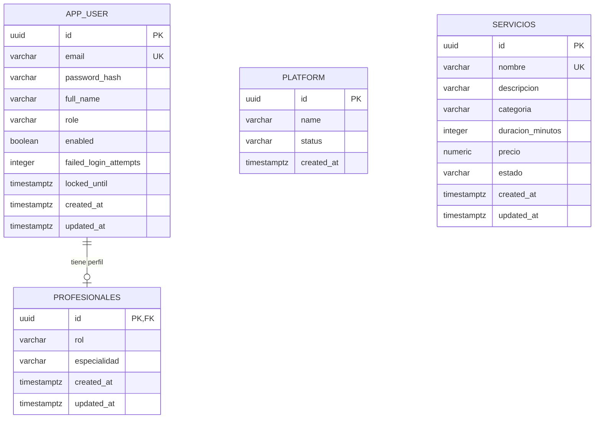

# Entregable de Bases de Datos - Sprint 1

## Caso 14: Plataforma de Reservas de Servicios
## EAV-10 CodeFactory
## Integrantes:
-  Sofía Espinal Vasquez --> sofia.evasquez@udea.edu.co
-  Elena Vargas Grisales --> elena.vargasg@udea.edu.co
-  Ana María Garzón Giraldo --> anam.garzon@udea.edu.co
-  Adelaida Rodriguez García --> adelaida.rodriguez@udea.edu.co
-  Miguel Angel Marín Otalvaro --> miguel.marin3@udea.edu.co
## Docente: Angel Rey
## Universidad de Antioquia - Facultad de Integniería

Este repositorio contiene exclusivamente el entregable de Bases de Datos del caso 14. El modelo se construyó a partir de las HU-01, HU-02, HU-03, HU-06, HU-20 y HU-22.

## Fundamentación del diseño

El diseño parte de las reglas de negocio identificadas en las historias de usuario. La información se separa en entidades con una responsabilidad concreta para evitar repetir datos y facilitar su consulta. Por esta razón, los datos de la cuenta se mantienen en `app_user`, mientras que la información específica del profesional se almacena en `profesionales`.

El modelo utiliza identificadores únicos para distinguir cada registro y relaciones mediante claves foráneas para conservar la integridad de los datos. Las reglas que afectan la operación del sistema se expresan también en la base de datos: los correos no se repiten, los roles tienen valores controlados, los precios deben ser positivos y la duración de un servicio debe estar dentro de un rango válido.

El diagrama ER representa la estructura conceptual del caso. A partir de este diseño se definieron las tablas, claves, atributos y restricciones del modelo lógico y, finalmente, las sentencias DDL de PostgreSQL incluidas en `schema.sql`.

### Alcance del Sprint 1

- Registro y control de cuentas de clientes, profesionales y administradores (HU-01 y HU-03).
- Configuración inicial de la plataforma (HU-20).
- Catálogo de servicios, precios, estado y duración estándar (HU-02 y HU-06).
- Registro del perfil de profesionales y su especialidad (HU-22).

## Entidades y relaciones

Las entidades principales son:

- `app_user`: cuenta de usuario, correo, rol, estado y datos de seguridad.
- `platform`: configuración y estado de la plataforma.
- `servicios`: catálogo de servicios, categoría, duración, precio y estado.
- `profesionales`: perfil profesional asociado a una cuenta con rol `PROFESSIONAL`.

Relaciones principales:

- Una cuenta `app_user` puede tener cero o un perfil en `profesionales`.
- Cada perfil de `profesionales` corresponde a exactamente una cuenta `app_user` con rol `PROFESSIONAL`.
- `platform` mantiene una única fila mediante un índice único sobre una expresión constante.
- `servicios` es un catálogo independiente en este sprint y controla que el nombre sea único.

## Diagrama ER

## Modelo lógico

| Tabla | Clave primaria | Claves foráneas | Reglas principales |
|---|---|---|---|
| `app_user` | `id` | — | `email` único; rol `CUSTOMER`, `PROFESSIONAL` o `ADMIN` |
| `profesionales` | `id` | `(id, rol)` → `app_user(id, role)` | `rol` debe ser `PROFESSIONAL`; especialidad obligatoria |
| `platform` | `id` | — | estado `ACTIVE` o `SUSPENDED`; una sola fila |
| `servicios` | `id` | — | nombre único; duración entre 1 y 480 minutos; precio positivo |

El modelo mantiene separadas las responsabilidades de cada entidad y utiliza restricciones de integridad para proteger las reglas de negocio en la base de datos.

## Preguntas de negocio

1. **Filtro:** ¿Cuáles son los servicios activos con duración superior a 60 minutos?
2. **Filtro:** ¿Qué profesionales tienen una especialidad determinada?
3. **Agregación:** ¿Cuántas cuentas existen por cada rol: clientes, profesionales y administradores?
4. **Join:** ¿Qué cuentas de usuario tienen un perfil profesional y cuál es su especialidad?
5. **Agregación y filtro:** ¿Cuál es el precio promedio de los servicios activos agrupados por categoría?

Estas preguntas pueden resolverse con las tablas y restricciones definidas en `schema.sql`.

## Archivos principales

- `schema.sql`: modelo físico consolidado, ejecutable en PostgreSQL o Supabase sobre una base vacía.
- `migrations/`: migraciones originales del proyecto general, conservadas como evidencia de trazabilidad.

## Ejecución

1. Crear o seleccionar una base de datos PostgreSQL vacía.
2. Ejecutar el archivo `schema.sql`.
3. Verificar que se creen las tablas `app_user`, `platform`, `servicios` y `profesionales` sin errores.
